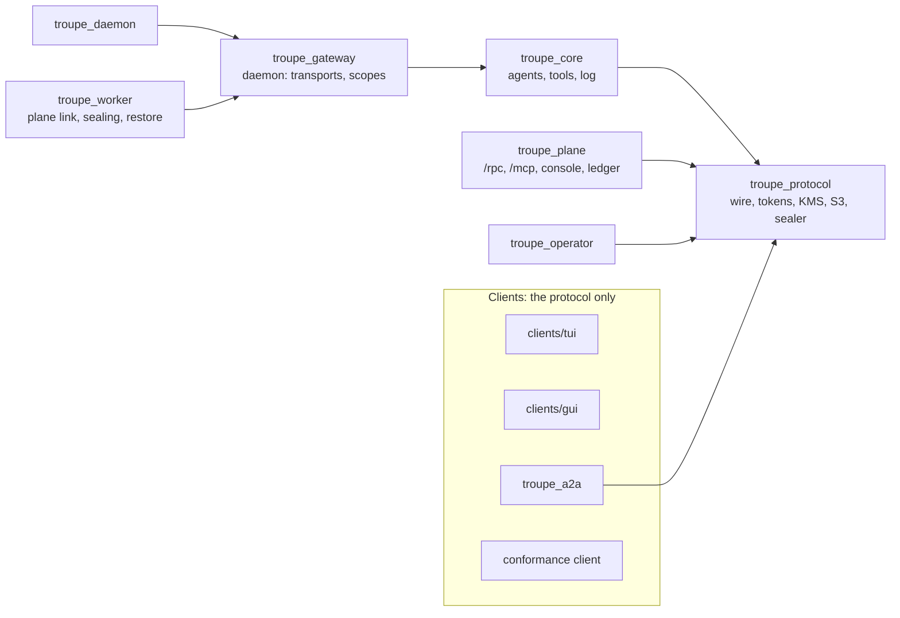
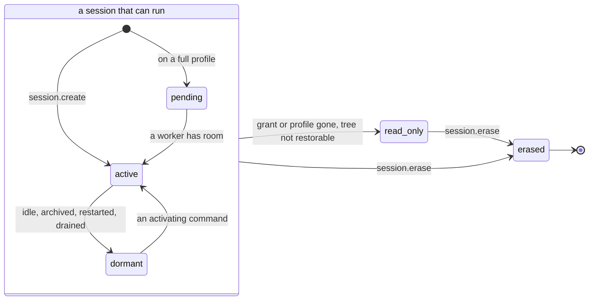
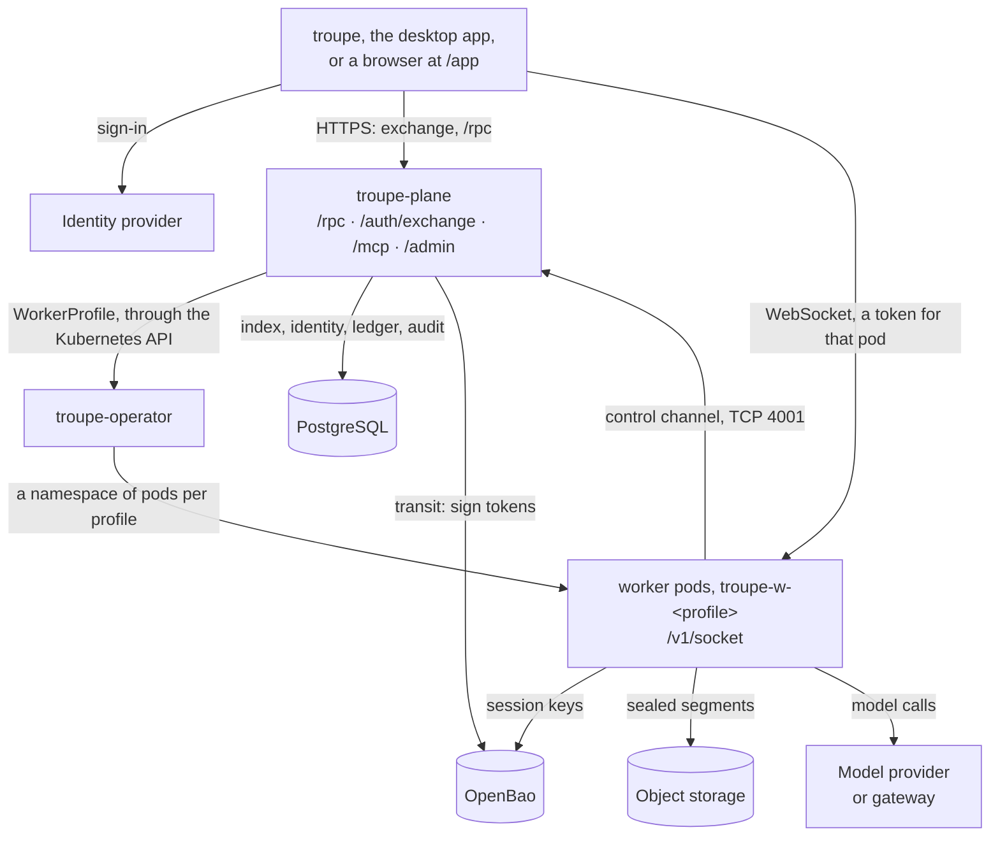
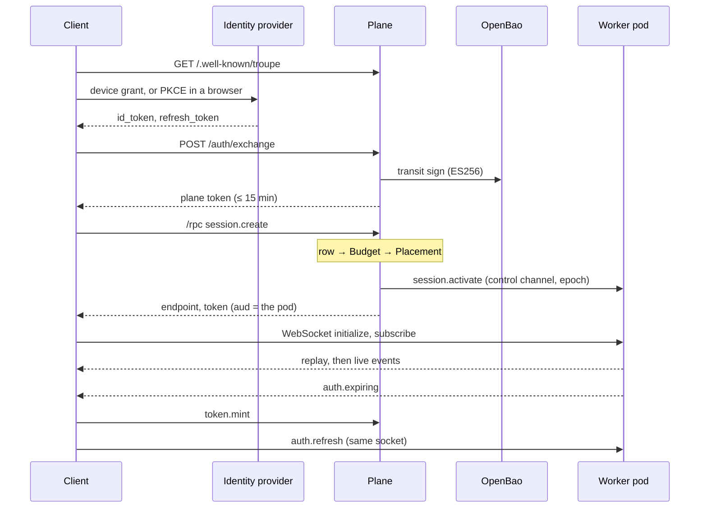

# Troupe — Architecture

Troupe runs coding agents. A **session** is an agent tree, its workspace and an
append-only, hash-chained log; a **harness** is any client that attaches to one over
[PROTOCOL.md](PROTOCOL.md). A session is owned by a daemon — `troupe-daemon` on a laptop,
or the same code on a worker pod — and the screen is a client, one of several, possibly on
another machine. One sentence organises everything below: **the log is the session.**
Every client view, every restart and every audit is a fold over it; the plane keeps an
index of logs and never their content.

This page is the design and its reasons; read it before changing `apps/troupe_core`,
`troupe_gateway`, `troupe_protocol` or a client. Where each piece is in the code, the
supervision trees and what the build enforces:
[docs/developer/architecture.md](docs/developer/architecture.md). The wire:
[PROTOCOL.md](PROTOCOL.md). Why each choice was made:
[docs/decisions/](docs/decisions/README.md), one file per decision, by number.

## 1. Shape

The build fails on any other edge
([the checks](docs/developer/architecture.md#2-boundaries)). Three rules carry the design:

- **A client gets no private access.** The A2A facade depends on `troupe_protocol` alone,
  the TUI reaches the harness only through a handful of doors, and the GUI depends on
  nothing here but the protocol. If one client can do something, a third-party client can,
  because there is no other door; the Python conformance client, written from
  `PROTOCOL.md` alone, proves it in CI.
- **The plane never depends on `troupe_core`.** It knows *that* a session exists and who
  may see it; it never runs an agent.
- **The operator depends on neither.** It holds cluster privileges and has no public
  surface, so compromising the internet-facing plane yields requests that still have to
  pass policy, not a cluster.

Remotely, a **plane** decides who may use what and where a session runs, an **operator**
turns a `WorkerProfile` into a namespace of **worker pods**, and a client talks to the pod
directly with a short-lived token (§6).

## 2. The harness

### 2.1 A session

Every agent, model request, tool run, subagent and watcher is a process; they share
nothing and handle failure by supervision. A session is a `rest_for_one` supervisor
ordered by dependency ([the tree](docs/developer/architecture.md#3-supervision-trees)):
`Session.Log` first, because everything persists through it; `Session.Shell`, a person's
own commands (Decision 813), right under it; `Approvals`, `Questions`, `ClientTools` and
the MCP sessions and servers above the agent, so a restarted agent finds the same answers
and registrations; the root `Agent.Node`; then `Watcher` and `Files`, so file watching can
never disturb a running agent; `Loop`, which runs `/loop` as turns of the root agent
(Decision 679); and `Session.Summary` last, because a projection that could restart an
agent by crashing would be worse than none. Sessions live in the core's tree, not the
daemon's, so a daemon can lose its listener and every client without an agent noticing.

### 2.2 The agent

`Agent.Server` is a `:gen_statem` over `:idle`, `:thinking`, `:acting`, `:compacting`
and `:done`. The mailbox never blocks: the model request streams back from its own task,
tool calls run concurrently in their own tasks and are reassembled in call order, and the
only synchronous calls out are to `Session.Log`, which never calls back. A model call given
up on, at `llm_timeout_ms` or on a cancel, has its task ended, which closes the request, and
is counted for the usage the provider had reported (Decision 788).

| State | Event | Next |
|---|---|---|
| idle | input | log it; budget check; start the stream → thinking (or done, budget) |
| thinking | stream done with tool calls | acting |
| thinking | text only | done (`finished`) — an implicit finish |
| thinking | prompt over the compaction threshold | compacting |
| thinking | cut at the output cap, or empty | note it and re-issue once, then done (`output_truncated`, `empty_reply`) |
| thinking | refusal, model error, timeout | done (`refused`); a root's failed request rests it idle, a subagent's is done (`llm_error`) and hands its parent what it has; a context overflow compacts once and retries |
| acting | each call | allowlist and permission check → error result, approval request, or a task |
| acting | approval, answer, tool result, child result, a task's `DOWN` | record it, and stop a child that has reported; when none are outstanding, the next turn |
| compacting | summary, model error, timeout | carry on the interrupted turn, or come to rest; without a summary the conversation is unchanged |
| done | input | a root agent that finished takes it as a new turn; one out of budget stays done |
| any | cancel | kill tasks and children, close their calls as errors → idle (`cancelled`) |

Input arriving while busy is postponed with `gen_statem`'s `:postpone`, not a hand-rolled
queue, and delivered at the turn boundary. **Replay**: an agent's state is a fold over its
own events; a crashed agent rebuilds from the log and finishes what it started, never
re-running a completed call, and the results already back go to the model with the rest.
A subagent is stopped once its parent has its result; from then on it is its log.
**Budgets** (turns, input and output tokens, working time) are checked before every
request; a child gets a share of the tokens and time its parent has left, and the turns
its parent was first given. Past `budget_warn_at` (0.8) a dimension logs one warning; at
the ceiling the agent asks the person attached, a grant buys another slice, folded from the
log (Decision 660), and `always` lifts the one limit asked about (Decision 687). **A tool
that keeps failing**, ten times in a row by default, stops the turn before the next request
and asks, whatever the budget says (Decision 687). **Compaction** is planned against the
whole prompt including cache reads, keeps the recent turns without ever cutting between a
tool call and its results, and logs the replacement conversation, large results as blobs,
so replay is faithful; a summary that fails changes nothing (Decision 774). The
summariser's request defines no tools, so the calls and results it summarises are written
out as text, and it is given up on after `llm_timeout_ms` like any model call (Decision
779). In the kept turns, a tool result over 16 KiB that the model has answered is sent from
then on as one line naming the `read_output` call that returns it; the conversation and
the log keep it whole (Decision 771).

### 2.3 Tools

A tool implements `Troupe.Tool`; authorisation happens before anything runs: an unknown
tool, one outside the definition's allowlist, or one denied is refused, and `ask` blocks
that call's task, not the agent. Reads are automatic; `write_file`, `edit_file`, `shell`,
`publish`, `import`, `web_fetch` and `onboard_write` ask by default (`onboard_write`
whatever the profile says when it writes into the config directory); MCP tools take their
server's permission. A write can never leave the workspace root; a read may also reach the
configured `read_roots`; both compare canonical paths. The runner is the one place
`rescue` is used: a raise, exit or timeout becomes an error result the model can read.
Every OS process runs under **`reaper`**, a small Zig program owned by a Port, so killing
the VM kills everything it started. A reaper that will not start is an error, not a crash:
`shell` says why, `grep` scans in the VM, the brief's `git` reads as no repository, and
`troupe doctor` fails its line. On a pod every command runs under bubblewrap, whatever the
session's mounts or bundle: `shell` and an ACP agent with the session's mount table as the
bind list, the tools' git and ripgrep with their own directory alone. A pod that cannot
start it refuses the command with a sentence, says so once in its log, and never runs it
outside (Decision 832).

Results are **bounded where they are created** (head and tail of command output, a window
of a file, the first items of a listing) with a marker naming the exact call that returns
the rest; nothing already in the conversation is rewritten, because that would invalidate
the provider's prompt cache. The prompt is ordered for the cache: tools in a fixed order, a
system prompt that stays the same through the session (the definition, the environment and
the skills), then an append-only history. The instruction files, the brief, the goal and
the task list ride in the conversation as turn context, each put again only when it
changed ([what changes in front of a prompt](docs/developer/prompt-prefix.md), Decision
863).

### 2.4 Failure matrix

| What dies | What restarts | Observed |
|---|---|---|
| a tool task | nothing; the agent gets `DOWN` or a timeout | an error result; the agent carries on |
| the model stream | nothing | an `llm_error`; a root rests, a subagent ends `llm_error` and its parent gets what it had |
| `Agent.Server` | `Agent.Node` (`one_for_all`) restarts it with its tasks and children, from the log | started-but-unfinished calls re-run (at least once), a delegation to a new child, and the old child's calls closed in the log |
| a subagent's node, past its restart limit | nothing; the parent gets `DOWN` | an error result for that delegation only |
| the root's node, past its restart limit | nothing; the session stops | `turn_ended` with `agent_failed` and what it raised, then the session is dormant (Decision 727) |
| `Watcher`, `Files`, `Loop`, `Summary` | that child and those after it | a notice; a loop carries on from its log |
| `Approvals`, `Log`, or the session past 3 restarts in 10 s | everything below it; the whole session | a restarted tree replays; a stopped one comes back dormant from its log |
| the VM | nothing | sessions come back dormant; one mid-turn is **interrupted** |
| the reaper's Port | — | the reaper kills the process tree; an error result |

An **interrupted** session makes no model call until someone activates it; its unfinished
calls, and those of any subagent it had at work (which ends `interrupted`), are closed as
errors naming the interruption. A crash loop that resumed by itself would spend money and
re-run shell commands nobody is watching. `resume_on_restart: true` opts back in.

### 2.5 Agents, skills and the brief

Agent definitions are markdown with YAML frontmatter, loaded lowest to highest: on a
person's machine the built-ins (`apps/troupe_core/priv/agents/`), the config directory and
the workspace's `.troupe/agents/`; on a pod the directories, then the built-ins, then the
profile's bundle, which wins unless the profile sets `repositoryOverridesBundle`
(Decision 826). A session has one root agent; `/<agent> prompt` opens a
**branch**, which is a session of its own with a `parent`. Skills follow the Agent Skills
convention and are disclosed progressively: one line per skill in the system prompt, a
`skill` tool that returns the body, and a read-only `skills:/` mount. The **project
brief** is facts in `.troupe/memory/facts.jsonl`, with `.troupe/memory.md` generated from
them: a prompt carries the commands and conventions, `recall` the rest, and `remember` and
a `librarian` agent write them (Decision 838). **Watch mode** acts on `AI!`, `AI?` and
`AI` comments in saved files and ignores the agent's own writes by content hash: each
trigger starts a `quick` or `answer` branch in the checkout, whose writes ask first
(Decision 844).

## 3. The wire

`PROTOCOL.md` is normative, written for someone implementing a client without this
repository: the event envelope, the subscription, the error codes and every method are
there, and the transports are in
[docs/developer/architecture.md §4](docs/developer/architecture.md#4-transports). What a
reader of this code needs is why it is shaped so:

**Events.** Each durable event's `prev_hash` chains it to the one before over canonical
JSON, so a client can verify a log without trusting whoever handed it over. Ephemerals
(`llm_delta`, `presence`, `summary_diff`, …) are never persisted and may be dropped; every
completed model message also lands as a durable `llm_response`. **`Session.Log` is the
only publisher of durable events**, publishing what it just wrote, in the shape it wrote;
otherwise a subscriber sees each fact twice in two shapes, and the difference only shows
under replay.

**Subscriptions** replay from the cursor, then follow live with no gap and no duplicate:
the connection holds the cursor, so the switch is one decision in one process.
**Backpressure** has two budgets: ephemerals are refused once a client has more than its
byte bound outstanding; durable events are never dropped for memory, and past the backlog
bound the subscription ends with `resync_required`. A `Writer` process per connection owns
the blocking send, so nothing blocks the publisher: a test stalls a socket and requires a
turn to take no more than twice its baseline, or the baseline and a quarter second,
whichever is more. **The summary projection** folds a session into a compact snapshot and
publishes diffs at most four times a second, so a fleet view need not follow twenty detail
streams.

**A command is an acknowledgement, never an effect.** `input.send` returns `accepted`;
what happened arrives as events, so every client learns it the same way. A state-changing
command's `command_id` is claimed *before* the command runs, so a retry after a disconnect
gets the same answer and never a second effect. **Scopes** (`observe` reads, `control`
steers, `admin` administers) are checked once per method.

## 4. Lifecycle, worktrees and blobs

A session is `active` (its tree running), `dormant` (stopped, serving history from its
log), `read_only` or `erased`; a remote one may also be `pending` on a full profile, or
`erasure_pending` until the plane has destroyed its key
([the states](PROTOCOL.md#session-states-dormancy-and-activation)). Nothing brings a
session back from `read_only` or `erased`:

A session goes dormant after its idle timeout: waiting on a person counts as idle, the
timeout is minutes rather than half an hour once no client is watching, and a session a
client is subscribed to by name is not put to sleep at all
([troupe-daemon](apps/troupe_daemon/README.md#how-long-it-stays-up)). The next
*activating* command restores the tree by folding the log, and asks again whatever it was
waiting on. What ended or was asked while nobody was reading a session is kept beside its
log as a mark and reported in its listing (`Sessions.Unseen`), so a client that comes back
can say so. A daemon restart brings sessions back dormant (restarting every session a
person ever had is a stampede, not a restoration), and the daemon stops itself after a
quiet period with no clients. `Sessions.Index` holds metadata only and monitors each live
tree, so a crashed session leaves the live view at once. The TUI's HQ page is a `fleet`
subscription plus one `session.list`: every approval waiting on a person, in sessions
nobody has open too.

A second live session in a workspace gets its own **git worktree** on `troupe/<slug>`, so
two agents never see each other's half-finished edits as the user's; removal refuses a
dirty tree unless forced. A tool result over 16 KiB becomes a **blob** reference fetched
with `blob.get` (byte ranges); replay resolves it back, because a restarted agent must
rebuild the conversation the model actually saw. Blobs deduplicate within a session only,
so one session's storage is never a probe for another's content.

## 5. Several harnesses, one session

Every input enters the session actor's mailbox, so **the log order is the order**; no
clock is involved. An input that arrives while the agent is busy produces a durable
`input_queued`, and `input_accepted` carries the author and the `command_id`, so a client
can show its own input as queued and reconcile against what happened. **Presence** is
ephemeral by structure: it is published through a path with no route to the log.
**Client-hosted tools** (a person's own MCP server offered to a session) need consent as a
round trip, run only on the registering connection, and survive a short disconnect by a
grace rather than failing the call; every registration durably **taints** the session, so
the other participants know something runs on somebody's machine
([PROTOCOL.md §8](PROTOCOL.md#8-client-hosted-tools)).

## 6. Remote

A client reaches the plane over HTTPS and a session's pod over a WebSocket of its own,
pods reach the plane over the control channel, and the plane is in the path of neither a
session's events nor its storage:

And the order a client does it in, from sign-in to a live session:

### 6.1 The plane

The plane decides *what* may happen and *where*; it never sees what happens, and is never
in the data path of a live session. **Identity**: it is a plain OIDC relying party;
`/auth/exchange` verifies the provider's token and mints a plane token signed through
OpenBao's transit engine, so the plane holds no key it could leak (`kid` is the RFC 7638
thumbprint, so plane and workers agree with nothing kept in step).

**The control channel.** Workers dial an internal TCP listener, never exposed through
ingress, with their projected ServiceAccount token; a `TokenReview` validates it and **the
namespace decides the profile**, so a pod can only enrol as what it is. Upward go
heartbeats, the session *index* (ids, epochs, sequence numbers, head hashes), status
columns and usage batches; downward, idempotent pushes (activate, dormant, drain, erase,
fence, JWKS and ACL changes, `config.updated`), routed to whichever replica holds the pod.
Bundles are fetched, not pushed, and so are credentials, each for a session the pod holds
alone (one it does not hold gets `not_found`), the owner read off the session row:

- `kms.assertion {session_id}` answers a short-lived JWT for *that session owner's* key
  slots, naming the owner's name at the key manager, under which the pod reads them.
- `git.credential {session_id}` answers a GitHub installation token the plane mints with
  its App for the repository on the session's row, narrowed to it and to `contents: read`,
  with the URL to clone it from; the pod's own git uses it for the clone on the session's
  first activation, and the session never sees it (Decision 885).
- With `access: "write"` it answers the fix loop's token, with what the session's worker
  profile grants (`spec.github.permissions`). The pod's own `git_push`, `pr_open`,
  `pr_comment` and `pr_checks` use it outside the sandbox to push the session's `troupe/*`
  branch through GitHub's API, open its draft pull request and read its CI, and report each
  step with `github.record {session_id, ...}`, metadata the plane checks, keeps on the
  session's row and audits (Decision 891).

**The harness API** (`/rpc`) is a fleet API: `me`, `teams.list`, `profiles.list`,
`sessions.list`, `session.get`, `session.create`, `session.open`, `token.mint`, archive,
pin, erase, `session.grant`, `session.review`, `trigger.fire`. `session.create` is a
sequence of reservations, each given back if a later one fails: row → budget (`Budget`:
the platform's, the team's and the person's ceilings) → capacity (`Placement`, or
`pending` while the profile grows) → push to the pod → token. The row comes first because
a placement is a conditional write against it, which survives the replica that made it.
`Placement`, `TeamBudget`, `PersonBudget` and `PlatformBudget` are `:global` actors (one per
profile, team and person, and one for the platform), which is why plane replicas must
cluster. `session.open read` never activates, since a session that woke because somebody
looked would never stay dormant; in `activate` mode a conditional epoch bump decides the
one caller that places it. `sessions.list` carries the status columns a pod reports
(`status`, `done_reason`, `failed_reason`, `pending_approvals`, `pending_questions`,
`cost_micros`), so a review queue is a listing and not a replay. The plane pushes nothing
to clients: `/rpc` is request and answer.

**Tokens for pods.** `aud` is **the pod's worker id**: an audience naming the profile would
make pods interchangeable, which is what a leaked token wants. Workers verify offline
against a cached JWKS, warn with `auth.expiring` two minutes out and accept `auth.refresh`
on the open socket. The role in a token is a claim about the moment it was minted; access
is checked again on every command against the ACL mirror the plane pushes, so a revoked
collaborator is refused on their next command, and a narrowed one runs it with the
narrower role's scopes.

### 6.2 A worker pod

**One process per active session, none per dormant one.** Everything a dormant session is
lives in object storage, and activation is the only way back, which makes relocation and
losing a volume the same operation. **Sealing**: a sealer per active session uploads an
AES-256-GCM segment at every turn's end and at least every 60 s; that interval is the whole
durability promise. Upload, *then* report: a segment the plane knows of but storage lacks
would let a rebuild claim history it cannot produce. The same `Troupe.Sessions.Sealer`
runs on a pod and in a daemon, so either can restore the other's sessions.

**Dormancy** is: record, seal, stop the tree, archive and upload the workspace, report,
then erase the local copy. **Epochs** are minted by the plane alone; a pod whose epoch has
passed refuses to activate (checked against the plaintext manifest before decrypting), and
a fenced running session stops and discards its cache. **Draining** (scale-down, a new
image, an admin's drain) stops placement in the database and waits for running turns up to
the grace period, and the plane checks its own index before agreeing the pod is empty. A
scale-down lowers the count only past pods drained that way; a pod stopped by anything else
drains itself on SIGTERM. **Disk pressure** evicts caches, least recently used, never an
active workspace. **Erasure** is driven by the plane, which destroys the session's key
**first**, with the metadata `delete` its policy has for this and nothing on the data path,
so nothing under the prefix decrypts (not old object versions, not backups) and the
deletion after it is tidiness. A team session's pod is told at once: it stops the session,
drops its copy and deletes the objects, and an offline pod applies pending erasures when it
enrols. A private session has no pod: its objects go when the owner's daemon next connects
and says it has stopped (Decisions 756 and 811). A key the key manager refused leaves the session
`erasure_pending`, and the plane tries it again every five minutes (Decision 811).

### 6.3 The operator

| Resource | Scope | Written by | Says |
|---|---|---|---|
| `TroupePolicy` | cluster | a cluster admin, never the plane | what any profile may ask for |
| `WorkerProfile` | `troupe-system` | the plane | what one pool of workers should be |
| `TeamVolume` | `troupe-system` | — | that a team has shared storage |

`spec.teams` is a projection of the plane's grants, not a second source of truth.
**Policy is checked twice, on purpose**: a `ValidatingAdmissionPolicy` gives a person an
error the moment they ask; the operator's check still holds when admission is down or the
policy tightened afterwards. `Resources.for_profile/3` is a **pure function** from profile,
policy and settings to manifests, so naming, addressing and egress are tested without a
cluster, and the reconciler only applies and compares: level-triggered and idempotent,
pruning by label (owner references cannot cross namespaces), led by a `Lease`. A pod gets a
*projected* token with audience `troupe-plane`, never the ServiceAccount's own, so it
cannot be replayed against the API server. StatefulSets are `OnDelete` because a pod holds
live sessions; the operator replaces a pod on an older revision once the plane, which alone
knows when a pod holds nothing, has drained it and recorded that on the profile.

**Egress** is default-deny: DNS, the plane's control port, OpenBao, object storage, the
model, the profile's MCP servers and git hosts. Plain NetworkPolicy cannot name a host, so
without Cilium the external ones are a wide rule on 443 and 80, with the installation's own
OpenBao and object storage and the profile's own endpoints beside it on the ports they
name, recorded rather than hidden. With Cilium the operator writes the `toFQDNs` rule the
profile asked for (with the installation's own OpenBao and object storage in it when they
are outside the cluster, a `toCIDR` of one address for a host given as an address), a DNS
rule through Cilium's proxy so it can learn addresses, and no wide rule beside it, since
Cilium admits the union of every policy on a pod. In either mode a profile's own endpoint
at a loopback or link-local address is admitted by no rule, and is refused where it is set
up and reported on the profile. Which mode a profile has is its `EgressByHostname`
condition, and the plane claims egress by hostname only where that condition says so.

### 6.4 The admin surface

Every administrative action goes through `Troupe.Plane.Admin`; the console, the `admin.*`
JSON-RPC methods and the MCP server at `/mcp` are renderings of it. A LiveView may call
nothing else in the plane, and a parity test asserts every function has an API method and
an MCP tool, so nothing the console can do is out of reach of a program or a model. For a
model the method's summary and typed arguments *are* the interface, and a destructive tool
takes a `confirm` argument repeating the identifier. `/mcp` also accepts the identity
provider's own token, because an MCP client does OAuth against the provider and has no
step at which to get a plane token; Troupe is a resource server, never an authorization
server.

`platform_admin` is membership of an identity-provider group, never granted in Troupe,
because a role Troupe could grant would be a way to escalate inside it. `team_admin` is
assigned per team. Neither can read session content: no admin method returns events.
Break-glass is a separate, audited console login for a lock-out, with no more access.

Profiles are applied **directly** (server-side apply of the whole resource) or held **by
GitOps**: a repository holds the `WorkerProfile`, `TroupePolicy` and `Trigger` resources
and something else applies them; the plane never writes git. A cluster singleton lists the
profiles, then the triggers, every fifteen seconds and makes the plane's rows follow them:
a resource that fails the plane's own checks is reported rather than used, admin writes are
refused as `managed_by_gitops`, and the console is locked. The plane then writes only what
no repository could know, a profile's `replicas`, `teams` and `mcpServers`, under its own
field manager (Decision 736). A trigger's key, runs and revisions stay the plane's, and
running one by hand is not a write (Decision 737). **Settings** override the deployment and
never replace it: a stored row wins, reset deletes it, and a `platform_admin_group` cannot
be saved until a check passes for the value in the field. **Audit** is a row per change
with the actor and a diff keyed by path (`spec.llm.model`), computed by the same function
the editor previews with.

## 7. What a profile carries, and work nobody starts

**Bundles** (agent definitions, skills and MCP servers) are one versioned, hashed,
immutable document per version, validated at publish by the plane and again by the worker
after checking the hash. A worker keeps every version under `bundles/<hash>/`, so a session
pinned to a version reads that version however many have been published since; retiring it
moves pinned sessions on at their next activation. The bundle is the MCP servers' one
source of truth: pods discover tools on `config.updated` and apply its allowlist, and the
plane writes the servers into the `WorkerProfile` so the operator opens egress and injects
each credential from `troupe-mcp-<name>`.

A **service principal** (`svc:<team>/<name>`) is a credential a team owns, not a member,
which keeps membership the identity provider's business; it exchanges its secret for the
same plane token a person gets and has no admin role. `session.create` takes what an
unattended session needs: a first `prompt` the plane passes on and never stores; `terms`
(a budget slice, `max_turns`, `wall_clock_seconds` and `approvals: wait | deny`, with no
`auto`: a trigger that needs none runs a profile whose bundle sets those tools to `auto`,
an administrator's versioned act); and an `origin`. A **trigger** is a row the plane stores
and something fires: `trigger.fire` renders the template and creates the session *as the
trigger's principal* through the same call a person's client makes, and the same
idempotency key returns the same run. Cron triggers fire from a `:global` scheduler in the
plane; from outside, a trigger is fired at `POST /trigger/<id>` with a key of its own that
fires that trigger and nothing else, or by an executor that calls `trigger.fire`.

**The A2A facade** maps the A2A protocol onto sessions: a task is a session, a message is
`input.send`, a stream is a subscription, `input-required` is an approval answered by a
structured decision, artifacts are `published` events and blobs served with the caller's
own token. It holds no database and no credential of its own ([docs/a2a.md](docs/a2a.md)).

## 8. What a session cost

**Cost is a fold over the log, not a second thing to write down.** Every `llm_response`
carries the model and, behind a gateway, its request id and cost, read from response
headers (`x-litellm-call-id`, `x-litellm-response-cost`). **Troupe keeps no price table
of its own**: the gateway prices a call where it can, and a reconciliation compares the
ledger with it by request id. A streamed response carries no cost header, so the harness
prices such a call itself, from the provider's catalog or else from `models.prices` (a
profile's `llm.prices`), and marks it `priced_locally` (Decision 689). A call nobody priced
is recorded at zero cost and said once a session in the log; one with no request id gets a
synthetic id `seq:<session>:<n>` that the reconciliation counts as unmetered.

On a pod, `Session.Log` hands each event to a usage fold that writes an ETS row from the
log's own process (no mailbox on the turn path), drained in batches over the control
channel. The plane answers each batch with `usage_seq`, the highest sequence now recorded;
the pod drops what it held up to it and, after a restart, re-folds its log from it. The
watermark only moves forward and is deliberately not fenced on the epoch, because a fenced
pod still made the calls it reports. The ledger's uniqueness on request id turns any
overlap into duplicates rather than charges. There is no rollup pipeline: the raw table,
an index and a one-minute cache answer every question at this volume.

## 9. Provenance and entitlements

A trigger run names a **revision**: the trigger document frozen and addressed by the hash
of its canonical form, `source` inside the hash and `enabled` outside it. Editing a
template does not rewrite what old runs ran, and the session a run made carries the hash
in its origin. A grant may carry **entitlements**: which of a bundle's agents, skills and
MCP servers come with it; no rows is no restriction, `deny` wins. The bundle is never
altered: the plane resolves a set at create, `profiles.list` shows the union across a
person's teams, the session gets its one team's set, and the pod filters agents after the
whole search order is merged, skills after the definition's own list, and each session's
MCP tool list; the pod still discovers once.

## 10. What belongs to a person

Key paths take an owner: `troupe/teams/<team>/sessions/<id>` for a pod, scoped to its
granted teams, and `troupe/people/<name>/…` for a person, which no pod rule mentions. The
name is the person's at the key manager, a column on their row: their subject when they
were first known, left alone when a switched `subject_claim` moves their subject, so
nothing under it has to move (Decision 755). Whatever reaches the key manager for a person
takes the name from the plane's answer, never from a subject. A bundle's MCP server may use
`credential_mode: person` (the session owner's credential, fixed at activation), kept at
`troupe/people/<name>/mcp/<slot>`, which only that person can read: the pod exchanges a
plane-signed assertion at OpenBao's JWT auth for a token templated on the name, and a
person connects a server with `me.connections.grant`, which takes no value and returns
none. Where nobody has connected, the tool answers `not_connected` rather than a 401 the
model would retry.

A **private session** runs on a person's machine and never touches a pod. The daemon seals
it with the same sealer under the person's key subtree; the plane holds a row
(`kind: private`, no team, no profile) and nothing else. Bytes cross through presigned URLs
for one key under the session's prefix (`session.presign`), listing through
`session.objects`, and the **epoch** fences two devices waking the same session:
`session.register` with `claim: true` bumps it conditionally, and the loser learns at its
next seal, when the plane will not sign a write naming its epoch, so it writes nothing more
under the prefix and keeps its local log read-only (Decision 800).

The daemon's plane token comes from the client that signed in (`identity.link`), which
hands it over again when it renews it and when the daemon has restarted; it is held in
memory only. Each link that carries one is also when the daemon asks what was erased while
it was away (`session.erasures`), drops its sealer and its copy of each, and says so
(`session.erased`), which is when the plane deletes the objects; and when it carries on
sealing each private session it has no sealer for, from the row's `last_seq` at the epoch
it held, or from the first event for one the plane has never heard of (Decision 764).
Signing out at the client takes the token back (`identity.sign_out`), and the daemon stops
every sealer until the next link carries them on (Decision 766).

## 11. Reading old logs

Every durable event carries a schema version. `Troupe.Log.Upcast` brings an old one up a
step at a time and may add or rename, never drop. The hash chain is not recomputed:
`prev_hash` covers the bytes as written. Recorded fixture logs, under
`test/fixtures/logs/<version>/` (0.2.0 and 0.3.0; no release since has recorded its own),
come with the fold each produces, hashed over a *witness* of the event types replay acts
on; a test reads the replay clauses from the source and asserts the witness covers them.
Snapshots are cache: one this build cannot trust is discarded for a full replay, which
produces the same fold. Protocol schemas are add-only within version 1, enforced by
`mix troupe.schema.diff`.
