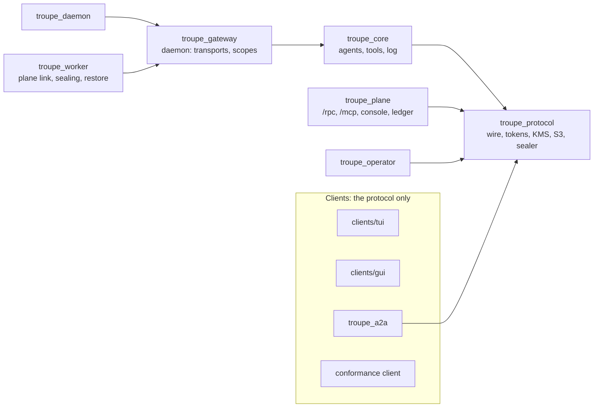

# Troupe — Architecture

Troupe runs coding agents. A **session** is an agent tree, its workspace and an
append-only, hash-chained log; a **harness** is any client that attaches to one over
[PROTOCOL.md](PROTOCOL.md). A session is owned by a daemon — `troupe-daemon` on a laptop,
or the same code on a worker pod — and the screen is a client, one of several, possibly on
another machine. One sentence organises everything below: **the log is the session.**
Every client view, every restart and every audit is a fold over it; the plane keeps an
index of logs and never their content.

This page is the map: the parts, where each lives, how they talk and where state is kept.
The harness and its clients, which run the same on a laptop and on a pod, are
[the harness and its clients](docs/developer/architecture.md); the
plane, the pods, the operator and what a session carries remotely are
[the plane and the pods](docs/developer/architecture-remote.md). The wire:
[PROTOCOL.md](PROTOCOL.md). Why each choice was made:
[docs/decisions/](docs/decisions/README.md), one file per decision, by number.

## 1. Shape

The build fails on any other edge ([the checks](#3-boundaries)). Three rules carry the
design:

- **A client gets no private access.** The A2A facade depends on `troupe_protocol` alone,
  the TUI reaches the harness only through a handful of doors, and the GUI depends on
  nothing here but the protocol. If one client can do something, a third-party client can,
  because there is no other door; the Python conformance client, written from
  `PROTOCOL.md` alone, proves it in CI.
- **The plane never depends on `troupe_core`.** It knows *that* a session exists and who
  may see it; it never runs an agent.
- **The operator depends on neither.** It holds cluster privileges and has no public
  surface, so compromising the internet-facing plane yields requests that still have to
  pass policy, not a cluster.

Remotely, a **plane** decides who may use what and where a session runs, an **operator**
turns a `WorkerProfile` into a namespace of **worker pods**, and a client talks to the pod
directly with a short-lived token ([the plane and the pods](docs/developer/architecture-remote.md#1-remote)).

## 2. Where each lives

Eight Mix projects under `apps/`. The root `mix.exs` releases four of them as container
images; `apps/troupe_daemon` releases the fifth from its own directory, one build per
platform, so a Windows or macOS runner compiles the harness and nothing of the platform.

| App | What | Umbrella deps |
|---|---|---|
| `troupe_protocol` | the wire (JSON-RPC, events, schemas, errors, tokens) and the contracts plane and workers share: OpenBao, S3, MCP clients, the sealer, `TroupePolicy` and `WorkerProfile` parsing | none |
| `troupe_core` | sessions: agents, tools, providers, the log, the index | protocol |
| `troupe_gateway` | the daemon: transports, connections, subscriptions, scopes, idempotency | core, protocol |
| `troupe_daemon` | the harness and a command line, released as `troupe-daemon` | core, gateway, protocol |
| `troupe_worker` | a worker pod: plane link, sealing, restore, auth, bundles | core, gateway, protocol (plane in tests) |
| `troupe_plane` | the control plane: identity, placement, budgets, `/rpc`, `/mcp`, the console | protocol |
| `troupe_operator` | the Kubernetes reconciler (Bonny) | protocol |
| `troupe_a2a` | the A2A facade | protocol |

| Release | Applications | Packaging |
|---|---|---|
| `troupe_operator`, `troupe_plane`, `troupe_a2a` | protocol + the app | image, `docker/Dockerfile` |
| `troupe_worker` | core, protocol, gateway, worker; `Troupe.Release.build_reapers/1` builds the two Linux `reaper`s | image |
| `troupe_daemon` | the harness | a tarball per platform, `apps/troupe_daemon` |

The clients are outside the umbrella: `clients/tui` is its own Mix project depending on
the three harness apps by path, and `clients/gui` a pnpm workspace depending on nothing
here but the protocol. One `VERSION` versions everything ([build.md §4](docs/developer/build.md#4-version)).

## 3. Boundaries

`mix troupe.boundaries` reads the `imports` chunk of every compiled beam and fails on:

| Rule | Reason in the task |
|---|---|
| `troupe_a2a` calls only `troupe_protocol` | "the A2A facade is a protocol client and gets no private access" |
| `troupe_plane` never calls `troupe_core` or `troupe_gateway` | "the plane does not run agents" |
| `troupe_operator` never calls core, gateway or plane | "the operator holds cluster privileges and has no public surface" |
| `troupe_daemon` calls only protocol, core and gateway | "the daemon is the harness and a command line, and nothing of the platform" |

Every cross-app call must also be declared `in_umbrella` in the caller's `mix.exs`.
Test-only reverse dependencies pass because only `lib/` beams are read. The TUI has its own
check, `mix troupe.xref` in `clients/tui`: UI modules call only `Troupe.Client` and pure
data modules, and the whole TUI reaches the harness only through the doors in
`@harness_allowed` (`clients/tui/lib/mix/tasks/troupe.xref.ex`: `Troupe.Protocol.Client`,
`Troupe.Config`, `Troupe.Paths`, `Troupe.Reaper` and a dozen more; Decision 673). The
Python conformance client in `apps/troupe_gateway/test/conformance/` checks that the
protocol alone is enough.

## 4. How they talk

One JSON-RPC framing, three transports: a Unix socket (NDJSON, mode 0600, authenticated
by file permissions), loopback TCP (NDJSON, a random token in a user-only file; chosen when
*trying* `AF_UNIX` fails, since whether it works is a property of the OTP build), and
WebSocket (one message per text frame): a pod's `/v1/socket` with a session token whose
audience is the pod, and the daemon's loopback WebSocket published in `daemon.json`, the
one a browser can use. `TROUPE_DAEMON_SOCKET=tcp` forces loopback TCP; any other
value is a socket path. `Troupe.Protocol.Daemon` finds or starts the local daemon —
`TROUPE_DAEMON_COMMAND`, else `troupe-daemon` on the `PATH` — serialising concurrent
starts with an `O_EXCL` lock.

## 5. Where state lives

A person's config and state directories, and what is in each, are
[where your files are](docs/user/configuration/files.md); `<state>` below is the state
directory.

| State | Where |
|---|---|
| A local session's log | `<state>/sessions/<workspace-hash>/<session-id>/events.jsonl`, blobs beside it |
| The project brief | `<repository root>/.troupe/memory/facts.jsonl`, one fact per line, and its generated view `.troupe/memory.md`; one process per repository writes both (Decision 838) |
| Daemon discovery | `$XDG_RUNTIME_DIR/troupe/daemon.sock` (`~/.troupe/run/troupe/` without it), or `daemon.json` (TCP port and token, loopback WebSocket) beside it, or in `%LOCALAPPDATA%\troupe` (`Troupe.Protocol.Endpoint`) |
| A pod's working copies | the `data` volume at `/var/lib/troupe` |
| Sealed sessions | S3 `sessions/<id>/…`, written by workers and by daemons for private sessions |
| Session keys | OpenBao KV v2, `troupe/teams/<team>/…` for pods, `troupe/people/<name>/…` for a person, under the name the plane keeps for them there (Decision 755) |
| Index, identity, ledger, audit, settings, triggers | PostgreSQL, never session content |
| `WorkerProfile` (written), `TroupePolicy` (read), `TokenReview` | the plane, through the Kubernetes API |
| Everything in `troupe-w-<profile>` | the operator, server-side apply as `troupe-operator` |
