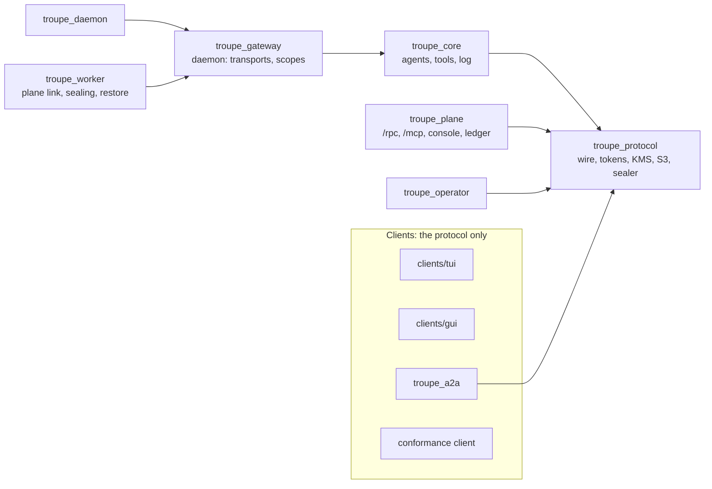
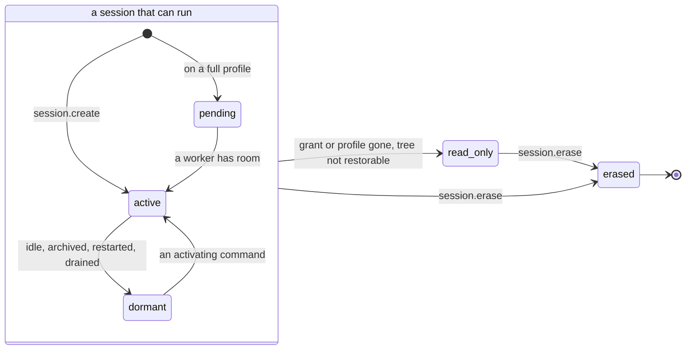

# Troupe — Architecture

Troupe runs coding agents. A **session** is an agent tree, its workspace and an
append-only, hash-chained log; a **harness** is any client that attaches to one over
[PROTOCOL.md](PROTOCOL.md). A session is owned by a daemon — `troupe-daemon` on a laptop,
or the same code on a worker pod — and the screen is a client, one of several, possibly on
another machine. One sentence organises everything below: **the log is the session.**
Every client view, every restart and every audit is a fold over it; the plane keeps an
index of logs and never their content.

This page is the design and its reasons; read it before changing `apps/troupe_core`,
`troupe_gateway`, `troupe_protocol` or a client. Where each piece is in the code, the
supervision trees and what the build enforces:
[docs/developer/architecture.md](docs/developer/architecture.md). The wire:
[PROTOCOL.md](PROTOCOL.md). Why each choice was made:
[docs/decisions/](docs/decisions/README.md), one file per decision, by number.

## 1. Shape

The build fails on any other edge
([the checks](docs/developer/architecture.md#2-boundaries)). Three rules carry the design:

- **A client gets no private access.** The A2A facade depends on `troupe_protocol` alone,
  the TUI reaches the harness only through a handful of doors, and the GUI depends on
  nothing here but the protocol. If one client can do something, a third-party client can,
  because there is no other door; the Python conformance client, written from
  `PROTOCOL.md` alone, proves it in CI.
- **The plane never depends on `troupe_core`.** It knows *that* a session exists and who
  may see it; it never runs an agent.
- **The operator depends on neither.** It holds cluster privileges and has no public
  surface, so compromising the internet-facing plane yields requests that still have to
  pass policy, not a cluster.

Remotely, a **plane** decides who may use what and where a session runs, an **operator**
turns a `WorkerProfile` into a namespace of **worker pods**, and a client talks to the pod
directly with a short-lived token ([§6](docs/developer/architecture-remote.md#6-remote)).

## 2. The harness

### 2.1 A session

Every agent, model request, tool run, subagent and watcher is a process; they share
nothing and handle failure by supervision. A session is a `rest_for_one` supervisor
ordered by dependency ([the tree](docs/developer/architecture.md#3-supervision-trees)):
`Session.Log` first, because everything persists through it; `Session.Shell`, a person's
own commands (Decision 813), right under it; `Approvals`, `Questions`, `ClientTools` and
the MCP sessions and servers above the agent, so a restarted agent finds the same answers
and registrations; the root `Agent.Node`; then `Watcher` and `Files`, so file watching can
never disturb a running agent; `Loop`, which runs `/loop` as turns of the root agent
(Decision 679); and `Session.Summary` last, because a projection that could restart an
agent by crashing would be worse than none. Sessions live in the core's tree, not the
daemon's, so a daemon can lose its listener and every client without an agent noticing.

### 2.2 The agent

`Agent.Server` is a `:gen_statem` over `:idle`, `:thinking`, `:acting`, `:compacting`
and `:done`. The mailbox never blocks: the model request streams back from its own task,
tool calls run concurrently in their own tasks and are reassembled in call order, and the
only synchronous calls out are to `Session.Log`, which never calls back. A model call given
up on, at `llm_timeout_ms` or on a cancel, has its task ended, which closes the request, and
is counted for the usage the provider had reported (Decision 788).

| State | Event | Next |
|---|---|---|
| idle | input | log it; budget check; start the stream → thinking (or done, budget) |
| thinking | stream done with tool calls | acting |
| thinking | text only | done (`finished`) — an implicit finish |
| thinking | prompt over the compaction threshold | compacting |
| thinking | cut at the output cap, or empty | note it and re-issue once, then done (`output_truncated`, `empty_reply`) |
| thinking | refusal, model error, timeout | done (`refused`); a root's failed request rests it idle, a subagent's is done (`llm_error`) and hands its parent what it has; a context overflow compacts once and retries |
| acting | each call | allowlist and permission check → error result, approval request, or a task |
| acting | approval, answer, tool result, child result, a task's `DOWN` | record it, and stop a child that has reported; when none are outstanding, the next turn |
| compacting | summary, model error, timeout | carry on the interrupted turn, or come to rest; without a summary the conversation is unchanged |
| done | input | a root agent that finished takes it as a new turn; one out of budget stays done |
| any | cancel | kill tasks and children, close their calls as errors → idle (`cancelled`) |

Input arriving while busy is postponed with `gen_statem`'s `:postpone`, not a hand-rolled
queue, and delivered at the turn boundary. **Replay**: an agent's state is a fold over its
own events; a crashed agent rebuilds from the log and finishes what it started, never
re-running a completed call, and the results already back go to the model with the rest.
A subagent is stopped once its parent has its result; from then on it is its log.
**Budgets** (turns, input and output tokens, working time) are checked before every
request; a child gets a share of the tokens and time its parent has left, and the turns
its parent was first given. Past `budget_warn_at` (0.8) a dimension logs one warning; at
the ceiling the agent asks the person attached, a grant buys another slice, folded from the
log (Decision 660), and `always` lifts the one limit asked about (Decision 687). **A tool
that keeps failing**, ten times in a row by default, stops the turn before the next request
and asks, whatever the budget says (Decision 687). **Compaction** is planned against the
whole prompt including cache reads, keeps the recent turns without ever cutting between a
tool call and its results, and logs the replacement conversation, large results as blobs,
so replay is faithful; a summary that fails changes nothing (Decision 774). The
summariser's request defines no tools, so the calls and results it summarises are written
out as text, and it is given up on after `llm_timeout_ms` like any model call (Decision
779). In the kept turns, a tool result over 16 KiB that the model has answered is sent from
then on as one line naming the `read_output` call that returns it; the conversation and
the log keep it whole (Decision 771).

### 2.3 Tools

A tool implements `Troupe.Tool`; authorisation happens before anything runs: an unknown
tool, one outside the definition's allowlist, or one denied is refused, and `ask` blocks
that call's task, not the agent. Reads are automatic; `write_file`, `edit_file`, `shell`,
`publish`, `import`, `web_fetch` and `onboard_write` ask by default (`onboard_write`
whatever the profile says when it writes into the config directory); MCP tools take their
server's permission. A write can never leave the workspace root; a read may also reach the
configured `read_roots`; both compare canonical paths. The runner is the one place
`rescue` is used: a raise, exit or timeout becomes an error result the model can read.
Every OS process runs under **`reaper`**, a small Zig program owned by a Port, so killing
the VM kills everything it started. A reaper that will not start is an error, not a crash:
`shell` says why, `grep` scans in the VM, the brief's `git` reads as no repository, and
`troupe doctor` fails its line. On a pod every command runs under bubblewrap, whatever the
session's mounts or bundle: `shell` and an ACP agent with the session's mount table as the
bind list, the tools' git and ripgrep with their own directory alone. A pod that cannot
start it refuses the command with a sentence, says so once in its log, and never runs it
outside (Decision 832).

Results are **bounded where they are created** (head and tail of command output, a window
of a file, the first items of a listing) with a marker naming the exact call that returns
the rest; nothing already in the conversation is rewritten, because that would invalidate
the provider's prompt cache. The prompt is ordered for the cache: tools in a fixed order, a
system prompt that stays the same through the session (the definition, the environment and
the skills), then an append-only history. The instruction files, the brief, the goal and
the task list ride in the conversation as turn context, each put again only when it
changed ([what changes in front of a prompt](docs/developer/prompt-prefix.md), Decision
863).

### 2.4 Failure matrix

| What dies | What restarts | Observed |
|---|---|---|
| a tool task | nothing; the agent gets `DOWN` or a timeout | an error result; the agent carries on |
| the model stream | nothing | an `llm_error`; a root rests, a subagent ends `llm_error` and its parent gets what it had |
| `Agent.Server` | `Agent.Node` (`one_for_all`) restarts it with its tasks and children, from the log | started-but-unfinished calls re-run (at least once), a delegation to a new child, and the old child's calls closed in the log |
| a subagent's node, past its restart limit | nothing; the parent gets `DOWN` | an error result for that delegation only |
| the root's node, past its restart limit | nothing; the session stops | `turn_ended` with `agent_failed` and what it raised, then the session is dormant (Decision 727) |
| `Watcher`, `Files`, `Loop`, `Summary` | that child and those after it | a notice; a loop carries on from its log |
| `Approvals`, `Log`, or the session past 3 restarts in 10 s | everything below it; the whole session | a restarted tree replays; a stopped one comes back dormant from its log |
| the VM | nothing | sessions come back dormant; one mid-turn is **interrupted** |
| the reaper's Port | — | the reaper kills the process tree; an error result |

An **interrupted** session makes no model call until someone activates it; its unfinished
calls, and those of any subagent it had at work (which ends `interrupted`), are closed as
errors naming the interruption. A crash loop that resumed by itself would spend money and
re-run shell commands nobody is watching. `resume_on_restart: true` opts back in.

### 2.5 Agents, skills and the brief

Agent definitions are markdown with YAML frontmatter, loaded lowest to highest: on a
person's machine the built-ins (`apps/troupe_core/priv/agents/`), the config directory and
the workspace's `.troupe/agents/`; on a pod the directories, then the built-ins, then the
profile's bundle, which wins unless the profile sets `repositoryOverridesBundle`
(Decision 826). A session has one root agent; `/<agent> prompt` opens a
**branch**, which is a session of its own with a `parent`. Skills follow the Agent Skills
convention and are disclosed progressively: one line per skill in the system prompt, a
`skill` tool that returns the body, and a read-only `skills:/` mount. The **project
brief** is facts in `.troupe/memory/facts.jsonl`, with `.troupe/memory.md` generated from
them: a prompt carries the commands and conventions, `recall` the rest, and `remember` and
a `librarian` agent write them (Decision 838). **Watch mode** acts on `AI!`, `AI?` and
`AI` comments in saved files and ignores the agent's own writes by content hash: each
trigger starts a `quick` or `answer` branch in the checkout, whose writes ask first
(Decision 844).

## 3. The wire

`PROTOCOL.md` is normative, written for someone implementing a client without this
repository: the event envelope, the subscription, the error codes and every method are
there, and the transports are in
[docs/developer/architecture.md §4](docs/developer/architecture.md#4-transports). What a
reader of this code needs is why it is shaped so:

**Events.** Each durable event's `prev_hash` chains it to the one before over canonical
JSON, so a client can verify a log without trusting whoever handed it over. Ephemerals
(`llm_delta`, `presence`, `summary_diff`, …) are never persisted and may be dropped; every
completed model message also lands as a durable `llm_response`. **`Session.Log` is the
only publisher of durable events**, publishing what it just wrote, in the shape it wrote;
otherwise a subscriber sees each fact twice in two shapes, and the difference only shows
under replay.

**Subscriptions** replay from the cursor, then follow live with no gap and no duplicate:
the connection holds the cursor, so the switch is one decision in one process.
**Backpressure** has two budgets: ephemerals are refused once a client has more than its
byte bound outstanding; durable events are never dropped for memory, and past the backlog
bound the subscription ends with `resync_required`. A `Writer` process per connection owns
the blocking send, so nothing blocks the publisher: a test stalls a socket and requires a
turn to take no more than twice its baseline, or the baseline and a quarter second,
whichever is more. **The summary projection** folds a session into a compact snapshot and
publishes diffs at most four times a second, so a fleet view need not follow twenty detail
streams.

**A command is an acknowledgement, never an effect.** `input.send` returns `accepted`;
what happened arrives as events, so every client learns it the same way. A state-changing
command's `command_id` is claimed *before* the command runs, so a retry after a disconnect
gets the same answer and never a second effect. **Scopes** (`observe` reads, `control`
steers, `admin` administers) are checked once per method.

## 4. Lifecycle, worktrees and blobs

A session is `active` (its tree running), `dormant` (stopped, serving history from its
log), `read_only` or `erased`; a remote one may also be `pending` on a full profile, or
`erasure_pending` until the plane has destroyed its key
([the states](PROTOCOL.md#session-states-dormancy-and-activation)). Nothing brings a
session back from `read_only` or `erased`:

A session goes dormant after its idle timeout: waiting on a person counts as idle, the
timeout is minutes rather than half an hour once no client is watching, and a session a
client is subscribed to by name is not put to sleep at all
([troupe-daemon](apps/troupe_daemon/README.md#how-long-it-stays-up)). The next
*activating* command restores the tree by folding the log, and asks again whatever it was
waiting on. What ended or was asked while nobody was reading a session is kept beside its
log as a mark and reported in its listing (`Sessions.Unseen`), so a client that comes back
can say so. A daemon restart brings sessions back dormant (restarting every session a
person ever had is a stampede, not a restoration), and the daemon stops itself after a
quiet period with no clients. `Sessions.Index` holds metadata only and monitors each live
tree, so a crashed session leaves the live view at once. The TUI's HQ page is a `fleet`
subscription plus one `session.list`: every approval waiting on a person, in sessions
nobody has open too.

A second live session in a workspace gets its own **git worktree** on `troupe/<slug>`, so
two agents never see each other's half-finished edits as the user's; removal refuses a
dirty tree unless forced. A tool result over 16 KiB becomes a **blob** reference fetched
with `blob.get` (byte ranges); replay resolves it back, because a restarted agent must
rebuild the conversation the model actually saw. Blobs deduplicate within a session only,
so one session's storage is never a probe for another's content.

## 5. Several harnesses, one session

Every input enters the session actor's mailbox, so **the log order is the order**; no
clock is involved. An input that arrives while the agent is busy produces a durable
`input_queued`, and `input_accepted` carries the author and the `command_id`, so a client
can show its own input as queued and reconcile against what happened. **Presence** is
ephemeral by structure: it is published through a path with no route to the log.
**Client-hosted tools** (a person's own MCP server offered to a session) need consent as a
round trip, run only on the registering connection, and survive a short disconnect by a
grace rather than failing the call; every registration durably **taints** the session, so
the other participants know something runs on somebody's machine
([PROTOCOL.md §8](PROTOCOL.md#8-client-hosted-tools)).

## 6. Remote

How a client reaches the plane and a session's pod, the order from sign-in to a live
session, and the four parts of a deployment, in
[the plane, the pods and what a session carries](docs/developer/architecture-remote.md#6-remote):

- [6.1 The plane](docs/developer/architecture-remote.md#61-the-plane): identity, the control
  channel, the harness API, a laptop's session offered for steering, tokens for pods.
- [6.2 A worker pod](docs/developer/architecture-remote.md#62-a-worker-pod): one process per
  active session, sealing, dormancy, epochs, draining, erasure.
- [6.3 The operator](docs/developer/architecture-remote.md#63-the-operator): the three
  resources, policy checked twice, egress.
- [6.4 The admin surface](docs/developer/architecture-remote.md#64-the-admin-surface): one
  module behind the console, the API and `/mcp`; roles, GitOps, settings and audit.

## 7. What a profile carries, and work nobody starts

Bundles, service principals, triggers and the A2A facade:
[§7 there](docs/developer/architecture-remote.md#7-what-a-profile-carries-and-work-nobody-starts).

## 8. What a session cost

Cost is a fold over the log, with no price table of its own, and how a pod's usage
reaches the ledger: [§8 there](docs/developer/architecture-remote.md#8-what-a-session-cost).

## 9. Provenance and entitlements

A trigger run names a revision, and a grant may narrow what a bundle brings:
[§9 there](docs/developer/architecture-remote.md#9-provenance-and-entitlements).

## 10. What belongs to a person

Key paths by owner, a person's own credentials, private sessions and the daemon's plane
token: [§10 there](docs/developer/architecture-remote.md#10-what-belongs-to-a-person).

## 11. Reading old logs

Every durable event carries a schema version. `Troupe.Log.Upcast` brings an old one up a
step at a time and may add or rename, never drop. The hash chain is not recomputed:
`prev_hash` covers the bytes as written. Recorded fixture logs, under
`test/fixtures/logs/<version>/` (0.2.0 and 0.3.0; no release since has recorded its own),
come with the fold each produces, hashed over a *witness* of the event types replay acts
on; a test reads the replay clauses from the source and asserts the witness covers them.
Snapshots are cache: one this build cannot trust is discarded for a full replay, which
produces the same fold. Protocol schemas are add-only within version 1, enforced by
`mix troupe.schema.diff`.
