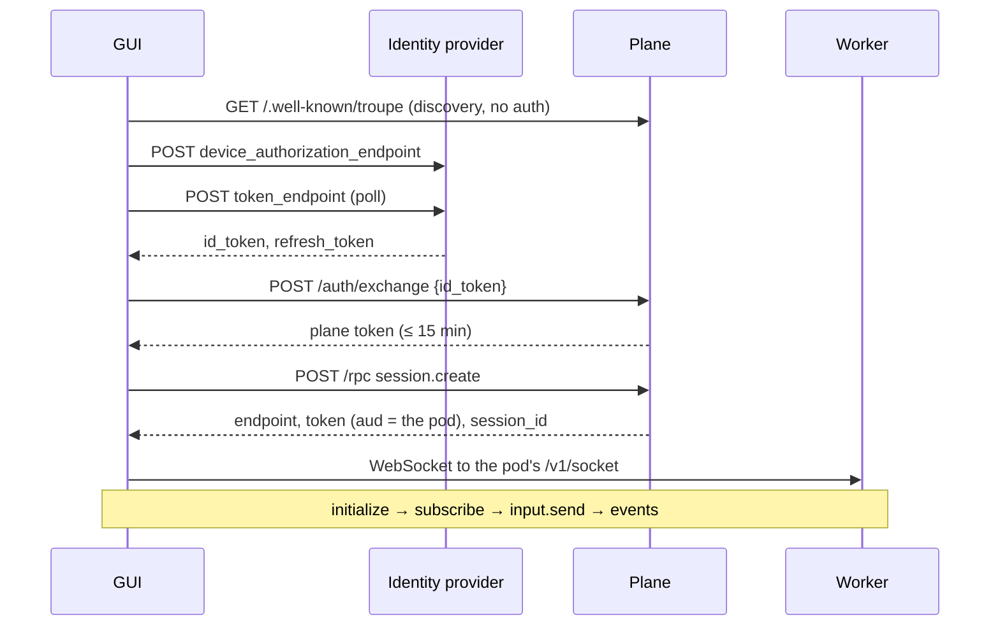

# The graphical client

The graphical client for [Troupe](../../README.md) (`troupe-gui`, as its package and image
are named), and `@troupe/client`, the TypeScript protocol client the desktop app and the
throughput bench stand on. Living beside the platform gets it no private door into the
server: it speaks [`PROTOCOL.md`](../../PROTOCOL.md) over a WebSocket, as the TUI and the
Python reference client do.

Four packages in one pnpm workspace:

| package | what |
| --- | --- |
| `packages/client` | `@troupe/client` — the protocol in TypeScript. JSON-RPC 2.0 over WebSocket, the plane's HTTP surface (discovery, device-grant login, `/auth/exchange`, `/rpc`), and a `SessionView` that folds events and turns "send a prompt, wait for the turn" into a promise. Runs in a browser or Node; no dependencies. |
| `packages/bench` | `@troupe/bench` — the throughput test. N clients, one session each, K prompts each, every milestone timed. |
| `apps/desktop` | The GUI. Vite + React, on the design system in [`docs/design/`](docs/design/DESIGN.md). Signs in through the plane (or, in local-only mode, talks to the daemon on this computer and nothing else), shows one list of every session — the team's on worker pods and the person's own on the daemon in front of them — streams a session, answers approvals, and reviews what ran unattended. The bundle is plain web; the Tauri shell in [`src-tauri/`](apps/desktop/src-tauri) loads it unchanged and adds the things a browser cannot do — see [`src/shell.ts`](apps/desktop/src/shell.ts). |
| `apps/console` | `@troupe/console` — the administrative console, an app of its own ([docs/admin/console.md](../../docs/admin/console.md)). Vite + React on `@troupe/client`'s `admin.ts` and the same design tokens, and nothing of the desktop app's, nor the desktop app anything of its: a test reads both and fails on an import either way. Signs in with the plane's own sign-in and calls its `admin.*` methods and `me`, nothing else; served by the chart at `/console` on the plane's host, from the same image as the GUI (root Decision 886). |

## The path a client takes



The plane is never in the data path of a live session. Only the last hop is a socket;
everything before it is ordinary HTTP. `PlaneClient` covers every step up to the socket,
and `TroupeConnection` + `SessionView` the socket.

Things the client library knows that the protocol document does not say loudly:

* One JSON-RPC message per text frame, no trailing newline, binary frames close the socket.
* `initialize` must be the first message; the token goes in `params.auth.token` because a
  browser cannot set the `Authorization` header on an upgrade.
* The acknowledgement of `input.send` is not the effect. The effect is the durable
  `input_accepted` event carrying your `command_id`.
* A text-only answer ends the turn with an *ephemeral* `agent_state` of `idle` and no
  durable marker. Ephemerals may be dropped under load, so `SessionView.prompt` also
  polls `session.get` once the model has answered with `end_turn`.
* Command ids are made unique across clients with a random prefix, not just per connection.
* `auth.expiring` arrives two minutes before the pod token expires; renew with `token.mint`
  on the plane and `auth.refresh` on the same socket — never by reconnecting.
* A session can move to another pod, and its old pod then answers `not_found` with
  `data.kind` of `session`. Ask the plane's `session.open` where it is, on every reconnection
  and after that answer (`SessionAttachment` does both).

## Run it

```sh
pnpm install
pnpm build                       # pnpm -r build: @troupe/client, then the desktop bundle (tsc, vite)
pnpm dev:local                   # the GUI on this computer's daemon alone: no plane, no sign-in
```

### On this computer alone — the default way to develop

```sh
pnpm dev:local                   # then open the address Vite prints
pnpm dev:local --port 5185       # anything after the name goes to Vite
```

`pnpm dev:local` starts a daemon and the GUI in *local-only* mode against it: no plane,
no identity provider, no key, and nothing sent anywhere. The app opens on the launcher,
with no sign-in; start a session in the `demo` directory it prints, and the answers come
from the daemon's scripted `fake` provider reading `script.json` beside it in
`TROUPE_DEV_HOME`: one step per model call, per agent under `routes` (`Troupe.LLM.Fake`),
from the top for each new session.

It needs `troupe-daemon` installed (`install.ps1`/`install.sh` at the repository root, or
`scripts/install-local.ps1` from a checkout); `TROUPE_DAEMON_BIN` names another. The daemon
it starts is a second instance of that install, with its own state, config and
`daemon.json` under `TROUPE_DEV_HOME` (a directory in the system's temp by default), so it
never touches the daemon you work with, its sessions or its keys. It stops ten minutes
after the last client leaves; the next `pnpm dev:local` starts it again.

The *Local only* switch is on *This computer*. Turning it off puts the sign-in screen back,
with "Use this computer only" as its third door; a stored plane sign-in survives the round
trip.

### Against a fake deployment, with nothing else installed

```sh
pnpm fake                        # an identity provider, a worker and a plane, on loopback
pnpm dev                         # then sign in to the plane URL `pnpm fake` printed
```

`pnpm fake` starts the identity provider, plane and worker the test suite runs against,
seeded with four sessions, among them one stopped on an approval and one stopped by
`tool_failures`. Signing in needs no clicking: a browser is sent to the provider and
straight back as Alice, and a device code approves itself. Four prompt prefixes drive the
scripted agent: `approve: <command>` asks for an approval, `big: <label>` returns a tool
result too large to inline, `quiet: …` answers without streaming, and `show: …` puts
`notes.md` on the session's scratchpad. The plane answers `me.client_defaults` with an
organisation gateway, so *Use organisation defaults* on the models panel has something to
fill in; `NO_CLIENT_DEFAULTS=1 pnpm fake` is an organisation that has set nothing.

It also starts the tests' fake daemon and prints the address to open the app at
(`#daemon=<port>:<token>`). There:

* a new session in `/home/ada/repo` starts as a repository with Claude Code's and Cursor's
  files does: it asks to onboard them, each as a diff under Review, then to have the
  librarian rewrite a brief an older survey wrote. `/memory` opens the backstage's Memory
  pane on the repository's facts, one of each status, with Refresh and Forget the brief as
  the terminal's `/memory refresh` and `/memory forget`;
* a new session in `/home/ada/project`, which has no brief, starts the librarian by itself
  and says so in the transcript;
* the session in `/home/ada/parser` shows a turn's frames
  ([docs/design/frames.md](../../docs/design/frames.md)): its working one strip above an
  answer with a table, a nested list, fenced code, a diff and a csv. Anything sent there
  plays the same turn live, its reasoning streaming and the curtain line under it, so
  `/detail` and a click on the strip have a running turn to work on.

### The console, against a fake plane

```sh
pnpm console:fake                # an identity provider and a plane with its admin methods, on loopback
pnpm console                     # then open http://localhost:5174 and sign in to the plane it printed
```

The same identity provider and plane, with the administrative half the console's tests
run against (`packages/client/test/support/admin.ts`): three teams, a version policy, an
organisation's defaults and enforced set, and an audit every change lands in. The provider
signs the browser straight back in as a platform admin; `CONSOLE_AS=bob` is a team admin,
`CONSOLE_AS=carol` somebody who administers nothing. Every admin answer is held a quarter
of a second so the loading states show; `HOLD_MS=0` answers at once.

### Your own daemon beside the fake plane

The fake deployment's daemon runs no agent, and `pnpm dev:local` has no plane. To see both
halves of the one list (a team session and a session on this computer, with questions, the
budget question, streamed reasoning and the harness's notes), run the real `troupe-daemon`
with its scripted model, as its own smoke tests and the TUI's client tests do:

```sh
# 1. the daemon: install it (install.sh / install.ps1 from a release; -y for the
#    daemon alone, --gui for this app too) or build it in ../../apps/troupe_daemon with
#    `MIX_ENV=prod mix release troupe_daemon`
# 2. a workspace whose model is the script. The provider, the script and auto_approve
#    are read from a workspace's own file only once the user's config.yaml trusts it,
#    which the last line of this step does; troupe config validate says so until then.
mkdir -p ~/demo/.troupe && cat > ~/demo/.troupe/config.yaml <<'YAML'
provider: fake
fake_script: /home/you/demo/.troupe/script.json   # absolute: resolved by the daemon, not the workspace
models: {default: fake-model}
auto_approve: true
max_turns: 2          # so the budget question appears on the third turn
YAML
cat > ~/demo/.troupe/script.json <<'JSON'
{"routes": {"root": [
  {"reasoning": "Let me look first.", "text": "One question before I change anything.",
   "tools": [{"name": "ask_user", "input": {"question": "Formal or casual?",
             "options": [{"label": "formal"}, {"label": "casual"}]}}]},
  {"text": "Noted."},
  {"tools": [{"name": "finish", "input": {"summary": "done", "ran": "none", "passed": "none",
                                          "unverified": "none", "needs": "none"}}]}
]}}
JSON
troupe-daemon config trust ~/demo
# 3. the usual two, each in its own terminal (pnpm fake runs until stopped), and sign in
#    to the fake plane
pnpm fake
pnpm dev
# 4. start the daemon and hand the page its port and token
troupe-daemon open --url http://localhost:5173/
```

Then *New session* in `~/demo`. The desktop application skips step 4: it reads
`daemon.json` itself, starts `troupe-daemon run` when nothing is listening, and reads it
again before dialling a daemon that went away, since a restarted one serves a new port with
a new token. A browser build dials where it was told and keeps that for a reload or a new
tab; after a restart, `troupe-daemon open` tells it again. A script step (`Troupe.LLM.Fake`)
is `text`, `tools`, `reasoning`, `stop` (`max_tokens` / `refusal`) or `error`.

### Against a real deployment

Three allowlists, not one:

* the plane's `TROUPE_CORS_ORIGINS` must contain the GUI's origin — `http://localhost:5173`
  in development, or the origin it is served from;
* the chart's `operator.workerAllowedOrigins` must contain it too, for a team session's
  socket to a worker pod: a pod admits no page whose origin is not listed. The GUI the
  chart serves and the desktop app are admitted without it;
* **the identity provider must allow that origin too.** The device grant is spoken to the
  provider directly, so a deployment that adds the GUI to the plane and stops there signs
  in as far as discovery and then fails. In Dex this is the public client's
  `redirectURIs`/allowed origins; in Authentik the application's allowed origins.

A browser cannot tell a page *why* a cross-origin request failed, so the GUI names both
possibilities and the origin to add rather than guess.

## Testing

```sh
pnpm test                        # the client's tests and the app's, below
pnpm first-token                 # sign-in to first streamed token, against the fakes
pnpm tokens:check                # fails if the generated design tokens are stale
pnpm icons:check                 # fails if the desktop app's icons are not the mask
```

The client's tests cover stage 1 and 2's done items, PKCE, the fold, the fleet store and
model settings, on Node's runner. The app's, in `apps/desktop/test`, render the app in
jsdom under Vitest against the fake daemon on a real socket and record every request the
page makes: in local-only mode, with a plane sign-in stored and every screen visited, the
daemon is the only thing it talks to. They also walk the third door, switch local-only off
and on without losing the stored sign-in, and fall back to this computer when the plane
does not answer.

`packages/client/test/support` is a deployment that implements the protocol rather than
imitating a screen: a real WebSocket, a hash-chained log, replay from a cursor with a
closed boundary, a device grant that answers `slow_down` and rotates its refresh token,
token expiry with `auth.expiring` and `auth.refresh`, blob range caps, and approvals
where the first answer wins. `browserFetch` puts a browser's same-origin policy in front
of Node's `fetch`, so the CORS behaviour is tested here rather than assumed. `daemon.ts`
is the other half: one token for the whole machine, several sessions live on one socket,
directories it owns, an actor that changes when an identity is linked, and model settings
it keeps without ever answering with the key.

What none of it proves is the *server's* half. [docs/e2e.md](docs/e2e.md) has the suites
that run against a real plane and a real worker; CI runs the plane suite against a plane
built from the same commit.

## Shipping it

The GUI is one static bundle behind nginx: a protocol client, so what ships is HTML, CSS
and JavaScript, and every call goes from the browser to the plane or a worker. Nothing in
the image holds a secret or needs telling anything at runtime.

It ships with the platform, not as a release of its own. The image is built with this
directory as the Docker context; the only other thing it reads is the repository's
LICENSE, NOTICE, THIRD-PARTY-NOTICES.txt and PROTOCOL.md (whose error table the build tests
the client against), as the `licences` context:

```sh
docker build --build-context licences=../.. --build-arg TROUPE_GUI_BASE=app -t troupe-gui .
```

and the platform's chart, [`charts/troupe`](../../charts/troupe), serves it: its `gui:`
block, on by default, is a Deployment, a Service, a NetworkPolicy and an Ingress at
`gui.basePath` on the plane's own host (root Decision 670). The image carries the console's
bundle too, at `/console/`, and the chart's `console:` block gives it an Ingress of its own at
`console.basePath` (`TROUPE_CONSOLE_BASE` when the image is built, `console` by default). There is no chart and no Helm
release of the GUI's own; a team that uses another client sets `gui.enabled: false` and
points `plane.appUrl` at it.

CI is the root [`ci.yml`](../../.github/workflows/ci.yml): its `gui` job typechecks, tests
and builds this workspace, `gui-e2e` runs the client against a plane built from the same
commit, and `images` builds and pushes `troupe-gui` beside the server images on a push to
`main` that changed a server app, `clients/gui` or the chart, once `ci-ok` has passed,
tagged `sha-<short>`. A release builds this image again, at its version, with the rest
([ci.md](../../docs/developer/ci.md#release-the-full-suite-then-everything)); rolling it
onto a cluster is the deployment's own business.

### Where it is mounted

`TROUPE_GUI_BASE` is baked in at build time, because Vite writes it into every asset URL:
an image built for `/app/` cannot be served at `/`. The chart's `gui.basePath` must match
it (CI builds with the repository variable `GUI_BASE`, default `app`); the Ingress strips
the prefix so the container stays ignorant of where it is.

**Serving the GUI at a path on the plane's own host is worth preferring**, and it is the
shape the chart gives it: no CORS allowlist to keep in step, no second DNS record or
certificate, and a sign-in whose redirect URI is the address people already have. The
plane's Ingress owns `/`, the GUI's `/app`, and nginx routes the more specific path. The
GUI's Ingress uses the plane's `tlsSecretName` and asks cert-manager for nothing (two
Ingresses on one host share one certificate), and the chart refuses `gui.basePath: /`,
because the root of that host is the plane's.

### Its Content-Security-Policy

nginx sends the app's policy, and the headers beside it, on every response, from
[`docker/headers.conf`](docker/headers.conf) (root Decision 803): scripts from the bundle
only, no inline script and no `eval`, nothing may frame it, and connections to its own
origin, the daemon at `127.0.0.1` on any port, and other hosts over TLS only. The app
keeps the local daemon's token in `localStorage`, so this is what keeps any other script
off its origin; the plane sends its own policy on everything else on the host. Whatever
serves the bundle anywhere else should send the same header.

### Check the digest, not the tag

A tag already in the registry plus `imagePullPolicy: IfNotPresent` means the node keeps
the image it has, and since the Deployment's spec did not change, no pod is restarted:
`helm upgrade` reports success and the old code carries on serving. It happened on a real
cluster. Read every pod's running digest after an upgrade
([routine-tasks.md](../../docs/admin/routine-tasks.md#upgrade)); CI never publishes a
floating tag.

## Design

[`docs/design/DESIGN.md`](docs/design/DESIGN.md) is the system and its rules,
[`docs/design/themes/`](docs/design/themes/THEMES.md) is it as data (four themes from one
token contract, each in light and dark, and where a person's choice is kept),
`afterglow.dc.html` is the design the app is drawn to (#52), and `example.dc.html` every
surface of the design before it. A change that gives the reserved colour a second job,
builds structure from cards rather than hairlines, or shows a status by colour alone is a
bug ([DESIGN.md §12](docs/design/DESIGN.md#12-what-a-developer-must-not-do)).

`apps/desktop/src/tokens.css` and `apps/desktop/src/mark.ts` are **generated** from
`docs/design/themes/*.tokens.json` by `pnpm tokens` (which refuses a theme whose token
names differ) and committed; do not edit them. So is everything in
`apps/desktop/src-tauri/icons/` (the app's icon on every platform, the installer's images
and the disk image's background), by `pnpm icons`, from `mark.ts` and Signal's dark
values; `scripts/icons.ts` says which and why.

## The throughput test

A worker with no plane, no object store and the scripted `fake` model measures a
*client*: the path from a frame to the session actor and back, without a model's latency.
It runs as one Docker container, dialled with tokens the bench mints itself
(`packages/bench/src/devToken.ts`); [docs/bench.md](docs/bench.md) has the key pair, the
`docker run`, the run and its variables.

Each client opens its own socket and its own session (five clients on one session would
measure the model's serialisation, not the transport) and sends its prompts one at a
time. Every prompt is timed from just before `input.send` to the ack, `input_accepted`,
the first `llm_delta`, the durable `llm_response` and the end of the turn. Results are
printed and written as JSON under `packages/bench/bench-results/`.

Measured on 2026-09-12, Docker Desktop on a Windows laptop, worker image built from
commit `2f85e39` of the platform's former repository, fake model:

| clients × prompts | connect+init p50 | input_accepted p50 / p95 | llm_response p50 / p95 | turn end p50 / p95 | turns/s |
| --- | --- | --- | --- | --- | --- |
| 5 × 20 | 13 ms | 0.6 / 1.3 ms | 1.1 / 3.7 ms | 1.3 / 9.1 ms | ~900 |
| 20 × 10 | 44 ms | 0.9 / 2.1 ms | 3.7 / 5.6 ms | 4.1 / 7.2 ms | ~1000 |

All 300 turns completed; the fake model answers instantly, so these numbers are the
harness and the transport, not a model. `BENCH_MODE=plane` runs the same test through a
plane; that path has not been measured, since it needs Postgres, OpenBao and an identity
provider behind it.

## Layout of the client package

```
packages/client/src
  types.ts        protocol shapes (open objects: v1 is additive)
  connection.ts   TroupeConnection — open, initialize, call, events, tool.invoke, auth.refresh
  plane.ts        PlaneClient — discovery, device grant, exchange, the harness API over /rpc
  auth.ts         AuthSession — signing in, and staying signed in. The only persisted secret
  session.ts      SessionView — subscribe, the replay cursor, commands, blobs, files, prompt()
  attach.ts       SessionAttachment — one session's socket kept alive across expiry and drops
  transcript.ts   the fold: events → a transcript. Pure, and the reason two clients agree
  fleet.ts        FleetStore — one list from however many sources there are
  daemon.ts       DaemonClient — the machine in front of you: one socket, many sessions
  onboard.ts      StartQuestions — a start's onboarding, then the brief, over `onboard.plan`
  config.ts       model settings: the shapes, and what an empty field in the form means
  admin.ts        the plane's administrative surface, one call per method
  agents.ts       agents as the daemon reads, checks, writes and switches them
  memory.ts       a repository's memory, as a client shows it and a start keeps it up
  offer.ts        your own servers, offered to a session on a pod
  pkce.ts         the authorization code flow with PKCE, the sign-in a browser can do
  scratch.ts      the session's scratchpad
  setup.ts        the first run's questions, as the daemon asks them
  update.ts       what a plane says about this client's version

apps/desktop/src
  App.tsx         the shell: sign in or this computer only, then the launcher or the list
  mode.ts         whether this app talks to a plane at all
  shell.ts        the whole contract between the web bundle and a desktop shell
  shell-tauri.ts  the desktop shell's half of it, the only module that imports Tauri
  shared.ts       the preferences that follow a person between clients, kept by the daemon
  updates.ts      the desktop app keeping itself current
  frames.ts       a transcript's frames, worked out as data (docs/design/frames.md)
  hooks.ts        React bindings over the stores above; no protocol knowledge
  notify.ts       a notification when a session finishes or asks while nobody is looking,
                  and its answer: a click, or the window back soon after, opens the session
  theme.ts        which theme and mode this person reads in; the only place that knows
  tokens.css      generated from docs/design/themes/*.tokens.json — do not edit
  mark.ts         the mask's geometry, generated from the same files — do not edit
  views/          SignIn · Launcher · Sessions · StartSession · Session · Approval · Question
                  Onboard (a start's onboarding and brief questions) · Approvals · Files · Review
                  CommandPalette · Local (Models · Servers) · LocalControls · Appearance
                  Agents · AgentEditor · AgentSwitch · Frames · Goal · Memory · Offer · Update
                  Onboarding/     the first run's questions, one screen per step, over `setup.get`
                                  and `setup.answer`; FirstRun leads with the theme, SetupScreen
                                  is the rail's Setup entry
```

What the code settles (the fold, the cursor, sign-in, storage, the two modes, the fleet)
is in [docs/developer/architecture.md §7](../../docs/developer/architecture.md#7-the-gui-clientsgui).
