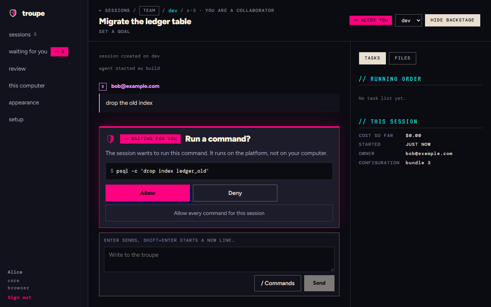
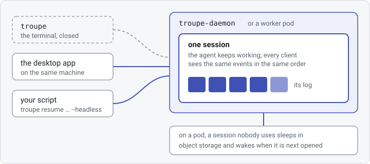
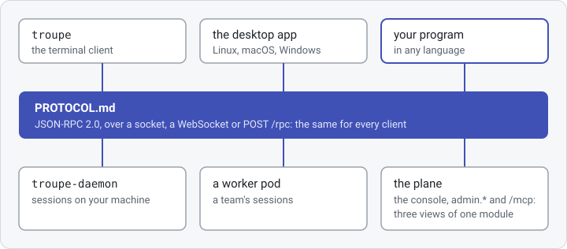
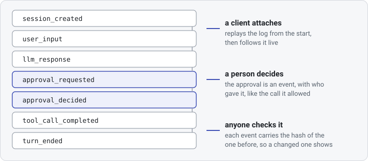

# Troupe

<div class="tx-hero" markdown>

Troupe is an open-source harness for coding agents, on your own machine and on your team's
Kubernetes cluster. An agent reads your code, changes it and runs commands, asking first,
in a session that outlives the window you started it from.

On Linux or macOS:

<!-- quick-start: sh -->
```sh
curl -fsSLO https://github.com/it-minds/troupe/releases/latest/download/install.sh
sh install.sh --tui
```

On Windows, in PowerShell:

<!-- quick-start: powershell -->
```powershell
irm https://github.com/it-minds/troupe/releases/latest/download/install.ps1 -OutFile install.ps1
powershell -ExecutionPolicy Bypass -File .\install.ps1 -Tui
```

Then, in a new terminal, `troupe config` sets up a model and `troupe` in a project
directory opens a session. Troupe is a beta, Apache-2.0, and has nothing to sign up for.

</div>

<!-- recording: docs/assets/seam.mp4, from gate issue #786 row 4. Until the file exists the
     figure shows its poster, the still below; then a <video controls poster> takes the img's place. -->
<figure class="tx-recording">
  
  <figcaption>A team's session on a plane, in the desktop app, stopped to ask before it runs
  a command, with what it has cost so far.</figcaption>
</figure>

## What is different

<div class="tx-feature" markdown>

<div markdown>

### A session outlives its client

A session lives in the [daemon](glossary.md#daemon) on your machine, or on a
[worker](glossary.md#worker) pod of your team's plane, not in the terminal you started it
from. Close the terminal and the agent carries on; open the session again from the
desktop app or a script and you see what it did. On a pod, a session nobody uses sleeps in
object storage and wakes when it is next opened
([the harness](../ARCHITECTURE.md#2-the-harness), [a worker pod](developer/architecture-remote.md#62-a-worker-pod)).

</div>

[](assets/session-outlives-client.svg)

</div>

<div class="tx-feature" markdown>

<div markdown>

### One protocol, and no other way in

The terminal client and the desktop app speak only [the protocol](../PROTOCOL.md), which
is complete on its own, with JSON Schema for every message: a program of yours gets
everything they get. On a plane, the console, the `admin.*` methods and the MCP server are
three renderings of one module, and a test holds them level, so nothing the console does is
out of a script's or an agent's reach ([the admin surface](developer/architecture-remote.md#64-the-admin-surface)).

</div>

[](assets/one-protocol.svg)

</div>

<div class="tx-feature" markdown>

<div markdown>

### Every session is a log you can replay and audit

What a session did is its log: every prompt, model reply, approval and tool call, in order,
each event carrying the hash of the one before. A client that attaches replays it and then
follows it live, two clients see the same thing in the same order, and a changed event
breaks the chain ([events](../PROTOCOL.md#4-events)). What a session cost is read from the
same log.

</div>

[](assets/event-log.svg)

</div>

## Who it is for

An engineer who wants an agent's work to carry on when the terminal closes, and to follow
it from the terminal, the desktop app or a script at once. A team that wants agents on
shared infrastructure, with sign-in from its identity provider, budgets per team and per
person, and an audit trail. Anyone writing a client of their own, against
[one documented protocol](../PROTOCOL.md) that the bundled clients use too.
[Why Troupe](why-troupe.md) says more, and when you do not need it.

## Try it in ten minutes

The [quick start](quick-start.md): the install above, a key for a model, a first session,
what it cost and a cap on the next one, and what a plane would add. CI runs its commands
against the latest release every night.

## Where to go

| | |
|---|---|
| **Install** | The [quick start](quick-start.md), then [the first run](user/README.md#first-run): `troupe setup`, or the desktop app's first screens. |
| **Run it for a team** | [Installing a plane](admin/installing.md), from an empty cluster to a first team in the console, then the rest of the [administrator's guide](admin/README.md). |
| **The documentation** | By reader, below; the words it uses are in the [glossary](glossary.md). |
| **The repository** | [it-minds/troupe](https://github.com/it-minds/troupe): the code, the [releases](https://github.com/it-minds/troupe/releases) and the issues. |
## The documentation, by reader

Four kinds of reader come here, and each has a track and an order to read it in. The
tracks do not lean on each other: an operator never needs the contributor's pages, and a
client author needs nothing but the protocol. The site at
<https://it-minds.github.io/troupe/> is built from this directory by `mkdocs.yml`.

### Using Troupe

You run agents, on your own machine or on your team's plane.

1. [user/](user/README.md) — what a session is, the first run in five steps, the ways in,
   and the words you will meet.
2. [The terminal client](../clients/tui/README.md) — installing `troupe`, a model
   provider, using it, and sessions on a plane; [in VS Code](user/vscode.md), opened in
   a terminal tab at the workspace folder.
3. [Command reference](user/cli-reference.md) (generated) — every command line `troupe`
   takes, and every command you type inside a session.
4. [Configuration](user/configuration.md) — every key in `config.yaml`, and which file
   set it; [models](user/models.md), [agents and commands](user/agents.md),
   [MCP servers and skills](user/mcp.md), [instruction files](user/instructions.md) and
   [memory](user/memory.md) each have a page.
5. [The daemon](../apps/troupe_daemon/README.md) — `troupe-daemon`, what runs your
   sessions, and how long it stays up.
6. [The desktop app](../clients/gui/docs/install.md) — installing the builds while they
   are unsigned.

### Running a deployment

You operate the platform: the chart, the services beside it, and the teams, profiles,
bundles and triggers on top.

1. [admin/](admin/README.md) — the tree, and nine things to know before the first
   `helm install`.
2. [Installing](admin/installing.md) — from a cluster with nothing on it to a first team
   in the console. The shape of what you are installing is
   [ARCHITECTURE.md §6](../ARCHITECTURE.md#6-remote).
3. [Roles and permissions](admin/roles-and-permissions.md) and
   [integrations](admin/integrations.md) — identity, what each surface accepts, and what
   the identity provider, OpenBao, PostgreSQL and object storage must provide;
   [Authentik](admin/authentik.md) step by step.
4. [Profiles and policy](admin/profiles-and-policy.md) (and [from a repository](admin/gitops.md)), then
   [bundles, triggers and budgets](admin/bundles-and-triggers.md).
5. Day two: [monitoring](admin/monitoring.md), [backup and restore](admin/backup-restore.md),
   [routine tasks](admin/routine-tasks.md).
6. For reference: [configuration](admin/configuration.md) (every variable, value,
   setting, Secret and port), [what Troupe dials](egress-allowlist.md) (generated), the
   [A2A facade](a2a.md), and [a worker on your own machine](admin/single-machine.md).

### Changing the code

You contribute to Troupe itself.

1. [CONTRIBUTING.md](../CONTRIBUTING.md) — before you start, the sign-off, a first
   contribution.
2. [A tour](developer/tour.md) — where things live, running the suite, adding a tool,
   and how the event log works.
3. [ARCHITECTURE.md](../ARCHITECTURE.md) — the design, and why the log is the session.
4. [developer/](developer/README.md) — setup, testing, conventions, the build, CI and
   releases, and the code's own map.
5. [decisions/](decisions/README.md) — the judgment calls that still hold, a file each,
   by number, each naming the code it governs.

### Writing a client

You write a program that talks to a daemon or a worker pod, in any language.

1. [PROTOCOL.md](../PROTOCOL.md) — the whole surface, normative, written to need no
   checkout of this repository.
2. [`protocol/schema/v1/`](../protocol/schema/v1/) — JSON Schema for every command and
   event, add-only within version 1.
3. [The conformance client](../apps/troupe_gateway/test/conformance/) — a client in
   Python's standard library that CI runs against a real daemon.
4. [The graphical client](../clients/gui/README.md) — `@troupe/client`, a TypeScript
   implementation, and what it learned that the protocol does not say loudly.

### Also here

[third-party-licences.md](third-party-licences.md) (generated): what Troupe depends on,
under which licences. [design/admin/](design/admin/DESIGN.md): the console's design.
`history/`: records kept as they were written, not instruction -
[the admin surface as it was built](history/admin-surface.md) and
[the console's plan](history/control-panel.md), which the console's open work (#56)
builds on, and [the command audit](history/command-audit.md) of 0.10.0.
[SECURITY.md](../SECURITY.md): reporting a vulnerability.
