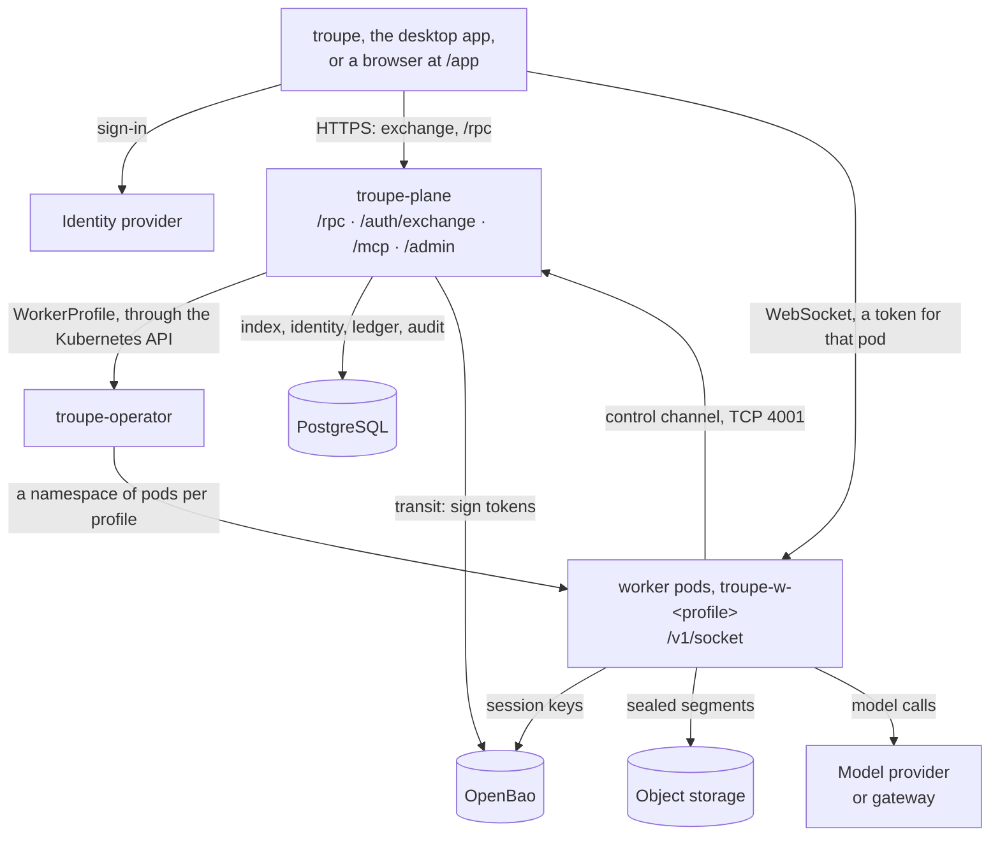
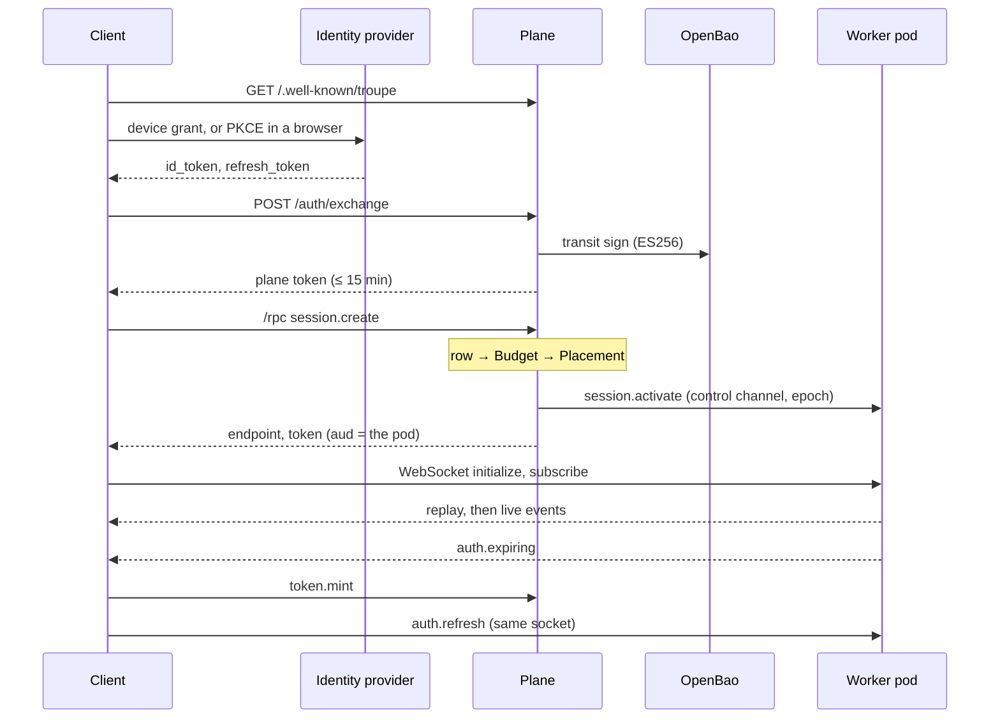

# Architecture: the plane, the pods and what a session carries

Sections 6 to 10 of [ARCHITECTURE.md](../../ARCHITECTURE.md), which is the design of the
harness and its reasons: how a session runs remotely (the plane, a worker pod, the
operator and the admin surface), what a profile carries and the work nobody starts, what a
session cost, provenance and entitlements, and what belongs to a person. They keep the
numbers they have there, so `ARCHITECTURE.md §6.2` is [§6.2](#62-a-worker-pod) here.

## 6. Remote

A client reaches the plane over HTTPS and a session's pod over a WebSocket of its own,
pods reach the plane over the control channel, and the plane is in the path of neither a
session's events nor its storage:

And the order a client does it in, from sign-in to a live session:

### 6.1 The plane

The plane decides *what* may happen and *where*; it never sees what happens, and is never
in the data path of a live session. **Identity**: it is a plain OIDC relying party;
`/auth/exchange` verifies the provider's token and mints a plane token signed through
OpenBao's transit engine, so the plane holds no key it could leak (`kid` is the RFC 7638
thumbprint, so plane and workers agree with nothing kept in step).

**The control channel.** Workers dial an internal TCP listener, never exposed through
ingress, with their projected ServiceAccount token; a `TokenReview` validates it and **the
namespace decides the profile**, so a pod can only enrol as what it is. Upward go
heartbeats, the session *index* (ids, epochs, sequence numbers, head hashes), status
columns and usage batches; downward, idempotent pushes (activate, dormant, drain, erase,
fence, JWKS and ACL changes, `config.updated`), routed to whichever replica holds the pod.
Bundles are fetched, not pushed, and so are credentials, each for a session the pod holds
alone (one it does not hold gets `not_found`), the owner read off the session row:

- `kms.assertion {session_id}` answers a short-lived JWT for *that session owner's* key
  slots, naming the owner's name at the key manager, under which the pod reads them.
- `git.credential {session_id}` answers a GitHub installation token the plane mints with
  its App for the repository on the session's row, narrowed to it and to `contents: read`,
  with the URL to clone it from; the pod's own git uses it for the clone on the session's
  first activation, and the session never sees it (Decision 885).
- With `access: "write"` it answers the fix loop's token, with what the session's worker
  profile grants (`spec.github.permissions`). The pod's own `git_push`, `pr_open`,
  `pr_comment` and `pr_checks` use it outside the sandbox to push the session's `troupe/*`
  branch through GitHub's API, open its draft pull request and read its CI, and report each
  step with `github.record {session_id, ...}`, metadata the plane checks, keeps on the
  session's row and audits (Decision 891).

**The harness API** (`/rpc`) is a fleet API: `me`, `teams.list`, `profiles.list`,
`sessions.list`, `session.get`, `session.create`, `session.open`, `token.mint`, archive,
pin, erase, `session.grant`, `session.review`, `trigger.fire`. `session.create` is a
sequence of reservations, each given back if a later one fails: row → budget (`Budget`:
the platform's, the team's and the person's ceilings) → capacity (`Placement`, or
`pending` while the profile grows) → push to the pod → token. The row comes first because
a placement is a conditional write against it, which survives the replica that made it.
`Placement`, `TeamBudget`, `PersonBudget` and `PlatformBudget` are `:global` actors (one per
profile, team and person, and one for the platform), which is why plane replicas must
cluster. `session.open read` never activates, since a session that woke because somebody
looked would never stay dormant; in `activate` mode a conditional epoch bump decides the
one caller that places it. `sessions.list` carries the status columns a pod reports
(`status`, `done_reason`, `failed_reason`, `pending_approvals`, `pending_questions`,
`cost_micros`), so a review queue is a listing and not a replay. The plane pushes nothing
to clients: `/rpc` is request and answer.

**A laptop's session offered for steering** is the one place the plane is in a session's
data path, because nothing can dial a laptop: its daemon dials `/v1/relay` with its
person's plane token, and the plane relays the protocol between that connection and each
person attached at `/v1/relay/session` with a token `remote.open` minted for that session
alone. Both ends hold every message to one table in the protocol app
(`Troupe.Protocol.Relay`), the laptop again to its own record of whom it shared the session
with, and each remote person is an ordinary connection on the laptop, so the session's rules
hold for them as for anybody. The plane keeps who offered what to whom and whether the
laptop is there, and no copy of what it relays (Decision 921).

**Tokens for pods.** `aud` is **the pod's worker id**: an audience naming the profile would
make pods interchangeable, which is what a leaked token wants. Workers verify offline
against a cached JWKS, warn with `auth.expiring` two minutes out and accept `auth.refresh`
on the open socket. The role in a token is a claim about the moment it was minted; access
is checked again on every command against the ACL mirror the plane pushes, so a revoked
collaborator is refused on their next command, and a narrowed one runs it with the
narrower role's scopes.

### 6.2 A worker pod

**One process per active session, none per dormant one.** Everything a dormant session is
lives in object storage, and activation is the only way back, which makes relocation and
losing a volume the same operation. **Sealing**: a sealer per active session uploads an
AES-256-GCM segment at every turn's end and at least every 60 s; that interval is the whole
durability promise. Upload, *then* report: a segment the plane knows of but storage lacks
would let a rebuild claim history it cannot produce. The same `Troupe.Sessions.Sealer`
runs on a pod and in a daemon, so either can restore the other's sessions.

**Dormancy** is: record, seal, stop the tree, archive and upload the workspace, report,
then erase the local copy. **Epochs** are minted by the plane alone; a pod whose epoch has
passed refuses to activate (checked against the plaintext manifest before decrypting), and
a fenced running session stops and discards its cache. **Draining** (scale-down, a new
image, an admin's drain) stops placement in the database and waits for running turns up to
the grace period, and the plane checks its own index before agreeing the pod is empty. A
scale-down lowers the count only past pods drained that way; a pod stopped by anything else
drains itself on SIGTERM. **Disk pressure** evicts caches, least recently used, never an
active workspace. **Erasure** is driven by the plane, which destroys the session's key
**first**, with the metadata `delete` its policy has for this and nothing on the data path,
so nothing under the prefix decrypts (not old object versions, not backups) and the
deletion after it is tidiness. A team session's pod is told at once: it stops the session,
drops its copy and deletes the objects, and an offline pod applies pending erasures when it
enrols. A private session has no pod: its objects go when the owner's daemon next connects
and says it has stopped (Decisions 756 and 811). A key the key manager refused leaves the session
`erasure_pending`, and the plane tries it again every five minutes (Decision 811).

### 6.3 The operator

| Resource | Scope | Written by | Says |
|---|---|---|---|
| `TroupePolicy` | cluster | a cluster admin, never the plane | what any profile may ask for |
| `WorkerProfile` | `troupe-system` | the plane | what one pool of workers should be |
| `TeamVolume` | `troupe-system` | — | that a team has shared storage |

`spec.teams` is a projection of the plane's grants, not a second source of truth.
**Policy is checked twice, on purpose**: a `ValidatingAdmissionPolicy` gives a person an
error the moment they ask; the operator's check still holds when admission is down or the
policy tightened afterwards. `Resources.for_profile/3` is a **pure function** from profile,
policy and settings to manifests, so naming, addressing and egress are tested without a
cluster, and the reconciler only applies and compares: level-triggered and idempotent,
pruning by label (owner references cannot cross namespaces), led by a `Lease`. A pod gets a
*projected* token with audience `troupe-plane`, never the ServiceAccount's own, so it
cannot be replayed against the API server. StatefulSets are `OnDelete` because a pod holds
live sessions; the operator replaces a pod on an older revision once the plane, which alone
knows when a pod holds nothing, has drained it and recorded that on the profile.

**Egress** is default-deny: DNS, the plane's control port, OpenBao, object storage, the
model, the profile's MCP servers and git hosts. Plain NetworkPolicy cannot name a host, so
without Cilium the external ones are a wide rule on 443 and 80, with the installation's own
OpenBao and object storage and the profile's own endpoints beside it on the ports they
name, recorded rather than hidden. With Cilium the operator writes the `toFQDNs` rule the
profile asked for (with the installation's own OpenBao and object storage in it when they
are outside the cluster, a `toCIDR` of one address for a host given as an address), a DNS
rule through Cilium's proxy so it can learn addresses, and no wide rule beside it, since
Cilium admits the union of every policy on a pod. In either mode a profile's own endpoint
at a loopback or link-local address is admitted by no rule, and is refused where it is set
up and reported on the profile. Which mode a profile has is its `EgressByHostname`
condition, and the plane claims egress by hostname only where that condition says so.

### 6.4 The admin surface

Every administrative action goes through `Troupe.Plane.Admin`; the console, the `admin.*`
JSON-RPC methods and the MCP server at `/mcp` are renderings of it. A LiveView may call
nothing else in the plane, and a parity test asserts every function has an API method and
an MCP tool, so nothing the console can do is out of reach of a program or a model. For a
model the method's summary and typed arguments *are* the interface, and a destructive tool
takes a `confirm` argument repeating the identifier. `/mcp` also accepts the identity
provider's own token, because an MCP client does OAuth against the provider and has no
step at which to get a plane token; Troupe is a resource server, never an authorization
server.

`platform_admin` is membership of an identity-provider group, never granted in Troupe,
because a role Troupe could grant would be a way to escalate inside it. `team_admin` is
assigned per team. Neither can read session content: no admin method returns events.
Break-glass is a separate, audited console login for a lock-out, with no more access.

Profiles are applied **directly** (server-side apply of the whole resource) or held **by
GitOps**: a repository holds the `WorkerProfile`, `TroupePolicy` and `Trigger` resources
and something else applies them; the plane never writes git. A cluster singleton lists the
profiles, then the triggers, every fifteen seconds and makes the plane's rows follow them:
a resource that fails the plane's own checks is reported rather than used, admin writes are
refused as `managed_by_gitops`, and the console is locked. The plane then writes only what
no repository could know, a profile's `replicas`, `teams` and `mcpServers`, under its own
field manager (Decision 736). A trigger's key, runs and revisions stay the plane's, and
running one by hand is not a write (Decision 737). **Settings** override the deployment and
never replace it: a stored row wins, reset deletes it, and a `platform_admin_group` cannot
be saved until a check passes for the value in the field. **Audit** is a row per change
with the actor and a diff keyed by path (`spec.llm.model`), computed by the same function
the editor previews with.

## 7. What a profile carries, and work nobody starts

**Bundles** (agent definitions, skills and MCP servers) are one versioned, hashed,
immutable document per version, validated at publish by the plane and again by the worker
after checking the hash. A worker keeps every version under `bundles/<hash>/`, so a session
pinned to a version reads that version however many have been published since; retiring it
moves pinned sessions on at their next activation. The bundle is the MCP servers' one
source of truth: pods discover tools on `config.updated` and apply its allowlist, and the
plane writes the servers into the `WorkerProfile` so the operator opens egress and injects
each credential from `troupe-mcp-<name>`.

A **service principal** (`svc:<team>/<name>`) is a credential a team owns, not a member,
which keeps membership the identity provider's business; it exchanges its secret for the
same plane token a person gets and has no admin role. `session.create` takes what an
unattended session needs: a first `prompt` the plane passes on and never stores; `terms`
(a budget slice, `max_turns`, `wall_clock_seconds` and `approvals: wait | deny`, with no
`auto`: a trigger that needs none runs a profile whose bundle sets those tools to `auto`,
an administrator's versioned act); and an `origin`. A **trigger** is a row the plane stores
and something fires: `trigger.fire` renders the template and creates the session *as the
trigger's principal* through the same call a person's client makes, and the same
idempotency key returns the same run. Cron triggers fire from a `:global` scheduler in the
plane; from outside, a trigger is fired at `POST /trigger/<id>` with a key of its own that
fires that trigger and nothing else, or by an executor that calls `trigger.fire`.

**The A2A facade** maps the A2A protocol onto sessions: a task is a session, a message is
`input.send`, a stream is a subscription, `input-required` is an approval answered by a
structured decision, artifacts are `published` events and blobs served with the caller's
own token. It holds no database and no credential of its own ([docs/a2a.md](../a2a.md)).

## 8. What a session cost

**Cost is a fold over the log, not a second thing to write down.** Every `llm_response`
carries the model and, behind a gateway, its request id and cost, read from response
headers (`x-litellm-call-id`, `x-litellm-response-cost`). **Troupe keeps no price table
of its own**: the gateway prices a call where it can, and a reconciliation compares the
ledger with it by request id. A streamed response carries no cost header, so the harness
prices such a call itself, from the provider's catalog or else from `models.prices` (a
profile's `llm.prices`), and marks it `priced_locally` (Decision 689). A call nobody priced
is recorded at zero cost and said once a session in the log; one with no request id gets a
synthetic id `seq:<session>:<n>` that the reconciliation counts as unmetered.

On a pod, `Session.Log` hands each event to a usage fold that writes an ETS row from the
log's own process (no mailbox on the turn path), drained in batches over the control
channel. The plane answers each batch with `usage_seq`, the highest sequence now recorded;
the pod drops what it held up to it and, after a restart, re-folds its log from it. The
watermark only moves forward and is deliberately not fenced on the epoch, because a fenced
pod still made the calls it reports. The ledger's uniqueness on request id turns any
overlap into duplicates rather than charges. There is no rollup pipeline: the raw table,
an index and a one-minute cache answer every question at this volume.

## 9. Provenance and entitlements

A trigger run names a **revision**: the trigger document frozen and addressed by the hash
of its canonical form, `source` inside the hash and `enabled` outside it. Editing a
template does not rewrite what old runs ran, and the session a run made carries the hash
in its origin. A grant may carry **entitlements**: which of a bundle's agents, skills and
MCP servers come with it; no rows is no restriction, `deny` wins. The bundle is never
altered: the plane resolves a set at create, `profiles.list` shows the union across a
person's teams, the session gets its one team's set, and the pod filters agents after the
whole search order is merged, skills after the definition's own list, and each session's
MCP tool list; the pod still discovers once.

## 10. What belongs to a person

Key paths take an owner: `troupe/teams/<team>/sessions/<id>` for a pod, scoped to its
granted teams, and `troupe/people/<name>/…` for a person, which no pod rule mentions. The
name is the person's at the key manager, a column on their row: their subject when they
were first known, left alone when a switched `subject_claim` moves their subject, so
nothing under it has to move (Decision 755). Whatever reaches the key manager for a person
takes the name from the plane's answer, never from a subject. A bundle's MCP server may use
`credential_mode: person` (the session owner's credential, fixed at activation), kept at
`troupe/people/<name>/mcp/<slot>`, which only that person can read: the pod exchanges a
plane-signed assertion at OpenBao's JWT auth for a token templated on the name, and a
person connects a server with `me.connections.grant`, which takes no value and returns
none. Where nobody has connected, the tool answers `not_connected` rather than a 401 the
model would retry.

A **private session** runs on a person's machine and never touches a pod. The daemon seals
it with the same sealer under the person's key subtree; the plane holds a row
(`kind: private`, no team, no profile) and nothing else. Bytes cross through presigned URLs
for one key under the session's prefix (`session.presign`), listing through
`session.objects`, and the **epoch** fences two devices waking the same session:
`session.register` with `claim: true` bumps it conditionally, and the loser learns at its
next seal, when the plane will not sign a write naming its epoch, so it writes nothing more
under the prefix and keeps its local log read-only (Decision 800).

The daemon's plane token comes from the client that signed in (`identity.link`), which
hands it over again when it renews it and when the daemon has restarted; it is held in
memory only. Each link that carries one is also when the daemon asks what was erased while
it was away (`session.erasures`), drops its sealer and its copy of each, and says so
(`session.erased`), which is when the plane deletes the objects; and when it carries on
sealing each private session it has no sealer for, from the row's `last_seq` at the epoch
it held, or from the first event for one the plane has never heard of (Decision 764).
Signing out at the client takes the token back (`identity.sign_out`), and the daemon stops
every sealer until the next link carries them on (Decision 766).
