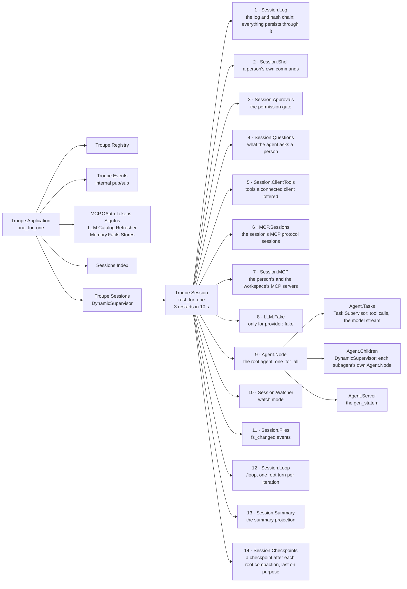
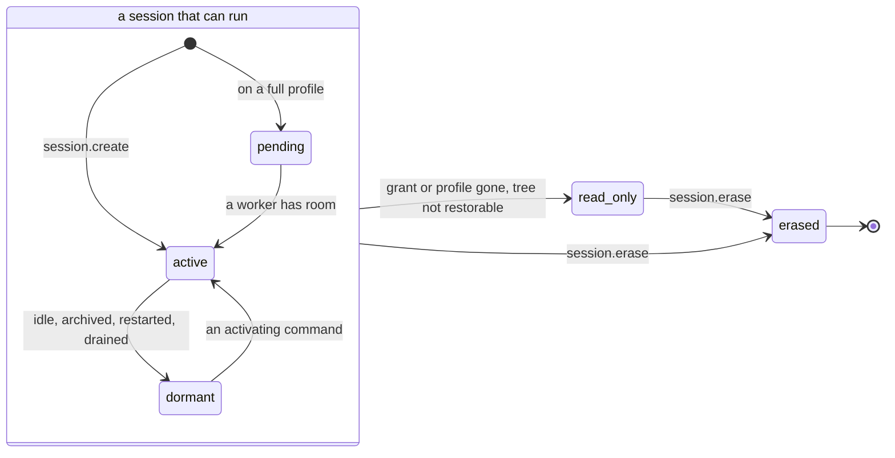
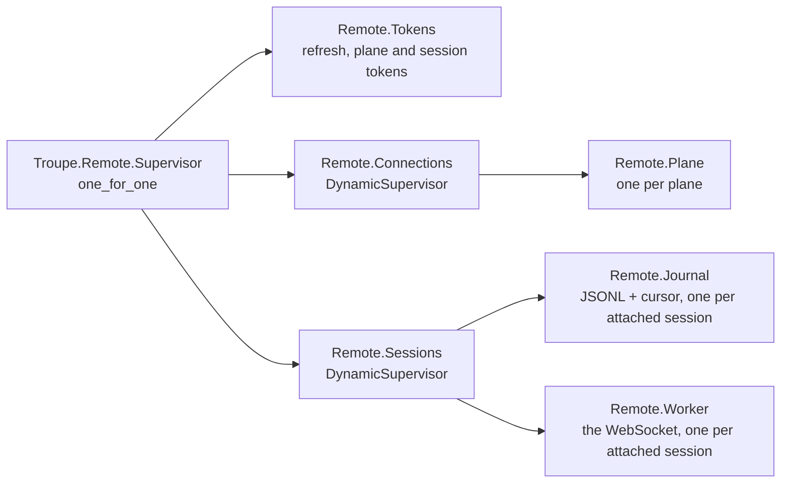

# Architecture: the harness and its clients

The harness, as it runs in `troupe-daemon` on a laptop and on a worker pod alike, and the
clients in this repository: the design, its reasons and where each piece is in the code.
The parts, the boundaries the build enforces and where state lives are
[the map](../../ARCHITECTURE.md); the plane, the pods and the operator are
[the plane and the pods](architecture-remote.md); the wire is
[PROTOCOL.md](../../PROTOCOL.md); runtime configuration is
[the server's variables](../admin/configuration.md).

## 1. The harness

### 1.1 A session

Every agent, model request, tool run, subagent and watcher is a process; they share
nothing and handle failure by supervision. A session is a `rest_for_one` supervisor
ordered by dependency (the tree is below):
`Session.Log` first, because everything persists through it; `Session.Shell`, a person's
own commands (Decision 813), right under it; `Approvals`, `Questions`, `ClientTools` and
the MCP sessions and servers above the agent, so a restarted agent finds the same answers
and registrations; the root `Agent.Node`; then `Watcher` and `Files`, so file watching can
never disturb a running agent; `Loop`, which runs `/loop` as turns of the root agent
(Decision 679); and the projections last, `Session.Summary` and `Session.Checkpoints`,
because a projection that could restart an agent by crashing would be worse than none. Sessions live in the core's tree, not the
daemon's, so a daemon can lose its listener and every client without an agent noticing.

**Core** (`Troupe.Application`, `one_for_one`): `Troupe.Registry`, `Troupe.Events`
(internal pub/sub), `MCP.OAuth.Tokens` and `MCP.OAuth.SignIns` (a person's sign-ins to
their own MCP servers), `LLM.Catalog.Refresher`, `Memory.Facts.Stores` (a repository's
facts, one process each), `Troupe.Sessions.Index`, and `Troupe.Sessions`, a
`DynamicSupervisor` of `:transient` sessions. One session (`Troupe.Session`, `rest_for_one`,
3 restarts in 10 s) starts its children in dependency order, top to bottom, so a crash
restarts the child and everything below it and nothing above:

The root `Agent.Node` is `significant`: when it gives up, past its own restart limit, the
session ends and comes back dormant from its log (Decision 727).

### 1.2 The agent

`Agent.Server` is a `:gen_statem` over `:idle`, `:thinking`, `:acting`, `:compacting`
and `:done`. The mailbox never blocks: the model request streams back from its own task,
tool calls run concurrently in their own tasks and are reassembled in call order, and the
only synchronous calls out are to `Session.Log`, which never calls back. A model call given
up on, at `llm_timeout_ms` or on a cancel, has its task ended, which closes the request, and
is counted for the usage the provider had reported (Decision 788).

| State | Event | Next |
|---|---|---|
| idle | input | log it; budget check; start the stream → thinking (or done, budget) |
| idle | `session.compact` | compacting, then back to idle; refused while there is too little to compact, and in any other state |
| thinking | stream done with tool calls | acting |
| thinking | text only | done (`finished`) — an implicit finish |
| thinking | prompt over the compaction threshold | compacting |
| thinking | cut at the output cap, or empty | note it and re-issue once, then done (`output_truncated`, `empty_reply`) |
| thinking | refusal, model error, timeout | done (`refused`); a root's failed request rests it idle, a subagent's is done (`llm_error`) and hands its parent what it has; a context overflow compacts once and retries, then retries once more with every large tool result left for `read_output`, the turn's own included |
| acting | each call | allowlist and permission check → error result, approval request, or a task |
| acting | approval, answer, tool result, child result, a task's `DOWN` | record it, and stop a child that has reported; when none are outstanding, the next turn |
| compacting | summary, model error, timeout | carry on the interrupted turn, or come to rest; without a summary the conversation is unchanged |
| done | input | a root agent that finished takes it as a new turn; one out of budget stays done |
| any | cancel | kill tasks and children, close their calls as errors → idle (`cancelled`) |

Input arriving while busy is postponed with `gen_statem`'s `:postpone`, not a hand-rolled
queue, and delivered at the turn boundary. **Replay**: an agent's state is a fold over its
own events; a crashed agent rebuilds from the log and finishes what it started, never
re-running a completed call, and the results already back go to the model with the rest.
A subagent is stopped once its parent has its result; from then on it is its log.
**Budgets** (turns, input and output tokens, working time) are checked before every
request; a child gets a share of the tokens and time its parent has left, and the turns
its parent was first given. Past `budget_warn_at` (0.8) a dimension logs one warning; at
the ceiling the agent asks the person attached, a grant buys another slice, folded from the
log (Decision 660), and `always` lifts the one limit asked about (Decision 687). **A tool
that keeps failing**, ten times in a row by default, stops the turn before the next request
and asks, whatever the budget says (Decision 687). **Compaction** is planned against the
whole prompt including cache reads, keeps the recent turns without ever cutting between a
tool call and its results, and logs the replacement conversation, large results as blobs,
so replay is faithful; a summary that fails changes nothing (Decision 774). The
summariser's request defines no tools, so the calls and results it summarises are written
out as text, and it is given up on after `llm_timeout_ms` like any model call (Decision
779). In the kept turns, a tool result over 16 KiB that the model has answered is sent from
then on as one line naming the `read_output` call that returns it; the conversation and
the log keep it whole (Decision 771).

### 1.3 Tools

A tool implements `Troupe.Tool`; authorisation happens before anything runs: an unknown
tool, one outside the definition's allowlist, or one denied is refused, and `ask` blocks
that call's task, not the agent. Reads are automatic; `write_file`, `edit_file`, `shell`,
`publish`, `import`, `web_fetch` and `onboard_write` ask by default (`onboard_write`
whatever the profile says when it writes into the config directory); MCP tools take their
server's permission. A write can never leave the workspace root; a read may also reach the
configured `read_roots`; both compare canonical paths. The runner is the one place
`rescue` is used: a raise, exit or timeout becomes an error result the model can read.
Every OS process runs under **`reaper`**, a small Zig program owned by a Port, so killing
the VM kills everything it started. A reaper that will not start is an error, not a crash:
`shell` says why, `grep` scans in the VM, the brief's `git` reads as no repository, and
`troupe doctor` fails its line. On a pod every command runs under bubblewrap, whatever the
session's mounts or bundle: `shell` and an ACP agent with the session's mount table as the
bind list, the tools' git and ripgrep with their own directory alone. A pod that cannot
start it refuses the command with a sentence, says so once in its log, and never runs it
outside (Decision 832).

Results are **bounded where they are created** (head and tail of command output, a window
of a file, the first items of a listing) with a marker naming the exact call that returns
the rest; nothing already in the conversation is rewritten, because that would invalidate
the provider's prompt cache. The prompt is ordered for the cache: tools in a fixed order, a
system prompt that stays the same through the session (the definition, the environment and
the skills), then an append-only history. The instruction files, the brief, the goal and
the task list ride in the conversation as turn context, each put again only when it
changed (Decision 863).

The prefix matters beyond the cache. A model that binds its thinking to the conversation
it was made in (Fable 5.1, Opus 5.5, Sonnet 5.5) refuses, on an enforced account, a
thinking block sent back after the system prompt, the tools or an earlier message changed,
and Troupe sends that call again without thinking (Decision 805). So on such a model the
task list's tools and `goal_complete` are offered from a turn's first call (867), a tool or
skill that comes or goes waits for the next turn (871, 876), and a compaction's tail goes
without the blocks made before what it summarises (867, 878). For what a stable system
prompt still cannot keep the same, `thinking_binding: drop_block` has the API drop a stale
block instead of refusing it, and `system_prompt: per_turn` is the prompt as it was before
0.13.0 (Decision 815; both in [the key table](../user/configuration.md#model-and-provider)).

### 1.4 Failure matrix

| What dies | What restarts | Observed |
|---|---|---|
| a tool task | nothing; the agent gets `DOWN` or a timeout | an error result; the agent carries on |
| the model stream | nothing | an `llm_error`; a root rests, a subagent ends `llm_error` and its parent gets what it had |
| `Agent.Server` | `Agent.Node` (`one_for_all`) restarts it with its tasks and children, from the log | started-but-unfinished calls re-run (at least once), a delegation to a new child, and the old child's calls closed in the log |
| a subagent's node, past its restart limit | nothing; the parent gets `DOWN` | an error result for that delegation only |
| the root's node, past its restart limit | nothing; the session stops | `turn_ended` with `agent_failed` and what it raised, then the session is dormant (Decision 727) |
| `Watcher`, `Files`, `Loop`, `Summary` | that child and those after it | a notice; a loop carries on from its log |
| `Approvals`, `Log`, or the session past 3 restarts in 10 s | everything below it; the whole session | a restarted tree replays; a stopped one comes back dormant from its log |
| the VM | nothing | sessions come back dormant; one mid-turn is **interrupted** |
| the reaper's Port | — | the reaper kills the process tree; an error result |

An **interrupted** session makes no model call until someone activates it; its unfinished
calls, and those of any subagent it had at work (which ends `interrupted`), are closed as
errors naming the interruption. A crash loop that resumed by itself would spend money and
re-run shell commands nobody is watching. `resume_on_restart: true` opts back in.

### 1.5 Agents, skills and the brief

Agent definitions are markdown with YAML frontmatter, loaded lowest to highest: on a
person's machine the built-ins (`apps/troupe_core/priv/agents/`), the config directory and
the workspace's `.troupe/agents/`; on a pod the directories, then the built-ins, then the
profile's bundle, which wins unless the profile sets `repositoryOverridesBundle`
(Decision 826). A session has one root agent; `/<agent> prompt` opens a
**branch**, which is a session of its own with a `parent`. Skills follow the Agent Skills
convention and are disclosed progressively: one line per skill in the system prompt, a
`skill` tool that returns the body, and a read-only `skills:/` mount. The **project
brief** is facts in `.troupe/memory/facts.jsonl`, with `.troupe/memory.md` generated from
them: a prompt carries the commands and conventions, `recall` the rest, and `remember` and
a `librarian` agent write them (Decision 838). **Watch mode** acts on `AI!`, `AI?` and
`AI` comments in saved files and ignores the agent's own writes by content hash: each
trigger starts a `quick` or `answer` branch in the checkout, whose writes ask first
(Decision 844).

## 2. The wire

`PROTOCOL.md` is normative, written for someone implementing a client without this
repository: the event envelope, the subscription, the error codes and every method are
there, and the transports are in
[the map](../../ARCHITECTURE.md#4-how-they-talk). What a
reader of this code needs is why it is shaped so:

**Events.** Each durable event's `prev_hash` chains it to the one before over canonical
JSON, so a client can verify a log without trusting whoever handed it over. Ephemerals
(`llm_delta`, `presence`, `summary_diff`, …) are never persisted and may be dropped; every
completed model message also lands as a durable `llm_response`. **`Session.Log` is the
only publisher of durable events**, publishing what it just wrote, in the shape it wrote;
otherwise a subscriber sees each fact twice in two shapes, and the difference only shows
under replay.

**Subscriptions** replay from the cursor, then follow live with no gap and no duplicate:
the connection holds the cursor, so the switch is one decision in one process.
**Backpressure** has two budgets: ephemerals are refused once a client has more than its
byte bound outstanding; durable events are never dropped for memory, and past the backlog
bound the subscription ends with `resync_required`. A `Writer` process per connection owns
the blocking send, so nothing blocks the publisher: a test stalls a socket and requires a
turn to take no more than twice its baseline, or the baseline and a quarter second,
whichever is more. **The summary projection** folds a session into a compact snapshot and
publishes diffs at most four times a second, so a fleet view need not follow twenty detail
streams.

**A command is an acknowledgement, never an effect.** `input.send` returns `accepted`;
what happened arrives as events, so every client learns it the same way. A state-changing
command's `command_id` is claimed *before* the command runs, so a retry after a disconnect
gets the same answer and never a second effect. **Scopes** (`observe` reads, `control`
steers, `admin` administers) are checked once per method.

## 3. Lifecycle, worktrees and blobs

A session is `active` (its tree running), `dormant` (stopped, serving history from its
log), `read_only` or `erased`; a remote one may also be `pending` on a full profile, or
`erasure_pending` until the plane has destroyed its key
([the states](../../PROTOCOL.md#session-states-dormancy-and-activation)). Nothing brings a
session back from `read_only` or `erased`:

A session goes dormant after its idle timeout: waiting on a person counts as idle, the
timeout is minutes rather than half an hour once no client is watching, and a session a
client is subscribed to by name is not put to sleep at all
([the daemon](../user/daemon.md#how-long-it-stays-up)). The next
*activating* command restores the tree by folding the log, and asks again whatever it was
waiting on. What ended or was asked while nobody was reading a session is kept beside its
log as a mark and reported in its listing (`Sessions.Unseen`), so a client that comes back
can say so. A daemon restart brings sessions back dormant (restarting every session a
person ever had is a stampede, not a restoration), and the daemon stops itself after a
quiet period with no clients. `Sessions.Index` holds metadata only and monitors each live
tree, so a crashed session leaves the live view at once. The TUI's HQ page is a `fleet`
subscription plus one `session.list`: every approval waiting on a person, in sessions
nobody has open too.

A second live session in a workspace gets its own **git worktree** on `troupe/<slug>`, so
two agents never see each other's half-finished edits as the user's; removal refuses a
dirty tree unless forced. A tool result over 16 KiB becomes a **blob** reference fetched
with `blob.get` (byte ranges); replay resolves it back, because a restarted agent must
rebuild the conversation the model actually saw. Blobs deduplicate within a session only,
so one session's storage is never a probe for another's content.

## 4. Several harnesses, one session

Every input enters the session actor's mailbox, so **the log order is the order**; no
clock is involved. An input that arrives while the agent is busy produces a durable
`input_queued`, and `input_accepted` carries the author and the `command_id`, so a client
can show its own input as queued and reconcile against what happened. **Presence** is
ephemeral by structure: it is published through a path with no route to the log.
**Client-hosted tools** (a person's own MCP server offered to a session) need consent as a
round trip, run only on the registering connection, and survive a short disconnect by a
grace rather than failing the call; every registration durably **taints** the session, so
the other participants know something runs on somebody's machine
([PROTOCOL.md §8](../../PROTOCOL.md#8-client-hosted-tools)).

## 5. Reading old logs

Every durable event carries a schema version. `Troupe.Log.Upcast` brings an old one up a
step at a time and may add or rename, never drop. The hash chain is not recomputed:
`prev_hash` covers the bytes as written. Recorded fixture logs, under
`test/fixtures/logs/<version>/` (0.2.0 and 0.3.0; no release since has recorded its own),
come with the fold each produces, hashed over a *witness* of the event types replay acts
on; a test reads the replay clauses from the source and asserts the witness covers them.
Snapshots are cache: one this build cannot trust is discarded for a full replay, which
produces the same fold. So is `events.jsonl.offsets` beside a log, where each event starts
(`Troupe.Session.Log.Offsets`): trusted while it bears the log's size and time, else built
again from the log. Protocol schemas are add-only within version 1, enforced by
`mix troupe.schema.diff`.

A `checkpoint` event is cache in the chain (PROTOCOL.md, Checkpoints). After each root
`compacted`, `Session.Checkpoints` waits for the root's next rest and appends the facts of
the log up to it (`Troupe.Session.Checkpoint`, a pure fold), naming that rest as
`through`; a compaction left owed by a crash is written when the tree comes back to a rest.
The contract is that a checkpoint's facts plus the fold of the events after `through` equal
the fold of the whole log: a property test holds it over generated logs, and
`test/fixtures/checkpoints/` (manual, threshold and overflow compactions, a background
child's approval held across one) is read by the core, the TUI and `@troupe/client`.
`subscribe {from: "checkpoint"}` and `session.events` read through the offsets, so neither
decodes more than it answers; the writer starts from the latest checkpoint too. A seal
report names the latest sealed (`checkpoint_seq`), which the plane keeps on the row.

## 6. The daemon

**Daemon** (`Troupe.Gateway.Daemon`, `rest_for_one`, started by `Troupe.Daemon.Application`
when `troupe-daemon` starts, or under `TROUPE_DAEMON_SERVE=1` from source): `Commands`
(idempotency ledger), `Plane` (where the plane is, if anybody linked one),
`Private.Sealers` (a sealer per private session), `Setup` (the first run's answers), `Connections`
(one process per client, at most 256), `Listener` (Unix socket or loopback TCP),
`Loopback` (a WebSocket on 127.0.0.1, the only door a browser has) and `Idle`. Sessions
are not in this tree.

## 7. The TUI (`clients/tui`)

The TUI and its HQ page call one module, `Troupe.Client`, a behaviour with two
implementations routed by session id through `Troupe.Client.Registry`:
`Troupe.Client.Daemon` (the `troupe-daemon` on the machine, or a `Troupe.Gateway.Daemon`
the TUI embeds when none answers, reached over its loopback WebSocket) and
`Troupe.Client.Remote` (a plane and its pods). Both attach a session through the same
`Troupe.Remote.Worker`, so a local session and a pod's look identical on screen. Fleet
calls take an origin, `{:local, workspace}` or `{:remote, plane_url}`.

`one_for_one` is the degraded mode: an unreachable plane does not touch attached sessions.
A worker connection subscribes with the journal's cursor as `from_seq` (the servers replay what is after it), or, with an empty journal and `checkpoints`, `from: "checkpoint"`:
the journal then starts with its summary and facts at `through`, and PgUp at the pane's top pages back (`session.events`).
The journal drops a batch it already has, so a reconnect or a `resync_required` produces the same transcript. Deltas
are coalesced per 33 ms and dropped past 64 KB. `Troupe.Remote.Translate` turns protocol
events into the harness's own at the edge, so the model and view never branch on "is this
remote". Browsing opens with `session.open read`; the first activating action calls
`session.open activate` once and reconnects to whatever endpoint comes back. A session the
plane moves to another pod is followed: a reconnect after a failure first asks
`session.open read` where it is, a pod's `not_found` for the session sends an activating
command once more wherever the plane opens it, and after ten tries in a row the worker
stops and says so until the next command (TUI Decision 118). Merge, discard, watch mode,
the brief and settings are local-only and answer a remote session with a sentence rather
than failing silently.

## 8. The GUI (`clients/gui`)

The package layout, how to run it and the protocol details the client library knows are
in the [GUI README](../../clients/gui/README.md). What its code settles:

- **The fold is in `@troupe/client`**, a pure function of the event stream, tested without
  a DOM; two clients agreeing is a property of that function. The React layer is an
  adapter over the client's stores and holds nothing. `@troupe/client` has no runtime
  dependencies; every protocol type is an open object, because v1 is additive.
- **The view owns the cursor**; `SessionAttachment` swaps the socket underneath it, so a
  pod token running out is invisible to a turn. On `auth.expiring` it mints (`token.mint`)
  and hands the token over with `auth.refresh` on the same socket; on a drop it reconnects
  with backoff (250 ms to 10 s) and resubscribes from the last `seq` it processed, and the
  server closes the boundary: no gap, no duplicate. Every reconnection asks the plane's
  `session.open` again, so a session moved to another pod is followed, and a command its
  pod refuses as `not_found` for the session runs once more after the reopen
  (`SessionAttachment.retrying`).
- **Sign-in**: a browser uses authorization code + PKCE (the device grant fails in a browser
  against some providers: Microsoft Entra ID's device-code endpoint, for one, sends no CORS
  headers), with `prompt=select_account` and, for a tenant-scoped Microsoft issuer,
  `domain_hint=organizations`; anything else uses the device grant. Redeeming a code is
  idempotent, and the code comes off the address bar either way. The redirect URI is the
  origin plus the base path with no trailing slash, registered as a single-page application.
- **Storage**: the provider's refresh token is the only persisted secret
  (`localStorage` `troupe.auth.refresh:<planeUrl>`, or, in the desktop shell, the TUI's
  `credentials.json`: one sign-in for both clients, Decision 958); the PKCE verifier sits
  in `sessionStorage` `troupe.auth.pending` between leaving and coming back; preferences
  are `troupe.pref.*`, and the shell seeds `planeUrl` from the file's `current` plane at
  start. Plane and pod tokens live in memory.
- **The stored refresh token is spent one caller at a time** (#53). A Web Lock is held per
  plane, across tabs, or a queue within the page where there are no locks, and the token
  is read inside it, so StrictMode's double effect, or two tabs, never spend a rotating
  token twice. A store shared with other programs brings a lock of its own (`TokenStore.lock`,
  the shell's `credentials.lock`), held inside the Web Lock, so the TUI renewing the
  same token waits its turn. A 400 or 401 is a refusal: its reason is logged, and the store is cleared
  only if it still holds the refused token. A 5xx keeps the token. A sign-in that brings
  no refresh token is warned about: the provider lacks `offline_access`, and the next
  reload will ask again.
- **Two modes, `local` and `plane`** (`mode.ts`, #85). `auth` is optional, and each screen
  says what it needs. In local mode Review and the plane's profiles are hidden, and the
  rail shows *This computer* and the OS user the daemon reported. *Local only* is a
  remembered setting (`troupe.pref.localOnly`, in the browser's storage), reached from the
  sign-in screen's third door or the switch on *This computer*; turning it on keeps the
  stored sign-in. *Offline* is plane mode with a plane that does not answer: "Continue on
  this computer", nothing remembered, and the plane retried every 15 s. That nothing
  reaches a plane in local mode is tested on traffic: `apps/desktop/test` (Vitest, jsdom)
  records every request the page opens.
- **The fleet** is one list from several sources (the plane's `sessions.list`, polled
  every 4 s because the plane does not push, and the daemon), merged by id with the
  daemon's copy winning. A source that fails keeps its last rows and reports an error.
- **An input is shown as queued**, below the stream, until `input_accepted` names its
  command id — never inserted optimistically. Approvals are a sticky panel; the inbox
  opens each waiting session in `read` mode.
