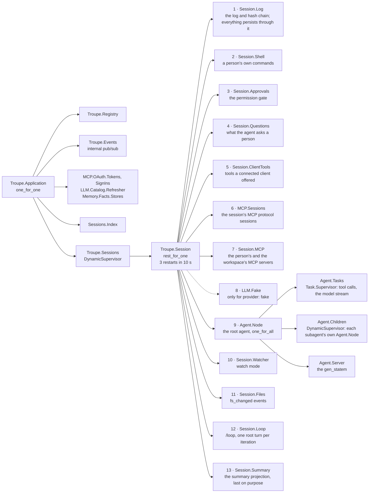
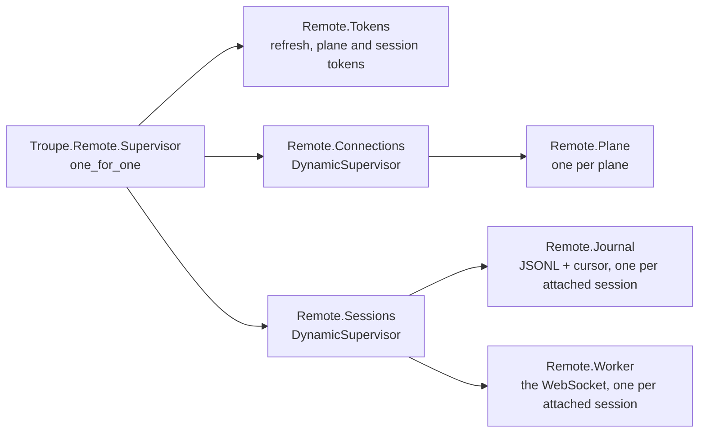

# Architecture, for someone changing the code

Where things are and which rules the build enforces. Why they are so is
[ARCHITECTURE.md](../../ARCHITECTURE.md), and this page does not repeat it; the wire is
[PROTOCOL.md](../../PROTOCOL.md); runtime configuration is
[the server's variables](../admin/configuration.md).

## 1. Apps and releases

Eight Mix projects under `apps/`. The root `mix.exs` releases four of them as container
images; `apps/troupe_daemon` releases the fifth from its own directory, one build per
platform, so a Windows or macOS runner compiles the harness and nothing of the platform.

| App | What | Umbrella deps |
|---|---|---|
| `troupe_protocol` | the wire (JSON-RPC, events, schemas, errors, tokens) and the contracts plane and workers share: OpenBao, S3, MCP clients, the sealer, `TroupePolicy` and `WorkerProfile` parsing | none |
| `troupe_core` | sessions: agents, tools, providers, the log, the index | protocol |
| `troupe_gateway` | the daemon: transports, connections, subscriptions, scopes, idempotency | core, protocol |
| `troupe_daemon` | the harness and a command line, released as `troupe-daemon` | core, gateway, protocol |
| `troupe_worker` | a worker pod: plane link, sealing, restore, auth, bundles | core, gateway, protocol (plane in tests) |
| `troupe_plane` | the control plane: identity, placement, budgets, `/rpc`, `/mcp`, the console | protocol |
| `troupe_operator` | the Kubernetes reconciler (Bonny) | protocol |
| `troupe_a2a` | the A2A facade | protocol |

| Release | Applications | Packaging |
|---|---|---|
| `troupe_operator`, `troupe_plane`, `troupe_a2a` | protocol + the app | image, `docker/Dockerfile` |
| `troupe_worker` | core, protocol, gateway, worker; `Troupe.Release.build_reapers/1` builds the two Linux `reaper`s | image |
| `troupe_daemon` | the harness | a tarball per platform, `apps/troupe_daemon` |

The clients are outside the umbrella: `clients/tui` is its own Mix project depending on
the three harness apps by path, and `clients/gui` a pnpm workspace depending on nothing
here but the protocol. One `VERSION` versions everything ([build.md §4](build.md#4-version)).

## 2. Boundaries

`mix troupe.boundaries` reads the `imports` chunk of every compiled beam and fails on:

| Rule | Reason in the task |
|---|---|
| `troupe_a2a` calls only `troupe_protocol` | "the A2A facade is a protocol client and gets no private access" |
| `troupe_plane` never calls `troupe_core` or `troupe_gateway` | "the plane does not run agents" |
| `troupe_operator` never calls core, gateway or plane | "the operator holds cluster privileges and has no public surface" |
| `troupe_daemon` calls only protocol, core and gateway | "the daemon is the harness and a command line, and nothing of the platform" |
| `Troupe.Plane.Web.Live.*` calls only `Troupe.Plane.Admin` among `Troupe.Plane.*` | "a LiveView is an admin API client and gets no private access" |

Every cross-app call must also be declared `in_umbrella` in the caller's `mix.exs`.
Test-only reverse dependencies pass because only `lib/` beams are read. The TUI has its own
check, `mix troupe.xref` in `clients/tui`: UI modules call only `Troupe.Client` and pure
data modules, and the whole TUI reaches the harness only through the doors in
`@harness_allowed` (`clients/tui/lib/mix/tasks/troupe.xref.ex`: `Troupe.Protocol.Client`,
`Troupe.Config`, `Troupe.Paths`, `Troupe.Reaper` and a dozen more; Decision 673). The
Python conformance client in `apps/troupe_gateway/test/conformance/` checks that the
protocol alone is enough.

The operator and the worker both compose a pod's hostname `<ordinal>-<profile>.<domain>`;
the two cannot share a function across the boundary, and both say so.

## 3. Supervision trees

**Core** (`Troupe.Application`, `one_for_one`): `Troupe.Registry`, `Troupe.Events`
(internal pub/sub), `MCP.OAuth.Tokens` and `MCP.OAuth.SignIns` (a person's sign-ins to
their own MCP servers), `LLM.Catalog.Refresher`, `Memory.Facts.Stores` (a repository's
facts, one process each), `Troupe.Sessions.Index`, and `Troupe.Sessions`, a
`DynamicSupervisor` of `:transient` sessions. One session (`Troupe.Session`, `rest_for_one`,
3 restarts in 10 s) starts its children in dependency order, top to bottom, so a crash
restarts the child and everything below it and nothing above
([why this order](../../ARCHITECTURE.md#21-a-session)):

The root `Agent.Node` is `significant`: when it gives up, past its own restart limit, the
session ends and comes back dormant from its log (Decision 727).

**Daemon** (`Troupe.Gateway.Daemon`, `rest_for_one`, started by `Troupe.Daemon.Application`
when `troupe-daemon` starts, or under `TROUPE_DAEMON_SERVE=1` from source): `Commands`
(idempotency ledger), `Plane` (where the plane is, if anybody linked one),
`Private.Sealers` (a sealer per private session), `Setup` (the first run's answers), `Connections`
(one process per client, at most 256), `Listener` (Unix socket or loopback TCP),
`Loopback` (a WebSocket on 127.0.0.1, the only door a browser has) and `Idle`. Sessions
are not in this tree.

**Worker** (`Troupe.Worker.Supervisor`, empty unless `TROUPE_WORKER_AUTOSTART`):
`KMS.OpenBao.Login` first (the worker's own OpenBao identity), `Sessions` (a
`Session.Manager` per active session), `Auth`, `MCP.Sessions`, `Connections`,
`ClientCredentials`, `MCP`,
`Bundles` (before the link: enrolment claims the bundle hash), `Usage`, `Disk.Watch`,
`Plane.Link` (only with
`TROUPE_PLANE_CONTROL`), and `Harness` — the gateway's `Commands`, `Connections`, a raw
NDJSON `Listener` on 4100 and `Gateway.Web` (Bandit on 4000: `/health/live`,
`/health/ready`, `/v1/socket`).

**Plane** (`Troupe.Plane.Supervisor`, empty unless `TROUPE_PLANE_AUTOSTART`): `Repo`,
`Settings` (5 s cache), PubSub, `Singleton` (a `DynamicSupervisor` for the `:global`
actors: one `Placement` per profile, one `TeamBudget` per team, one `PersonBudget` per
person, one `PlatformBudget`, and the fleet scaler, GitOps and erasure-retry singletons),
`Fleet.Sweeper`, the keepers of the trigger scheduler, the fleet scaler, GitOps
(`Gitops.Keeper`) and the erasure retry (`Erasure.Retry.Keeper`), `Erasure.Tasks`, `Fleet.ReleaseImage` (rewrites
`release` profiles after an upgrade), the control channel's registry, connections and `:gen_tcp`
listener on 4001 (plaintext or TLS, told apart by the first byte), `Ledger.Cache`, `Tokens.Credential` (the OpenBao login), the Phoenix
endpoint on 4000, and libcluster when `RELEASE_DISTRIBUTION=name`. The `:global` actors
are why the chart refuses more than one replica without distribution.

**Operator** (`rest_for_one`, under `TROUPE_OPERATOR_AUTOSTART`): `Reconcilers` (one per
resource), `Watch` (Bonny: watch, resync, `Lease` leadership), `Descendants`. **A2A**:
a plane-token cache, the stream registry, and Bandit when autostarted.

## 4. Transports

One JSON-RPC framing, three transports: a Unix socket (NDJSON, mode 0600, authenticated
by file permissions), loopback TCP (NDJSON, a random token in a user-only file; chosen when
*trying* `AF_UNIX` fails, since whether it works is a property of the OTP build), and
WebSocket (one message per text frame): a pod's `/v1/socket` with a session token whose
audience is the pod, and the daemon's loopback WebSocket published in `daemon.json`, the
one a browser can use. `TROUPE_DAEMON_SOCKET=tcp` forces loopback TCP; any other
value is a socket path. `Troupe.Protocol.Daemon` finds or starts the local daemon —
`TROUPE_DAEMON_COMMAND`, else `troupe-daemon` on the `PATH` — serialising concurrent
starts with an `O_EXCL` lock.

## 5. Where state lives

A person's config and state directories, and what is in each, are
[where your files are](../user/configuration/files.md); `<state>` below is the state
directory.

| State | Where |
|---|---|
| A local session's log | `<state>/sessions/<workspace-hash>/<session-id>/events.jsonl`, blobs beside it |
| The project brief | `<repository root>/.troupe/memory/facts.jsonl`, one fact per line, and its generated view `.troupe/memory.md`; one process per repository writes both (Decision 838) |
| Daemon discovery | `$XDG_RUNTIME_DIR/troupe/daemon.sock` (`~/.troupe/run/troupe/` without it), or `daemon.json` (TCP port and token, loopback WebSocket) beside it, or in `%LOCALAPPDATA%\troupe` (`Troupe.Protocol.Endpoint`) |
| A pod's working copies | the `data` volume at `/var/lib/troupe` |
| Sealed sessions | S3 `sessions/<id>/…`, written by workers and by daemons for private sessions |
| Session keys | OpenBao KV v2, `troupe/teams/<team>/…` for pods, `troupe/people/<name>/…` for a person, under the name the plane keeps for them there (Decision 755) |
| Index, identity, ledger, audit, settings, triggers | PostgreSQL, never session content |
| `WorkerProfile` (written), `TroupePolicy` (read), `TokenReview` | the plane, through the Kubernetes API |
| Everything in `troupe-w-<profile>` | the operator, server-side apply as `troupe-operator` |

## 6. The TUI (`clients/tui`)

The TUI and its HQ page call one module, `Troupe.Client`, a behaviour with two
implementations routed by session id through `Troupe.Client.Registry`:
`Troupe.Client.Daemon` (the `troupe-daemon` on the machine, or a `Troupe.Gateway.Daemon`
the TUI embeds when none answers, reached over its loopback WebSocket) and
`Troupe.Client.Remote` (a plane and its pods). Both attach a session through the same
`Troupe.Remote.Worker`, so a local session and a pod's look identical on screen. Fleet
calls take an origin, `{:local, workspace}` or `{:remote, plane_url}`.

`one_for_one` is the degraded mode: an unreachable plane does not touch attached sessions.
A worker connection subscribes from the journal's cursor + 1; the journal drops a batch it
already has, so a reconnect or a `resync_required` produces the same transcript. Deltas
are coalesced per 33 ms and dropped past 64 KB. `Troupe.Remote.Translate` turns protocol
events into the harness's own at the edge, so the model and view never branch on "is this
remote". Browsing opens with `session.open read`; the first activating action calls
`session.open activate` once and reconnects to whatever endpoint comes back. A session the
plane moves to another pod is followed: a reconnect after a failure first asks
`session.open read` where it is, a pod's `not_found` for the session sends an activating
command once more wherever the plane opens it, and after ten tries in a row the worker
stops and says so until the next command (TUI Decision 118). Merge, discard, watch mode,
the brief and settings are local-only and answer a remote session with a sentence rather
than failing silently.

## 7. The GUI (`clients/gui`)

The package layout, how to run it and the protocol details the client library knows are
in the [GUI README](../../clients/gui/README.md). What its code settles:

- **The fold is in `@troupe/client`**, a pure function of the event stream, tested without
  a DOM; two clients agreeing is a property of that function. The React layer is an
  adapter over the client's stores and holds nothing. `@troupe/client` has no runtime
  dependencies; every protocol type is an open object, because v1 is additive.
- **The view owns the cursor**; `SessionAttachment` swaps the socket underneath it, so a
  pod token running out is invisible to a turn. On `auth.expiring` it mints (`token.mint`)
  and hands the token over with `auth.refresh` on the same socket; on a drop it reconnects
  with backoff (250 ms to 10 s) and resubscribes from the last `seq` it processed, and the
  server closes the boundary: no gap, no duplicate. Every reconnection asks the plane's
  `session.open` again, so a session moved to another pod is followed, and a command its
  pod refuses as `not_found` for the session runs once more after the reopen
  (`SessionAttachment.retrying`).
- **Sign-in**: a browser uses authorization code + PKCE (the device grant fails in a browser
  against some providers: Microsoft Entra ID's device-code endpoint, for one, sends no CORS
  headers), with `prompt=select_account` and, for a tenant-scoped Microsoft issuer,
  `domain_hint=organizations`; anything else uses the device grant. Redeeming a code is
  idempotent, and the code comes off the address bar either way. The redirect URI is the
  origin plus the base path with no trailing slash, registered as a single-page application.
- **Storage**: the provider's refresh token is the only persisted secret
  (`localStorage` `troupe.auth.refresh:<planeUrl>`, or, in the desktop shell, the TUI's
  `credentials.json`: one sign-in for both clients, Decision 958); the PKCE verifier sits
  in `sessionStorage` `troupe.auth.pending` between leaving and coming back; preferences
  are `troupe.pref.*`, and the shell seeds `planeUrl` from the file's `current` plane at
  start. Plane and pod tokens live in memory.
- **The stored refresh token is spent one caller at a time** (#53). A Web Lock is held per
  plane, across tabs, or a queue within the page where there are no locks, and the token
  is read inside it, so StrictMode's double effect, or two tabs, never spend a rotating
  token twice. A store shared with other programs brings a lock of its own (`TokenStore.lock`,
  the shell's `credentials.lock`), held inside the Web Lock, so the TUI renewing the
  same token waits its turn. A 400 or 401 is a refusal: its reason is logged, and the store is cleared
  only if it still holds the refused token. A 5xx keeps the token. A sign-in that brings
  no refresh token is warned about: the provider lacks `offline_access`, and the next
  reload will ask again.
- **Two modes, `local` and `plane`** (`mode.ts`, #85). `auth` is optional, and each screen
  says what it needs. In local mode Review and the plane's profiles are hidden, and the
  rail shows *This computer* and the OS user the daemon reported. *Local only* is a
  remembered setting (`troupe.pref.localOnly`, in the browser's storage), reached from the
  sign-in screen's third door or the switch on *This computer*; turning it on keeps the
  stored sign-in. *Offline* is plane mode with a plane that does not answer: "Continue on
  this computer", nothing remembered, and the plane retried every 15 s. That nothing
  reaches a plane in local mode is tested on traffic: `apps/desktop/test` (Vitest, jsdom)
  records every request the page opens.
- **The fleet** is one list from several sources (the plane's `sessions.list`, polled
  every 4 s because the plane does not push, and the daemon), merged by id with the
  daemon's copy winning. A source that fails keeps its last rows and reports an error.
- **An input is shown as queued**, below the stream, until `input_accepted` names its
  command id — never inserted optimistically. Approvals are a sticky panel; the inbox
  opens each waiting session in `read` mode.
- **The base path is baked into the image** (`TROUPE_GUI_BASE`), the Ingress strips it
  ([where it is mounted](../../clients/gui/README.md#where-it-is-mounted)), and a GUI
  mounted at a sub-path prefills the plane URL with its own origin.
- **Design tokens are generated** from `clients/gui/docs/design/themes/*.tokens.json`
  ([the GUI's design](../../clients/gui/README.md#design)). Those four files are the
  repository's only copy: the plane's front page and the TUI are generated from them too
  (Decision 716). Afterglow is the default and the design (Decision 702); `pnpm icons`
  draws the desktop app's icons from `mark.ts` (Decision 703).

## 8. Things a reader will trip over

- `troupe_protocol` is not "no I/O beyond a socket": it holds the OpenBao, S3 and MCP
  clients and the CRD parsers, because they are contracts the plane and workers both hold.
- `apps/troupe_protocol/test/troupe/policy_test.exs` imports `Troupe.Operator.Fixtures`
  without declaring the dependency ([testing.md §1](testing.md#1-running)).
- `troupe_plane`'s `web/live/status.ex` reads its states from `priv/design/statuses.json`,
  which `mix troupe.admin.tokens` writes, not from `docs/design/admin/tokens.json`
  directly: the image build does not see `docs/`.
