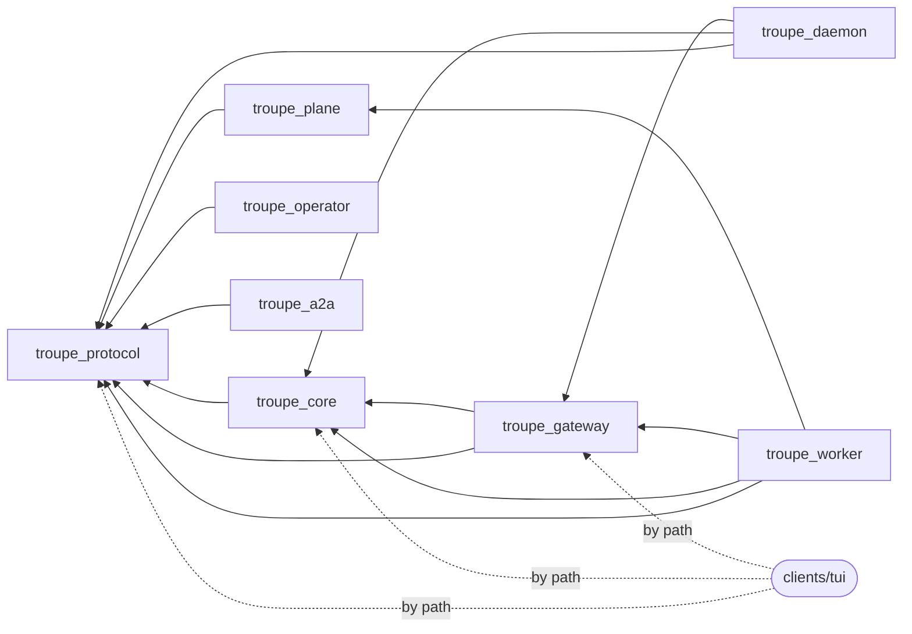
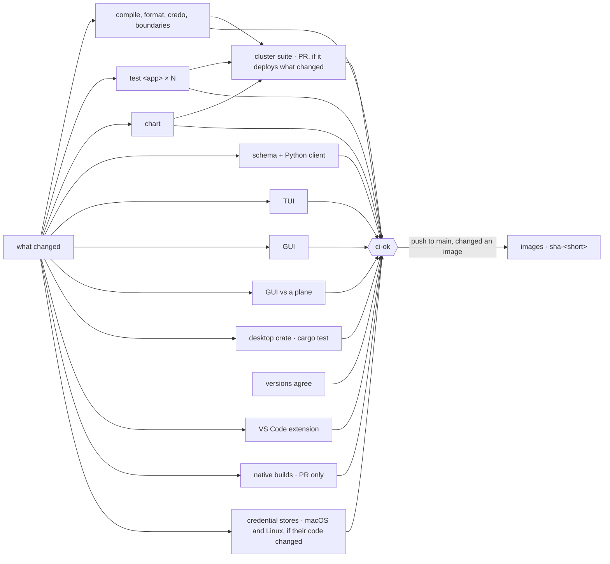
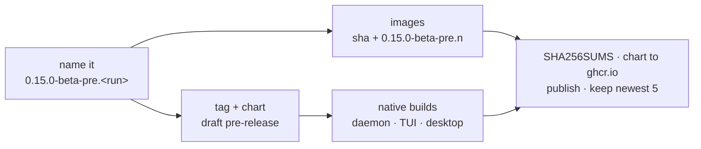
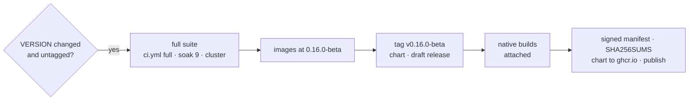

# CI, pre-releases and releases

Three speeds, one set of jobs (Decision 676):

| | when | runs | publishes |
|---|---|---|---|
| **Focused CI** — [`ci.yml`](../../.github/workflows/ci.yml) | every pull request into `main`, every push to `main` | only what the change can have broken, the [cluster suite](#the-suite-that-needs-a-cluster) included when it deploys what changed | `main`: the five images as `sha-<short>` |
| **Pre-release** — [`prerelease.yml`](../../.github/workflows/prerelease.yml) | by hand, any branch or commit | builds only, **no test suite** | a GitHub pre-release `v<VERSION>-pre.<n>`: images, chart, `troupe`, `troupe-daemon`, desktop installers |
| **Release** — [`release.yml`](../../.github/workflows/release.yml) | merging a VERSION change (`scripts/release 0.16.0-beta`) | **the full suite**: every job, nine soak runs, the cluster suite | the GitHub release `v<VERSION>`, images and chart at that version |

Plus [`nightly.yml`](../../.github/workflows/nightly.yml) — the full suite, the native builds and the harness against a real model on `main` every night, publishing nothing — [`pages.yml`](../../.github/workflows/pages.yml), which builds the documentation site on every pull request and publishes it from `main` (Decision 739), and [`quick-start.yml`](../../.github/workflows/quick-start.yml), which runs [the quick start](../quick-start.md)'s commands every night against the latest release, on Linux and Windows, as a reader would (Decision 740).

**Nothing here deploys** (Decision 735). A release publishes and ends: a deployment takes the published chart and images and rolls them from somewhere of its own, and no workflow in this repository knows where that is or holds a credential for it.

## Where it is published

| what | where | tags |
|---|---|---|
| the five images | `ghcr.io/it-minds/troupe-plane`, `troupe-operator`, `troupe-worker`, `troupe-a2a`, `troupe-gui` | `sha-<short>` for every build; the version for a release or a pre-release |
| the chart | `oci://ghcr.io/it-minds/charts/troupe`, and `troupe-<version>.tgz` on the release page | the version, for a release, and for a pre-release that built its images |
| `troupe`, `troupe-daemon`, the desktop installers, `install.sh`, `install.ps1` | the release page | — |

The packages are public, so a cluster pulls them with no credential. They are pushed with the workflow's own `GITHUB_TOKEN` (`packages: write`), which reaches its own owner's packages alone, so a fork publishes to its own `ghcr.io/<owner>`. There is no registry to configure; a deployment that wants its images in its own registry copies them from here. The chart's `values.yaml` names these images, with tags defaulting to the chart's version.

## Focused CI: what a change runs

`changes` compares the change with its base and plans the run. Umbrella apps are chosen from the dependency graph the apps' own `mix.exs` files declare, so a change to an app tests it and **every app that depends on it**, and nothing else:

Arrows point at what an app depends on; a change flows back along them. So:

| the change touches | umbrella suites | also |
|---|---|---|
| `clients/gui/**` | — | GUI (tokens, typecheck, build, test); GUI-e2e if the client package; the desktop crate's `cargo test` if `apps/desktop/src-tauri`; native builds (PR) if the desktop app or the client package |
| `clients/tui/**` | — | TUI `mix check`; native builds (PR) |
| `clients/vscode/**` | — | the VS Code extension: typecheck, unit tests, its suite inside a real VS Code on Linux and Windows (and macOS in a full run), and the `.vsix` as the run's artifact |
| `docs/user/cli-reference.md` | — | TUI `mix check`, which holds it to the command tables |
| `apps/troupe_daemon` | daemon | native builds (PR) |
| `apps/troupe_plane` | plane, worker | GUI-e2e; the cluster suite (pull request) if its migrations |
| `apps/troupe_operator` | operator | the cluster suite (pull request) |
| `apps/troupe_a2a` | a2a | — |
| `apps/troupe_core` | core, gateway, daemon, worker | TUI, protocol, GUI-e2e |
| `apps/troupe_gateway` | gateway, daemon, worker | TUI, protocol, GUI-e2e |
| `apps/troupe_protocol`, `config/`, `mix.lock` | all eight | TUI, protocol, GUI-e2e |
| `charts/`, `docker/` | — | chart (lint, render, kubeconform), GUI-e2e, the cluster suite (pull request) |
| `dev/kind/`, `scripts/kind-up`, `scripts/remote-up`, `scripts/build-images`, `scripts/kind-upgrade-check` | — | chart, the cluster suite (pull request) |
| `apps/troupe_protocol/lib/troupe/keyring*`, the desktop's `secrets.rs` | as their app | [the credential stores](#the-credential-stores) on a macOS keychain and a Secret Service |
| `scripts/signing/`, `Troupe.Release.OSSigning`, `tauri.signing.conf.json`, `native.yml` | as their app | the release's OS signing, self-signed, on a Mac and on Windows (`signing.yml`, [code-signing.md](code-signing.md#how-it-is-tested-without-apple-or-microsoft)) |
| `PROTOCOL.md`, `protocol/`, `VERSION`, `.tool-versions`, `.github/workflows/` | everything | but the native builds, unless `native.yml` changed, the cluster suite, unless `cluster.yml` or `VERSION` changed, the credential stores, unless `keyring.yml` changed, and the signing, unless `native.yml` or `signing.yml` did |
| anything else (docs) | — | only `versions` |

`versions` runs whatever changed, because a moved file can break any of what it checks:
every copy of the version agrees, every Markdown link resolves, no deployment is named,
every decision in `docs/decisions/` has its fields, a number of its own and `paths`
that match something (`mix troupe.decisions --check`, run there with a bare `elixir`;
Decision 790), and no changed code file cites a decision number more often than it did
at the base (`scripts/decision-citations.exs --base HEAD^1`, the job checking out two
commits; Decision 882).

Each umbrella app is its own parallel leg (`test <app>`), and one `lint` job compiles the whole umbrella with warnings as errors and runs format, credo, the generated-asset checks, the boundaries and the bench ([bench.md](bench.md): a turn's cost and shape held to budgets, its table in the run's summary) whenever any app is under test.

`ci-ok` is the one required check: it fails if any job that ran failed, and a job skipped because its part of the repository did not change counts as passing. A push to `main` publishes the images once `ci-ok` has passed. The soak belongs to the nightly and releases, not focused runs; the cluster suite is in focused runs only where a pull request changes what it deploys (below).

## The suite that needs a cluster

[`cluster.yml`](../../.github/workflows/cluster.yml) is two jobs side by side, each on a
kind cluster of its own (Decision 889): `kind`, the chart installed fresh and `mix
troupe.e2e`, and `upgrade`, the release before this one installed from the registry and
upgraded to this tree ([below](#the-upgrade-from-the-previous-release), Decision 936). They
run:

- on a **pull request** that changes what the cluster runs: `charts/` (the CRDs and the
  admission policy among it), `docker/`, `dev/kind/`, `scripts/kind-up`,
  `scripts/remote-up`, `scripts/build-images`, `scripts/kind-upgrade-check`,
  `apps/troupe_operator/` (the operator and the suite itself), `cluster.yml`, the plane's
  migrations (`apps/troupe_plane/priv/repo/migrations/`), `VERSION`, or what the images are
  built from that lives elsewhere (`clients/gui/Dockerfile`, the repository's
  `.dockerignore`). Into `main` through
  `ci.yml`, after `lint`, the test legs and `chart` have passed or been skipped; into a
  `development-*` chunk through `dev-check.yml`, after its compile, because a fixer's
  machine may have no cluster and the chunk's own pull request into `main` comes only once
  every fix is in;
- in the **nightly** and every **release**, whatever changed.

Not on a push to `main`, whose pull request ran it, and not for a change to the workflows
in general, which runs everything else.

In order: the runner's AppArmor restriction on unprivileged user namespaces lifted, as
the test legs lift it, since the runner's kernel is the node's and a worker's bubblewrap
needs one; `scripts/kind-up` (a cluster with no CNI); the CRDs applied and the admission
policy and the kind values' TroupePolicy put through a server-side dry run, before anything
is built, so a rule the API server refuses fails in about a minute (the 0.16.0 release met
one ten minutes into this job, and nothing before it had applied a CRD to an API server);
`scripts/remote-up` (Cilium, the ingress, the five images built and loaded, the chart, a
profile); a stand-in answering at 169.254.169.254 on the runner, for the metadata test;
then the suite, with its Mix build cached under a key of its own.

**What it costs.** About twenty-five minutes of one runner, most of it the image builds
(nine minutes) and the suite (twelve). On a pull request it starts once the cheaper checks
of the same change have passed, so it is the last to finish on a change to the chart or the
operator; a change elsewhere does not run it.

**On a laptop**, the same: `scripts/remote-up` once, then `scripts/e2e` (or `mix
troupe.e2e` with kind, kubectl and helm on the machine). The metadata test says it skipped
the connection where nothing answers at that address; CI sets
`TROUPE_E2E_METADATA_STAND_IN=1`, so there a missing stand-in fails it.

### The upgrade from the previous release

`upgrade` runs `scripts/kind-upgrade-check`, which is what a deployment does with every
release ([../admin/upgrading.md](../admin/upgrading.md)) with an organisation in it:

1. **The previous release**: the newest `v*` tag at or below `VERSION` that is not this
   commit (on a chunk branch the release it was cut from, on a release commit the one
   before), or `--from <version>` / `TROUPE_UPGRADE_FROM`. Its chart from
   `oci://ghcr.io/it-minds/charts/troupe` (`TROUPE_UPGRADE_CHART` names another, a `.tgz`
   or a directory, for a machine that cannot reach the registry), its CRDs, its images
   pulled from `ghcr.io/it-minds`, and its own tag's `dev/kind/values.yaml`, by
   `scripts/remote-up` on a kind cluster with no Troupe on it.
2. **A seed** through the protocol (`apps/troupe_operator/test/upgrade/seed_test.exs`): a
   team with a profile granted, the profile following the release with the scripted `fake`
   model, a session that ran a turn and went dormant, the organisation's memory, a client
   version policy and the signing key a client pins, a webhook trigger with its key that
   fired once, and the audit rows all of that wrote.
3. **This tree's images**, built and loaded (`scripts/build-images`).
4. **The upgrade, and nothing else**: this tree's CRDs (`helm show crds charts/troupe |
   kubectl apply --server-side --force-conflicts -f -`), then `helm upgrade` to
   `charts/troupe`, its migrate hook first, and the rollout.
5. **The check** (`test/upgrade/check_test.exs`): `/.well-known/troupe` reports this
   commit; the audit chain verifies and still has the seeded rows; the team and the profile
   are there; the client policy is served and verifies under the key pinned before; the
   profile is Ready with its pods replaced on the new release by themselves; the dormant
   session wakes there, its log read back, and answers a turn; the memory reaches a new
   session; the trigger fires on its old key.

A hook that fails, a CRD the API server refuses, a rollout that does not finish or a seeded
thing lost fails the job, and `.e2e/upgrade/logs/` (the migration Job's log, the plane's,
the operator's, the workers', the release's history, the pods and events) is its artifact.
A step that needed a person is the failure: there is no step for one.

The services beside the chart (PostgreSQL, MinIO, OpenBao, Dex in `dev/kind/dependencies.yaml`)
are a deployment's own and are this tree's under both releases; where they changed since
the previous release, the script says so and writes the diff beside the logs, since that is
a precondition the upgrade page has to name.

N−1 to N only. A release skipped on the way is tested nowhere, and the upgrade page says
so.

**What it costs.** About as long as the fresh job, on a runner of its own: the five image
builds, a second cluster, the seed and the check, each with a worker pod to start. Beside
`kind`, so a pull request waits for the longer of the two rather than their sum.

**On a laptop**, `scripts/kind-upgrade-check` (with `--recreate` where `scripts/remote-up`
already put a Troupe on the cluster; it refuses to upgrade one it did not install) under
the plane lock. The suite runs in the toolbox container, as `scripts/e2e` runs it; the
times of each step are printed at the end.

## The credential stores

[`keyring.yml`](../../.github/workflows/keyring.yml) runs `Troupe.Keyring`'s own store
(`apps/troupe_protocol/test/troupe/keyring_test.exs`) against a macOS keychain on a
`macos-14` runner and a Secret Service on Linux (`gnome-keyring` on a session bus of the
step's own, its login keyring made and unlocked with a password of the job's own), and the desktop crate's
`secrets.rs` tests against the same keychain: a value stored, read, replaced, four
kilobytes of it whole, and deleted. Every other suite runs the store in the VM, and a
Windows laptop has only Credential Manager. It runs on a pull request that changes
`apps/troupe_protocol/lib/troupe/keyring*`, its test, the desktop's `secrets.rs` or
`keyring.yml`: into `main` through `ci.yml`, into a `development-*` chunk through
`dev-check.yml`, after its compile; and in the nightly and every release. Both tests skip,
saying so, on a machine with no store; the job sets `TROUPE_KEYRING_REQUIRE=1`, so a store
that did not come up fails it.

## Pre-release: a build to try, now

`Actions → pre-release → Run workflow`, with a branch, tag or commit. About twenty minutes, most of it the Windows and macOS builders.

- **No test suite.** The native jobs' own smoke tests still run (`--version`, a headless run in the embedded daemon), because a binary that cannot start is not a build.
- The daemon, the TUI and the plane report the pre-release's version. The desktop installers keep VERSION's number: an MSI version must be numeric.
- It is a GitHub *pre-release*, so `/releases/latest` and the installers' default never pick it up. The `install.sh` and `install.ps1` attached to it install it (`scripts/release-installers` pins them), and so does naming it:
  `TROUPE_VERSION=0.15.0-beta-pre.12 sh install.sh` or `$env:TROUPE_VERSION = "0.15.0-beta-pre.12"; .\install.ps1`. A pre-release has no signed `manifest.json`, so either installer refuses it on a machine where `minisign` is installed, and `troupe update` refuses its builds.
- Nothing is deployed. Its images and chart are installed like a release's, by naming the version: Helm never picks a pre-release version by itself.
- Only the newest five are kept (`keep`); older pre-releases and their tags are deleted. Release candidates (`-rc.N`) are releases and are never touched.

## Release: the full suite, then everything

`scripts/release 0.16.0-beta` opens the pull request that changes VERSION. Merging it is the release:

- The full suite is `ci.yml` called with `full: true`: every job whatever changed, each app's suite nine more times, and the cluster suite on kind. Nothing is trusted from an earlier run.
- The images are built from the commit being released and tagged with the version; the chart is packaged at that version, so it pulls exactly those.
- The `publish` job runs in the `release` environment and signs the release before anything else: `scripts/release-desktop-update.exs` writes the desktop app's `latest.json` and a `.sig` beside each file it updates from (Decision 874), then `scripts/release-manifest.exs` writes `manifest.json`, every file attached with its component, target, size and sha256, and `manifest.json.minisig` with the release key ([below](#the-release-key)), then `SHA256SUMS` covers both. Without the key the job fails there and the release stays a draft: it is never published unsigned (Decision 865).
- The chart goes to `oci://ghcr.io/it-minds/charts/troupe` just before the release is published, so a chart version in the registry is a release that finished. The release's notes show both ways to install it.
- A version with a hyphen — a beta such as `0.15.0-beta`, or a release candidate such as `1.0.0-rc.1` — runs all of it and is published as a GitHub pre-release, so `/releases/latest` and the installers' default find it only once it is marked Latest by hand.
- A release whose run failed after VERSION merged can be retried with `Actions → release → Run workflow`: by hand it cuts VERSION's version if that has no tag yet.

### The release key

One minisign key (Ed25519) signs every release's manifest; `troupe update` and the
installers check it before they install anything ([updating](../user/updating.md),
Decision 865). The maintainer creates it once, on a machine of their own, and nobody else
holds the secret half:

1. `minisign -G -W -p troupe-release.pub -s troupe-release.key` makes the pair, the secret
   key unencrypted (`-W`): the environment below is its protection.
2. In the repository's settings, **Environments → `release`** (create it if a run has not),
   add the secret `RELEASE_MINISIGN_KEY` with the whole of `troupe-release.key`, both lines.
   Restrict the environment to `main` as well, so no other branch can sign.
3. Put the public key's second line (`RW...`) first in
   `apps/troupe_core/priv/release-keys.txt`, by pull request. Every `troupe` and
   `troupe-daemon` built from then on trusts it, and `scripts/release-installers` writes it
   into the installers a release attaches.
4. Keep `troupe-release.key` offline, or destroy it: the environment's copy is the one that
   signs.

Until both are there the release workflow fails at the manifest, saying which is missing.
The key in the environment must be the first key in the list, or the script refuses it.

**Rotating it.** Make a new pair; put its public key first in `release-keys.txt` and keep
the old one on the line below; set `RELEASE_MINISIGN_KEY` to the new key and add
`RELEASE_MINISIGN_KEY_PREVIOUS` with the old one. The next release is signed with both, so a
client built before it can still check it. In the release after that, take the old key out
of the list and delete `RELEASE_MINISIGN_KEY_PREVIOUS`. If the key is lost or leaked, rotate
the same way, and say in the release's notes which key to stop trusting.

## Nightly

The full suite and the native builds on `main` at 02:17 UTC, publishing nothing — so a race, a cluster regression or a broken Windows build shows up the next morning, not in the middle of a release.

### The live check

[`live.yml`](../../.github/workflows/live.yml), in the same run: the harness against a real model, through the LiteLLM gateway. Everything else here uses the scripted `fake` model, which does as it is told; the sessions that ran away with real money did so on a real one. `scripts/install-local --tui` builds `troupe-daemon` and `troupe` from the commit, as a person building from source would, and [`scripts/live-check`](../../scripts/live-check) makes three `troupe run build … --headless` runs, each in an empty workspace with its own daemon and config and a five-minute timeout:

| run | passes when | a failure means |
|---|---|---|
| **a headless task**: write `hello.txt` with one given line, then stop | exit 0, the file holds the line, the log has a `turn_ended` | the headless runner does not exit when a real model ends its turn in prose (#127), or the task was not done |
| **a delegation**: find a fact in `notes/` through one `explore` subagent | exit 0, and a `delegate` call whose result is the subagent's summary or its honest note that it was cut short (#130) | the delegation never happened, failed, or came back empty. The fact missing from the final answer is a warning, not a failure |
| **a failing tool loop**: read a file that is never there, and keep retrying | the failure guard, set to three here, stops the turn after three failed reads: `turn_ended` with `reason: tool_failures`, exit 1 | a budget stopped the loop and the guard did not (#117), or the job's own timeout did and nothing in the harness had. *Inconclusive* means the model gave up by itself before the third failure, so the guard was not reached |

A failure is a harness regression until shown otherwise: the step prints the run's output and, on failure, the session's log (one event a line) and the daemon's. A warning is about what the model said and needs nothing unless it repeats.

**What it may spend.** Each run's user config limits an agent to 12 model calls, 200,000 input tokens, 24,000 output tokens and four minutes, and a spent budget stops rather than asks (`budget_asks: false`). The brief's automatic refresh is off (`memory_auto_refresh: false`), so no librarian starts. The job stops at 20 minutes whatever happens, and the key is capped at the gateway at about $2 a day, the most a runaway night costs. The job summary lists each run's model calls, tokens and cost: the gateway's price where it gives one, else the harness's own from `TROUPE_NIGHTLY_MODEL_PRICES`, marked *priced here* (#160). The gateway prices no streamed call, so for `qwen3-235b` the column says *not reported* until that variable holds the gateway's rates. A night that goes as it should is some tens of thousands of input tokens.

**By hand**, alone: `gh workflow run nightly.yml -f only=live`, with `--ref <branch>` to try a branch before it merges, or `Actions → nightly → Run workflow` with *only* set to `live`. `all` is the whole nightly, about seventy minutes. GitHub offers a dispatch only for a workflow `main` has, and the run then uses the branch's copy of it.

## Files

| workflow | what | called by |
|---|---|---|
| `ci.yml` | every check; focused or full | pull requests into `main`, pushes to `main`, `nightly.yml`, `release.yml` |
| `dev-check.yml` | compile, credo, schema, client builds (the VS Code extension's `.vsix` kept as the run's artifact), and the decisions' check and the citation check whatever changed; no tests but the cluster suite, when the change touches what it deploys | every other pull request: into a `development-*` chunk ([fixing-issues.md](fixing-issues.md)), or stacked on another branch |
| `cluster.yml` | the suite that needs a cluster, on kind ([above](#the-suite-that-needs-a-cluster)) | `ci.yml`, `dev-check.yml` |
| `licences.yml` | every locked package's licence against the policy in `scripts/licences.exs`, and `docs/third-party-licences.md`, `THIRD-PARTY-NOTICES.txt` and the chart's LICENSE and NOTICE current | every pull request |
| `pages.yml` | the documentation site (`mkdocs.yml`), strict: a broken link, a nav entry to a missing page or a page left out of the nav fails it; on `main`, published to GitHub Pages | every pull request, pushes to `main` |
| `dco.yml` | every commit authored from 2026-09-27 has its author's `Signed-off-by:` ([CONTRIBUTING.md](../../CONTRIBUTING.md)) | pull requests into `main` and `development-*` |
| `images.yml` | the five images to ghcr.io, `sha-<short>` and an optional version | `ci.yml` (main), `prerelease.yml`, `release.yml` |
| `native.yml` | `troupe-daemon` ×5, `troupe` ×5, desktop ×3; optionally attached to a release; OS-signed with `sign: release` ([code-signing.md](code-signing.md#6-the-day-the-certificates-exist)) | `ci.yml` (PRs that touch them, without macOS), `nightly.yml`, `prerelease.yml`, `release.yml` (signed), `signing.yml` |
| `signing.yml` | `native.yml` with `sign: self-signed` on one Mac and Windows, and the manifest held to what was signed | `ci.yml`, `dev-check.yml` (PRs that change what signs) |
| `prerelease.yml` | an untested pre-release of any commit | by hand |
| `release.yml` | full suite → images → tag → publish | a VERSION change on `main`; by hand to retry |
| `nightly.yml` | full suite + native builds + the live check; `only: live` for the last alone | schedule; by hand |
| `live.yml` | three headless runs against the real gateway | `nightly.yml` |
| `quick-start.yml` | the blocks `docs/quick-start.md` marks, from the latest release's installers, on Ubuntu (`sh`) and Windows (PowerShell), with the scripted model; that the README's quick start is the page's and its protocol badge PROTOCOL.md's version | schedule; pull requests that change the page, the README, PROTOCOL.md or it; by hand, with a release to install |

## Runners and timeouts

Every Linux job names its runner image instead of taking `ubuntu-latest`, and every job
stops at about three times its usual length (Decision 796): Ubuntu 26.04 for most; 24.04
for the cluster suite, the TUI's jobs, the native Linux builds, the live check and the quick
start's Linux run; 22.04 for the desktop app's Linux build, the glibc floor. The VS Code
extension's Windows and macOS legs and the desktop app's Windows build still take
`windows-latest` and `macos-latest` (D81). A new job names its image. A native target's timeout is the `timeout` beside it
in `native.yml`'s target lists, and a timeout that fires on a healthy but slow run is a
re-run, not a reason to raise it.

## Secrets and variables

The images and the chart need none: the workflow's own token pushes them.

| Name | Kind | Used by |
|---|---|---|
| `RELEASE_MINISIGN_KEY` | `release` environment secret | `release.yml`'s `publish` job: the release key that signs `manifest.json` ([the release key](#the-release-key)). Without it a release is not published |
| `RELEASE_MINISIGN_KEY_PREVIOUS` | `release` environment secret | the same job, during a key rotation only: the key being retired, which signs too |
| `GUI_BASE` | repository variable | `images.yml`: the GUI's mount path baked into its assets, default `app` |
| `APPLE_*`, `AZURE_*` | `release` environment secrets | `native.yml` with `sign: release`: sign and notarise every macOS and Windows artifact and what it unpacks; absent, a release is unsigned and says so ([code-signing.md](code-signing.md#the-secrets)) |
| `TROUPE_NIGHTLY_BASE_URL`, `TROUPE_NIGHTLY_API_KEY` | repository secrets | `nightly.yml` → `live.yml`: the LiteLLM gateway (OpenAI-compatible, with `/v1` or without) and a key for it, capped there at about $2 a day. Without both the live check fails and says so |
| `TROUPE_NIGHTLY_MODEL` | repository variable | the model the live check runs, by the gateway's name for it; default `qwen3-235b`, the model the runaway sessions were on |
| `TROUPE_NIGHTLY_MODEL_PRICES` | repository variable | `nightly.yml` → `live.yml` → the runs' `TROUPE_MODEL_PRICES`: what the gateway charges for the model, in dollars per million tokens, as `{"qwen3-235b": {"input": <in>, "output": <out>}}` with the rates from the gateway's own model configuration. Unset, the summary's cost column says *not reported*; nothing else changes |

The gateway's key is a repository secret and not an environment's, because the live check
runs on any branch it is dispatched on. What keeps it from a pull request is that only
`nightly.yml` calls `live.yml`, on a schedule or by hand, and the job that holds it runs
for those two events and no other.
