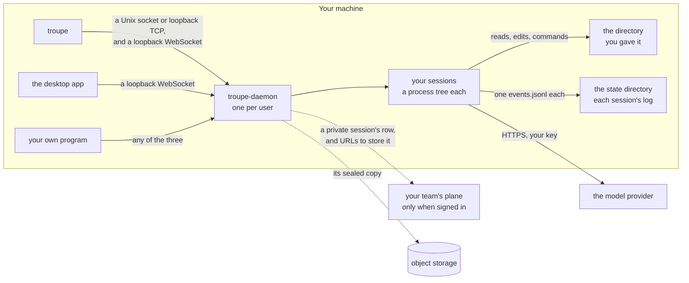

# Troupe for users

Troupe runs a coding agent for you. You give it a task in a directory; it reads, edits,
runs commands and reports back. The work lives in a **session**: a process on one of your
team's worker pods, or in the daemon on your own machine, and the window you look at it
through is only a window. Close it and the session carries on; open it from another
machine and you see the same transcript; two people can open the same session at once.

## First run

1. Install `troupe` and `troupe-daemon` with the latest release's `install.sh` or
   `install.ps1`, saying yes to the TUI ([quick start](../quick-start.md#1-install)).
2. `troupe setup` sets up a model, one question to a screen: where the work runs, the
   provider (a key in the environment, an opencode setup or a working `config.yaml` is
   offered first), the key, the models with their context and price, a first project and
   what the agent may do there without asking, and whether the daemon starts when you log
   in. A summary comes last, and nothing is written before it: Enter writes it and opens
   the first session in that project, Esc leaves with nothing written, Shift-Tab goes back
   a step. Run it again whenever you like. Without a terminal (standard input or output
   redirected) it says which and prints the ways on instead.
3. `troupe` in a project directory opens a session; `troupe run "a task" --headless` does
   one task and exits.
4. The settings are one file, `config.yaml` in `~/.config/troupe/` (`%APPDATA%\troupe\` on
   Windows, with every other file of your own; [where your files
   are](configuration/files.md)), and `troupe config` shows what is in force. The
   [cookbook](configuration/cookbook.md) has a complete file for each provider and more;
   the smallest is [Anthropic's](configuration/providers.md#anthropic), the key read from
   the environment. Your
   organisation may set defaults below it and limits above it; `troupe config --explain`
   says which ([configuration](configuration-layers.md#your-organisations-defaults-and-limits)).
5. `troupe config validate` checks that file after you edit it by hand;
   [configuration.md](configuration.md) has every key.

With no settings and no key, plain `troupe` opens `troupe setup`'s screen before the
session. `troupe config`, on a machine with no `config.yaml`, offers in a terminal to copy
an opencode setup's providers (keys as opencode has them written), and otherwise three
choices: set up a provider here, line by line (Anthropic first, then OpenAI or a gateway:
provider, URL, key and a model from what the provider lists; Enter at every question is
Anthropic with `api_key: "{env:ANTHROPIC_API_KEY}"`); take your organisation's settings
from a plane (`troupe login`, then `troupe config pull`); or not now. Without a terminal it
prints the choices and asks nothing. A `config.yaml` through which no model can be asked
gets the report and then the same choices, and the installers end with the same check.
Whatever finds no key says so with one next step, `troupe config`: the report's last line,
a headless run's model error, the first turn in the TUI. A first run finished in the
desktop app is recorded by the daemon, and plain `troupe` asks nothing then.

`troupe doctor` checks the setup, one line each: the config files load, the default
model's provider has a key, the key is accepted (a real request, the provider's model
list), where the key is kept, that the helper every command runs under starts, whether a
daemon is running, `troupe-daemon` and `troupe` on the `PATH`, and every plane you are
signed in to. A line that says `FAIL` makes it exit 1; `warn` does not. `troupe-daemon
doctor` prints the same lines. `troupe doctor --bench` then says whether a session gets
through the harness on this machine: a turn of thirty tool calls, a tool output too long
to send whole, a compaction, a cancel, a replay of the session's log, thinking made before
the prompt changed, Claude Code's, opencode's, Cursor's and Copilot's files onboarded, and a
remembered command whose file changed since, eleven scenarios run in `troupe`
itself against a scripted model, so in a few seconds and with no provider, key or network,
a line each saying it passed or what did not hold (`--json` prints it as one object).
`troupe bench --live` goes further: four small tasks against your model, under a cap it
prints and asks about first, saying whether they got done and what each cost
([what a task costs](bench.md)).

**The desktop app** asks the same questions on its first run, as screens, then opens a
first session with a suggested prompt. It writes the same `config.yaml`, and once it is
done the terminal client does not ask again. **Setup** in the app's rail runs it again at
any time, and a session whose key the provider refuses offers it too. Without either, the
app's **This computer** screen, under **Models**, sets up the same file, or you write it
yourself.

## Ways in

On your own machine every way in is a client of one daemon, `troupe-daemon`, which runs
your sessions and outlives the windows you look at them through. Whichever client needs it
first starts it (the terminal client runs one inside itself when none is running), and it
stops on its own a while after the last client leaves, or never once `troupe daemon login
on` has it start at login ([troupe-daemon](../../apps/troupe_daemon/README.md#how-long-it-stays-up),
[start at login](../../apps/troupe_daemon/README.md#start-at-login)):

| Way in | What it is | Its documentation |
|---|---|---|
| `troupe` | the terminal UI, on the daemon on your machine; `troupe --remote` for your team's plane | [clients/tui](../../clients/tui/README.md) |
| VS Code | **Troupe: Open** opens `troupe` in a terminal tab beside your files, at the folder you are working in; the Troupe side bar shows that folder's settings | [vscode.md](vscode.md) |
| The desktop app, or the GUI at your plane's `/app` | the graphical client: sessions on your machine and on the plane in one list, approvals from an inbox. **Use this computer only** on the sign-in screen skips signing in and never contacts a plane. In a browser, `troupe-daemon open` connects the GUI to your machine | [clients/gui](../../clients/gui/README.md); installing the unsigned desktop builds: [install.md](../../clients/gui/docs/install.md) |
| Your own program | anything that speaks [PROTOCOL.md](../../PROTOCOL.md) to a daemon or a pod | the protocol |
| Another agent | a profile called through the A2A facade | [a2a.md](../a2a.md) |

`troupe update` keeps `troupe` and the daemon current, checking each release's signature
first, and the desktop app updates itself and the daemon beside it the same way
([updating](updating.md)). `troupe login <plane URL>` signs you in with a code you type in
your browser; you sign in where you always do, and Troupe never has a password of its own.

## Words you will meet

The [glossary](../glossary.md) defines each of Troupe's words: a **plane**, a **team**, a
**profile**, a **bundle**, a **trigger** and the rest. What follows is what you do with
the ones you meet first.

**Session.** One agent working in one directory, with a durable log: `active`, `dormant`
(stopped, log kept, woken when used), `read_only`, or `erased`. In the TUI `/new` starts
another beside it (`--private`, `--remote PROFILE`, or `--branch` for a fork that goes on
from this one's conversation) and `/back` returns; `troupe resume latest` opens the newest
in the directory, and `troupe resume ID --headless "message"` runs one more turn on it and
exits ([command reference](cli-reference.md)). A session you erase reads
`erasure_pending` until the plane has destroyed its key. Erased on your machine, it is
erased at the plane too and goes from your machine once the key is gone; erased elsewhere,
the copy on your machine goes the next time your client signs your daemon in. Erasing one
on your machine needs that sign-in: without it the daemon erases nothing and says which
plane it is sealed at.

**Private session.** A session on your machine sealed under your own key, listed by the
plane and opened from another device: `troupe --private`, or *Keep it private* in the
desktop app once *This computer* uses your account. Your client hands the daemon its
sign-in to the plane, again as it renews it and after the daemon restarts, and the daemon
keeps it in memory only; one started while it had none is sealed once it has. Signing out
(`troupe logout`, or *Sign out* in the desktop app) takes it back, and nothing is sealed
until you sign in again, when each private session carries on where it stopped. One with
nothing running goes dormant on its own a while after you stop looking at it, even while
it waits on your answer, so it does not keep the daemon up; answering later wakes it, and
the turn carries on.

**Steering from another device.** A session on your machine you offer to the plane you are
signed in to, so you can follow and steer it from the desktop app or the console on
another device (the console's *Mine*, which anybody the plane knows signs in to, not only
its administrators): `/steer on` in the terminal, or *Steer from elsewhere* in the session's
head in the desktop app. Name the people who may steer it too (`/steer on
bea@example.com`), or only follow it (`cy@example.com:observe`). Your machine keeps one
connection to the plane while it is offered and nothing listens on it; your rules and
approvals hold for every prompt, and an approval answered from elsewhere is for that one
call. Elsewhere it is listed as *Remote*, with *Offline since …* while your machine is
away, as soon as it is offered, withdrawn or goes away, since the plane tells the desktop
app and the console rather than being asked again; the desktop app names who is steering
your session as they arrive and leave; in the terminal, HQ (`/remote`) lists the sessions offered to you beside the plane's,
as `laptop` rows, and opens one to steer it. Who joins and leaves is said in the session's
window, and the status line names who is there. At your first offer the daemon signs in
for itself and keeps that sign-in in your computer's credential store, so the offer stays
online after you close the terminal or the app, and the daemon does not stop while
something is offered. `/steer off`, or *Withdraw*, ends every remote view at once; with
the last one withdrawn, signing out or `troupe logout`, the daemon lets its sign-in go.
Your team's administrators may turn offering off for the team. A private session is never
offered.

**Agent.** A session starts with `build`, or `plan` for a proposal first, which may
delegate to others, waiting for each or letting it work in the background while it goes
on; it can look in on one at work and stop it, and cancelling the turn stops them too.
Your team's bundle or your own files can add more ([agents](agents.md)).

**Goal and loop.** `/goal <text>` in the TUI sets what the session works towards; the
agent sees it on every later turn until `/goal clear`, and it survives a restart. `/loop
[n]` lets the session work towards it on its own for up to `n` turns (10 unless you say,
`loop_max_iterations`). Each turn ends with the agent saying whether the goal is met, and
the loop stops when it is, at the limit, after three failed turns in a row, when the
budget asks you, or on `/loop stop`. The status line shows how far it has got, and you can
keep typing while it runs.

**Approval.** Writing or editing a file and running a shell command ask first: the session
stops that one call and waits for allow, deny or allow-for-this-session. Anyone attached
with control rights can answer; the first answer wins and everyone is told who gave it.

**Budget.** Limits on turns, tokens and time, plus your team's money budget on the plane.
When one is reached the agent says which and asks, or stops; it never silently continues.
The question says what the session has used and spent, and you answer with how much more
and for how long: pick a size for this run, this session or this workspace (which writes
it to the repository's `.troupe/config.yaml`, so the next session there starts with it),
or type an amount (`+25`, `+50k tokens`, `+15 min`, with `session` or `workspace` after
it). "No limit this session" lifts the limit it asked about for the rest of the session,
and the others still ask. Apart from the budget, a tool that fails ten times in a row
stops the turn and asks whether to go on, even with every limit lifted.

**Cost.** One thing you type is often many model calls, each sending the whole
conversation again. When a turn ends, the desktop app says what it cost in one line under
it, and `troupe run --headless` prints the same line:
`turn: 12 calls · ↑ 48.2k sent · 610.4k cached · ↓ 6.3k received · $0.41`, its
subagents' calls included, and the one that summarises the conversation when it is
compacted; the TUI says it in its side panel
([tokens and cost](terminal-screen.md#tokens-and-cost)). `sent` is input billed in
full, `cached` what the provider's prompt cache served at a fraction of the price, and the
money is what the gateway said or what the model's price comes to (`no price` when nothing
prices it; [what a call costs](models.md#what-a-call-costs)). The session's log keeps the
same figures for every turn, and for every call what its prompt was made of: the system
prompt, the instruction files and brief when the system prompt carries them
(`system_prompt: per_turn`; by default they go with the turn and count in the
conversation), the tool definitions, the conversation and the tool results.

**Repository.** A session on the plane may be created with a GitHub repository
(`owner/name`), and its pod starts from a clone of it. On a profile that allows it, the
agent then pushes its work to a `troupe/*` branch, opens a draft pull request, reads CI on
it and pushes fixes, as your organisation's GitHub App and never as you; after three red
CI rounds it stops, says on the pull request what still fails, and leaves the draft for a
person. Each push and the pull request's link are in the transcript, and the session's
listing shows its branch, last commit and pull request
([the GitHub App](../admin/github-runs.md#the-fix-loop)).

## Reading a transcript

A turn shows its answer, not its working. Everything rendered from something is a frame
on a surface of its own, a step from the chat: the model's prose, a code block, a diff, a
tool call and what came back, reasoning, data. What you typed keeps its own panel. By
default a turn's reasoning, its calls and the prose between them are one line where they
began, above the answer: `▸ 7 steps · 1 failed · grep, read_file, edit_file · 14s`. The
design both clients follow is [docs/design/frames.md](../design/frames.md), and the TUI's
own way of drawing it is in [its page](terminal-screen.md#reading-a-transcript).

- **In the desktop app** a click on that line opens the whole turn, every frame in it, and
  another click shuts it. `/detail quiet`, `/detail tools` or `/detail everything` in the
  command palette changes how much of every turn is open in this session's window, and
  draws the history again: `tools` opens each call's frame, its result cut past 24 lines
  to its first 20 (a press on `… 42 more lines` shows the rest in place) and its reasoning
  to `▸ thinking · 12s`; `everything` collapses nothing, arguments included, which is what
  a bug report wants. Whatever the level, a call that failed is open with its error, an
  approval or a question waits in its panel, and everything after a budget ran out is open.
- **The answer** is rendered from its Markdown: headings, lists nested to any depth,
  tables, quotes, and each fenced block a frame of its own, code with its language and
  path, a `diff` with `+n −m`, and `csv`, `tsv` or `json` as a table with its row count.
  **source** at the top of an answer shows the Markdown as the model wrote it. Raw HTML in
  a reply is shown as text, never as markup, and an image is never loaded; Mermaid shows
  its source for now.
- **Reasoning** is what the model streamed before it answered, so it is there for a turn
  the app watched happen, and not in a session opened afterwards.
- **While a turn works**, the line under it says what is running, how many and for how
  long, after a few words from the theatre: `◐ reading the script — running read_file
  a.ex (00:06)`. The facts are always there; waiting on you, the line is `waiting for you`
  in the colour that means you.
- **The default** for every session is the `transcript.detail` setting (`quiet`, `tools`
  or `everything`), from your `config.yaml`, a repository's `.troupe/config.yaml` or your
  organisation's, as any setting. `/detail` changes it for one session and writes nothing;
  the session's log is the same at every level.

## The scratchpad

A document you want to keep, such as a plan, a report, a table or a diagram, does not
belong in the chat, where it scrolls away and has to be printed again to be revised. An
agent puts it on the session's scratchpad instead, with its `show` tool, and keeps its
reply to the short answer and the document's name. It revises a document in place with
`patch`, which replaces an exact span of it or adds to its end, so the conversation
carries the change and not the whole document again; you see the whole document,
revised. Showing a document again under the same name replaces it.

**When an agent uses it.** Only when you ask for a document (a plan, report, table or
diagram to keep or revise), or when its answer would run past about 80 lines. Anything
else it answers in the chat. Ask for "a plan as a document" to get one on the scratchpad;
ask it to "answer here" to keep a long answer in the chat.

- **In the TUI** each document is a card in the transcript where the agent showed it: its
  title, its name, its size, and `new` or `updated 3 times`. `/scratch` lists the
  session's documents and opens one beside the list, Markdown drawn as a reply is and the
  other kinds as written; `/scratch plan.md` opens that one at once.
- **In the desktop app** the card opens the scratchpad beside the conversation, a tab for
  each document, and **Show scratchpad** in the session's header opens it on the latest.
- **Kinds.** A document is `markdown`, `mermaid`, `json`, `csv` or `text`. The clients show
  the last four as text for now.
- **Where it is.** A document is the session's own, beside its log in the state directory,
  never in your working directory: there is nothing to commit or clean up. Erasing the
  session erases its documents, a private session's stay on your machine with its log, and
  a fork has the ones its history shows. Your own program reads one as `scratch:/<name>`
  (`scratch.list` and `fs.read` in [PROTOCOL.md](../../PROTOCOL.md)).
- **Limits.** 256 KiB a document (`scratch_max_bytes`) and 50 documents a session
  (`scratch_max_documents`). Past either, `show` and `patch` refuse and say so, and the
  agent replaces a document or answers in the chat. A document too long for one reply of
  the model's is written in parts: the agent shows its start and patches the rest on.
- **What it costs.** Until the conversation is compacted, a document's words are in it as
  the `show` call's arguments, so it costs about what the same answer in the chat would,
  and a `patch` carries only its change. A compaction leaves each document out for a
  one-line pointer (its name, title, version and size), and a long patch too, and the
  summary it writes lists every document on the scratchpad, so from then on the model is
  not sent them again but knows they are there. When the agent needs one after that, it
  reads it back with `read_file` on `scratch:/<name>`; that read is the only way the
  agent's tools reach the scratchpad, and it writes there only with `show` and `patch`. In
  a long session that compacts often, the scratchpad costs more than answering in the
  chat, not less: each revision is a call of its own and a reply, and each read back after
  a compaction is another ([bench.md](../developer/bench.md) has the measurement). That is
  why an agent uses it only when asked or for a long answer.

## What Troupe never does

- **It never reads your session on the plane.** The plane holds who, which profile, which
  state and what it cost. The transcript lives in the pod's log and in storage encrypted
  under keys the plane cannot use. No administrative method returns what a session said.
- **It never writes where you cannot see.** Every file change goes through a tool that is
  either an approval prompt or a durable event in the log, and nothing Troupe keeps for
  itself lands in your working directory.
- **It never approves its own commands unattended.** An unattended session waits for a
  person or is configured to deny. `--auto-approve` is a choice a client makes for itself,
  and the log records that client as the approver.
- **It never uses your machine unasked.** Offering your own tool server to a session takes
  a deliberate confirmation, and everyone on the session sees it.
- **It never merges.** A session pushes only its own `troupe/*` branch, never with force,
  and opens a pull request only as a draft; a person reviews and merges it. The agent's
  shell never holds a GitHub token: the pod's own tools do the pushing.

Everything it does unasked, and what it never does, in one place for a reviewer:
[security](../admin/security.md). How it works underneath:
[ARCHITECTURE.md](../../ARCHITECTURE.md). Running the platform:
[admin/](../admin/README.md). Every setting, which file wins and how to see where a value
came from: [configuration.md](configuration.md).
