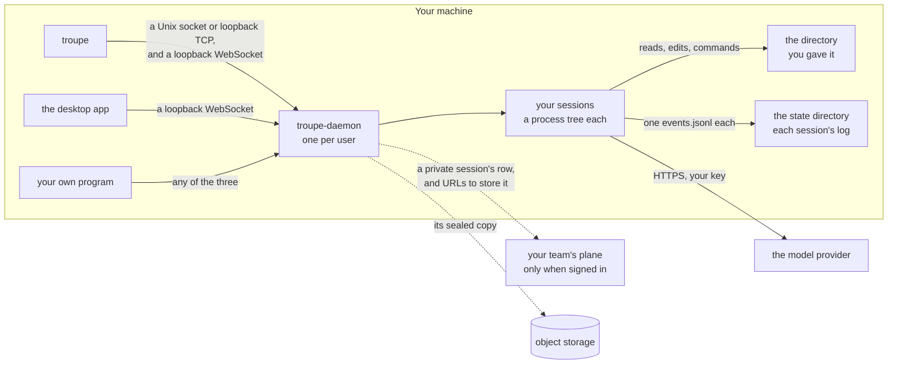

# Troupe for users

Troupe runs a coding agent for you. You give it a task in a directory; it reads, edits,
runs commands and reports back. The work lives in a **session**: a process on one of your
team's worker pods, or in the daemon on your own machine, and the window you look at it
through is only a window. Close it and the session carries on; open it from another
machine and you see the same transcript; two people can open the same session at once.

## First run

1. Install `troupe` and `troupe-daemon` with the latest release's `install.sh` or
   `install.ps1`, saying yes to the TUI ([quick start](../quick-start.md#1-install)).
2. `troupe setup` sets up a model, one question to a screen, and writes one file,
   `config.yaml`; `troupe config` shows what is in force, and the desktop app asks the same
   on its first run ([setting up](setup.md)).
3. `troupe` in a project directory opens a session; `troupe run "a task" --headless` does
   one task and exits.
4. Give it a task. Writing or editing a file and running a shell command ask you first
   ([approvals](sessions.md#approvals)), and when the turn ends it says what it cost
   ([what a call costs](models.md#what-a-call-costs)).
5. When something does not work, `troupe doctor` checks the setup one line at a time
   ([troupe doctor](setup.md#troupe-doctor)); for everything else, the pages below.

## Ways in

On your own machine every way in is a client of one daemon, `troupe-daemon`, which runs
your sessions and outlives the windows you look at them through. Whichever client needs it
first starts it (the terminal client runs one inside itself when none is running), and it
stops on its own a while after the last client leaves, or never once `troupe daemon login
on` has it start at login ([troupe-daemon](../../apps/troupe_daemon/README.md#how-long-it-stays-up),
[start at login](../../apps/troupe_daemon/README.md#start-at-login)):

| Way in | What it is | Its documentation |
|---|---|---|
| `troupe` | the terminal UI, on the daemon on your machine; `troupe --remote` for your team's plane | [clients/tui](../../clients/tui/README.md) |
| VS Code | **Troupe: Open** opens `troupe` in a terminal tab beside your files, at the folder you are working in; the Troupe side bar shows that folder's settings | [vscode.md](vscode.md) |
| The desktop app, or the GUI at your plane's `/app` | the graphical client: sessions on your machine and on the plane in one list, approvals from an inbox. **Use this computer only** on the sign-in screen skips signing in and never contacts a plane. In a browser, `troupe-daemon open` connects the GUI to your machine | [clients/gui](../../clients/gui/README.md); installing the unsigned desktop builds: [install.md](../../clients/gui/docs/install.md) |
| Your own program | anything that speaks [PROTOCOL.md](../../PROTOCOL.md) to a daemon or a pod | the protocol |
| Another agent | a profile called through the A2A facade | [a2a.md](../a2a.md) |

## The pages

The [glossary](../glossary.md) defines each of Troupe's words: a **plane**, a **team**, a
**profile**, a **bundle**, a **trigger** and the rest. Each page below explains one thing,
and the others link to it.

- [Setting up and checking a machine](setup.md): what `troupe setup` and `troupe config`
  ask, `troupe doctor`, and signing in to a plane. Read it when a first run goes wrong.
- [Sessions](sessions.md): starting one, private sessions, Local only, steering from
  another device, goals and loops, approvals, budgets, a repository. Read it before your
  first session on a plane.
- [Sharing a session by name](sessions-shared.md): inviting somebody to follow or steer,
  archiving, and `troupe://` links. Read it when somebody else should see a session.
- [Reading a transcript](transcript.md): what a turn shows in each client, and the
  scratchpad an agent keeps documents on. Read it when a turn's working is hidden.
- [The terminal client's screen](terminal-screen.md): the keys, colours, the observer, the
  palette, the settings page, watch mode and the new-session screen.
- [Command reference](cli-reference.md): every command line and every command inside a
  session.
- [What a profile gives a session](profiles.md): the agents, tools, model, reach and limits
  of a profile on your team's plane, before you start a session on it.
- [Agents, commands and workflows](agents.md): the built-in agents, your own, and the
  commands and workflows you write.
- [Instruction files and onboarding](instructions.md): `AGENTS.md`, rules, the project
  brief, and bringing other tools' files in.
- [Memory](memory.md): what every session of yours starts knowing, at each level, and
  what an agent may write there.
- [Artifacts](artifacts.md): pages, documents and files published for other people, and
  where a file you ask for goes.
- [MCP servers and skills](mcp.md): the tools a session is given, and signing in to one.
- [Models and providers](models.md): which models Troupe can address, what a call costs
  and how hard a model thinks.
- [What a task costs on your setup](bench.md): `troupe bench --live`.
- [Configuration](configuration.md): the files and every key;
  [which file wins](configuration-layers.md), [seeing and changing
  settings](configuration-settings.md) and the [cookbook](configuration/cookbook.md).
- [Updating Troupe](updating.md): `troupe update`, the desktop app's update, and what a
  plane recommends.
- [Troupe in VS Code](vscode.md): the extension.

## What Troupe never does

- **It never reads your session on the plane.** The plane holds who, which profile, which
  state and what it cost. The transcript lives in the pod's log and in storage encrypted
  under keys the plane cannot use. No administrative method returns what a session said.
- **It never writes where you cannot see.** Every file change goes through a tool that is
  either an approval prompt or a durable event in the log, and nothing Troupe keeps for
  itself lands in your working directory.
- **It never approves its own commands unattended.** An unattended session waits for a
  person or is configured to deny. `--auto-approve` is a choice a client makes for itself,
  and the log records that client as the approver.
- **It never uses your machine unasked.** Offering your own tool server to a session takes
  a deliberate confirmation, and everyone on the session sees it.
- **It never merges.** A session pushes only its own `troupe/*` branch, never with force,
  and opens a pull request only as a draft; a person reviews and merges it. The agent's
  shell never holds a GitHub token: the pod's own tools do the pushing.

Everything it does unasked, and what it never does, in one place for a reviewer:
[security](../admin/security.md). How it works underneath:
[ARCHITECTURE.md](../../ARCHITECTURE.md). Running the platform:
[admin/](../admin/README.md).
